# Atzar a l’aula

**Que la sort reparteixi el joc.** Vuit eines per triar, repartir, jugar i mesurar el temps a classe. En català, gratuïtes, sense anuncis ni registre, i pensades per projectar a la pissarra digital.

[**▶ Obre Atzar a l’aula**](https://ja.cat/atzar) · [Accés directe](https://felipsarroca.github.io/util-apps/Atzar/) · Llicència [CC BY-NC-SA 4.0](https://creativecommons.org/licenses/by-nc-sa/4.0/deed.ca)

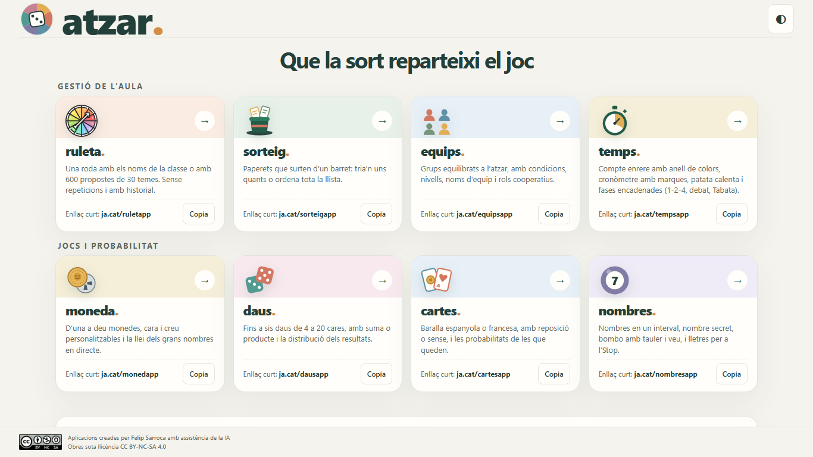

## Per què Atzar a l’aula

- **Llest per a l’aula**: s’obre amb un enllaç curt, es projecta en mode aula a pantalla completa i es controla amb la barra d’espai.
- **Atzar de debò**: el resultat es tria amb el generador criptogràfic del navegador abans de cap animació, i es pot comprovar amb les estadístiques de cada app.
- **Didàctic**: Moneda, Daus i Cartes mostren la probabilitat teòrica al costat de la que surt, i cada app proposa idees concretes per a l’aula.
- **Privat i sense connexió**: no hi ha comptes ni servidors. Les dades es queden al navegador i les apps funcionen sense internet un cop obertes.

## Les vuit apps

| App | Enllaç curt | Què fa | A l’aula |
| --- | --- | --- | --- |
| [Ruleta](Ruleta/) | [ja.cat/ruletapp](https://ja.cat/ruletapp) | Roda de noms o de 600 propostes en 30 temes, amb o sense repeticions | Torns de paraula, dinàmiques de conversa i creativitat |
| [Sorteig](Sorteig/) | [ja.cat/sorteigapp](https://ja.cat/sorteigapp) | Paperets d’un barret: triar-ne uns quants o ordenar tota la llista | Ordre d’exposicions, càrrecs, temes de treball |
| [Equips](Equips/) | [ja.cat/equipsapp](https://ja.cat/equipsapp) | Grups equilibrats amb condicions, nivells, edició a mà i rols cooperatius | Equips de base, parelles, trencaclosques |
| [Temps](Temps/) | [ja.cat/tempsapp](https://ja.cat/tempsapp) | Compte enrere, cronòmetre amb marques, patata calenta i fases encadenades | 1-2-4, debats, estacions, educació física |
| [Moneda](Moneda/) | [ja.cat/monedapp](https://ja.cat/monedapp) | D’1 a 10 monedes, ratxes, simulacions i el repte «persones contra l’atzar» | Llei dels grans nombres, fal·làcia del jugador |
| [Daus](Daus/) | [ja.cat/dausapp](https://ja.cat/dausapp) | D’1 a 6 daus de 4 a 20 cares o daus amb paraules, suma o producte | Per què surt tant el 7?, càlcul mental, daus de conversa |
| [Cartes](Cartes/) | [ja.cat/cartesapp](https://ja.cat/cartesapp) | Baralla espanyola (40/48) o francesa (52/54), amb reposició o sense | Probabilitat condicionada, joc del 24 |
| [Nombres](Nombres/) | [ja.cat/nombresapp](https://ja.cat/nombresapp) | Nombres en un interval, nombre secret, bombo amb veu en 12 llengües i lletres | Bingo de càlcul, nombres en diverses llengües, l’Stop |

### Ruleta
Escriu els noms un per línia o carrega un tema de la biblioteca (preguntes de conversa, reptes creatius, repàs…) i fes girar la roda. Amb **Sense repeticions**, qui surt deixa la roda fins que la recuperes. Pots desar les classes i reutilitzar-les a Sorteig i Equips.

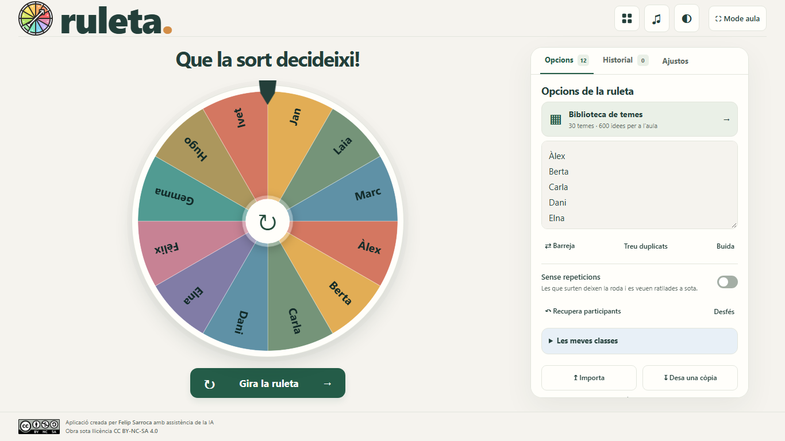

### Sorteig
Els noms surten d’un barret en paperets. Pots treure’n un o diversos alhora, no tornar-los al barret fins que hagin sortit tots, o ordenar tota la llista d’un cop.

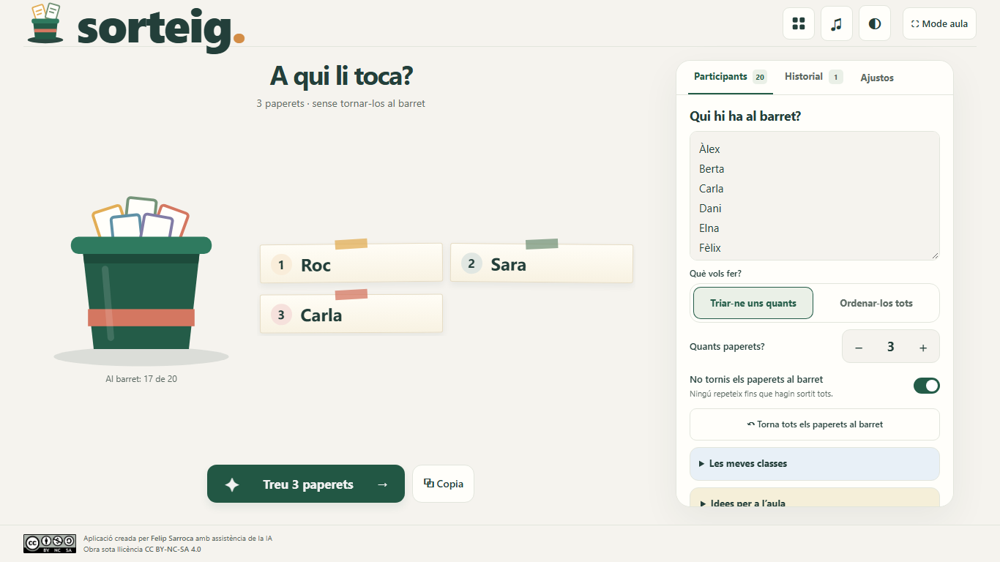

### Equips
Reparteix la classe per nombre d’equips o per persones per equip. Pots indicar qui ha d’anar junt o separat, equilibrar per nivells, assignar rols cooperatius (coordinació, secretaria, portaveu, material) i retocar els equips a mà.

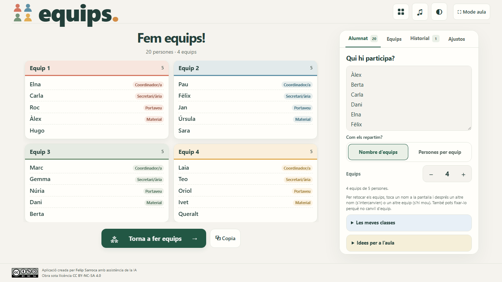

### Temps
Quatre modes: **compte enrere** amb un anell que canvia de color, **cronòmetre** amb marques exportables, **patata calenta** amb una durada secreta i **fases encadenades** (1-2-4, debat, estacions, Tabata, Pomodoro) que sonen i passen soles.

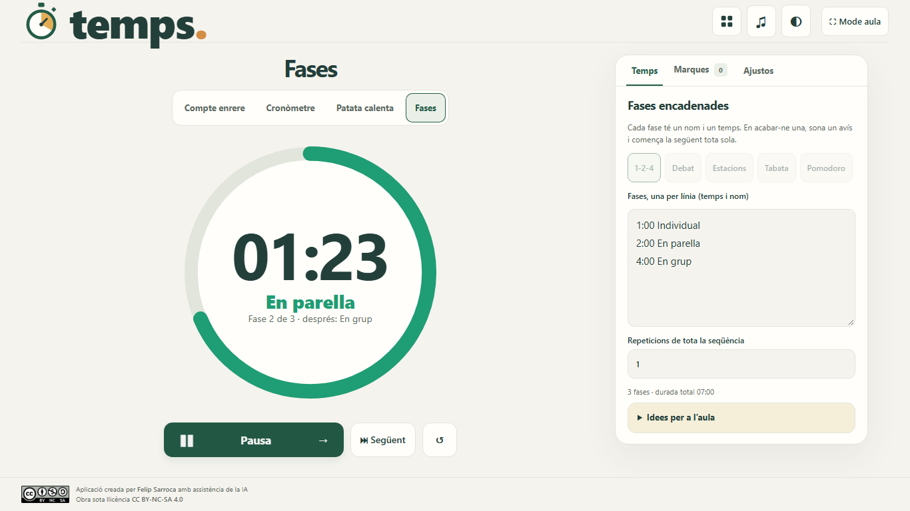

### Moneda
Llança fins a deu monedes o simula’n milers. L’estadística mostra el percentatge de cares, la ratxa més llarga i els canvis. El repte proposa a l’alumnat inventar-se 100 tirades i comparar-les amb les reals.

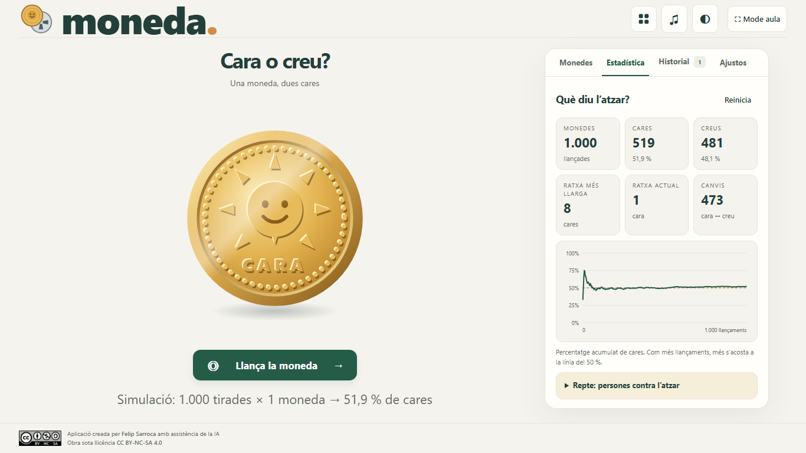

### Daus
Daus en 3D de 6 cares i daus de 4 a 20 cares, amb suma o producte. El gràfic compara el que surt amb la probabilitat teòrica. També hi ha **daus amb paraules** (preguntes, pronoms, temps verbals, emocions).

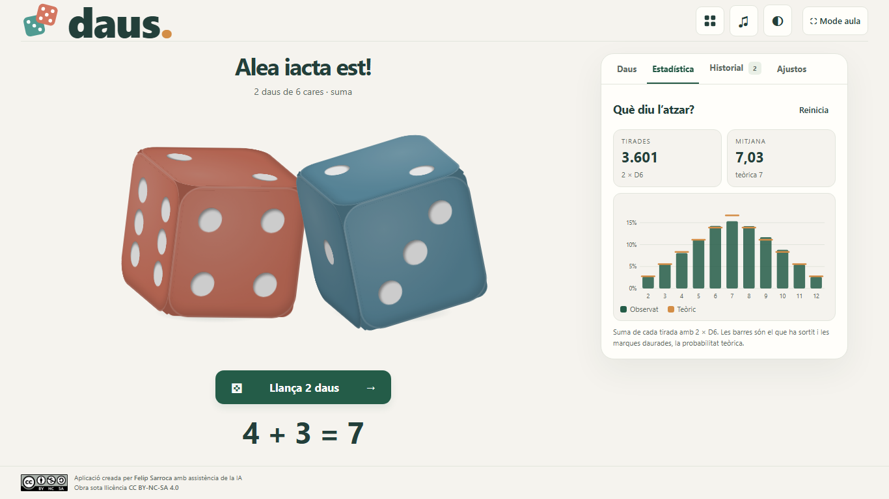

### Cartes
Treu cartes d’una baralla espanyola o francesa, amb reposició o sense. L’app explica com canvia la probabilitat de la carta següent segons el que ja ha sortit.

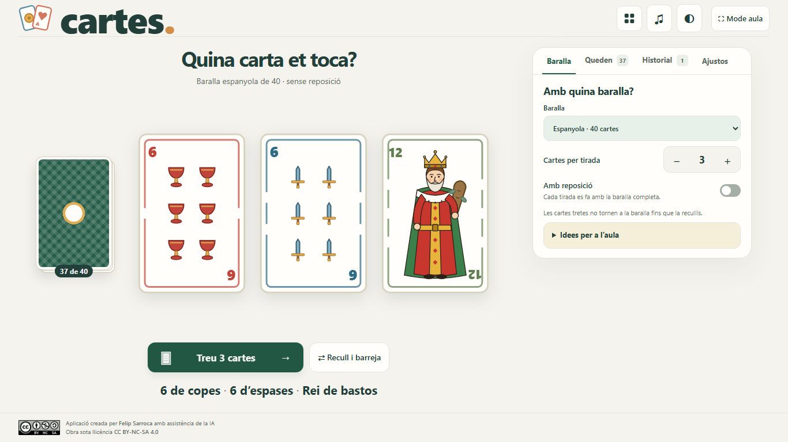

### Nombres
Nombres a l’atzar en un interval, un nombre secret per endevinar, un **bombo** amb tauler i veu en 12 llengües, i **lletres** amb dígrafs i categories per jugar a l’Stop.

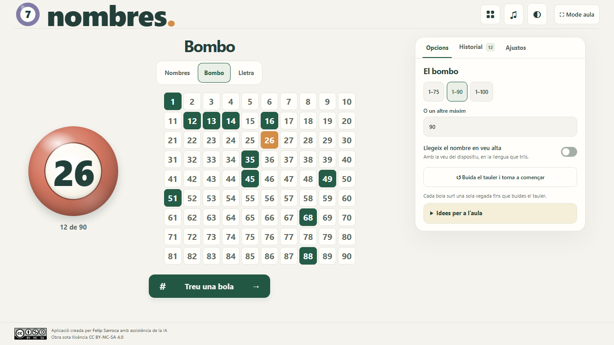

### També en tema fosc i en mòbil

<p>
  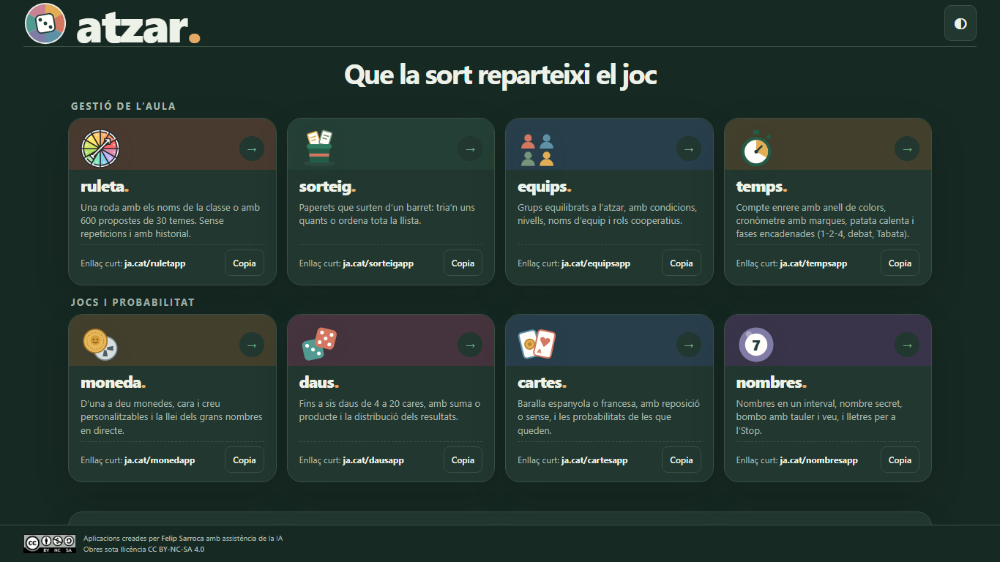
  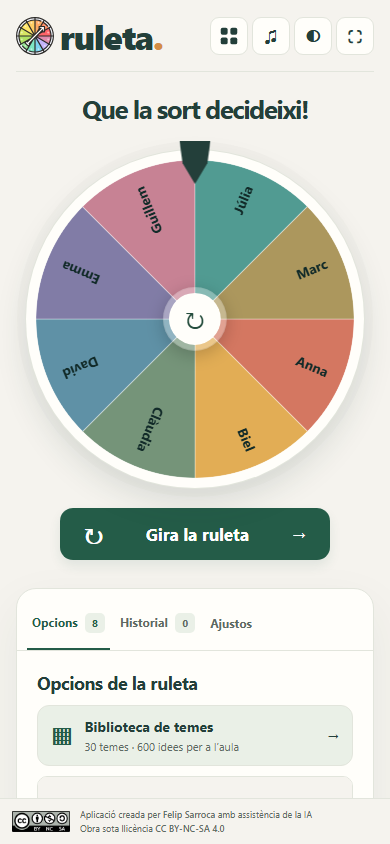
  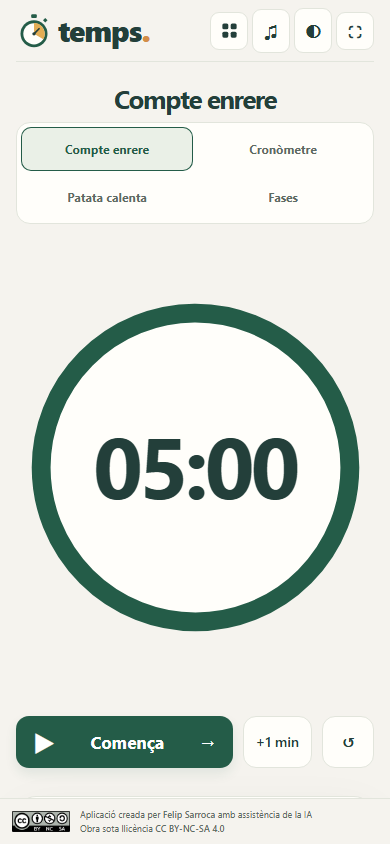
</p>

## Elements comuns

- **Mode aula**: amaga el panell, demana pantalla completa i amplia l’objecte principal.
- **Adaptació a la pantalla**: des de la pissarra digital fins a un portàtil de 1366 × 768 o un mòbil, sense desplaçaments horitzontals.
- **Tema clar o fosc** i **so** compartits entre totes les apps (la Ruleta conserva els seus ajustos propis).
- **Dreceres**: barra d’espai per a l’acció principal i Esc per sortir del mode aula.
- **Historial** exportable en CSV i, quan té sentit, botó per copiar el resultat.
- **Classes compartides**: les classes desades a la Ruleta apareixen també a Sorteig i Equips.
- **Desfés**: esborrar historials, estadístiques, marques o classes es pot desfer des de l’avís que apareix.
- **Idees per a l’aula** a cada app, amb propostes que encaixen de manera natural amb l’eina.

## Com funciona l’atzar

Totes les apps fan servir `crypto.getRandomValues`, el generador criptogràfic del navegador, amb mostreig per rebuig per evitar el biaix del mòdul. **El resultat es tria abans de l’animació**: la durada o la trajectòria no influeixen en el que surt. Les ordenacions completes són permutacions de Fisher-Yates, i les simulacions ràpides de Moneda i Daus fan servir el mateix generador.

Les proves automàtiques comproven amb el test del khi quadrat que les freqüències i les parelles de resultats consecutius són uniformes, i que la cara que es veu del dau o de la moneda coincideix sempre amb el resultat desat.

## Privacitat i ús sense connexió

Les llistes, els ajustos i els historials es desen només al navegador del dispositiu (`localStorage`). No hi ha comptes, anuncis ni peticions a servidors externs. Des del menú (**Les teves dades**) es pot exportar una còpia en JSON i importar-la en un altre ordinador; la importació es pot desfer.

Atzar a l’aula és una aplicació web instal·lable (PWA): un cop oberta, un *service worker* en desa una còpia i funciona sense connexió. Des del menú del navegador es pot instal·lar com una aplicació més. També es pot descarregar tota la carpeta `Atzar` i obrir `index.html`.

## Estructura

```text
Atzar/
├── index.html, style.css, script.js, favicon.svg   # Menú
├── manifest.webmanifest, sw.js, icons/             # Instal·lació i ús sense connexió
├── shared/          # atzar.css i atzar.js: estils, atzar, so, tema, mode aula, gràfics
├── Ruleta/          # App autònoma amb biblioteca de temes i proves pròpies
├── Sorteig/  Equips/  Temps/
├── Moneda/   Daus/    Cartes/  Nombres/
├── docs/captures/   # Captures d’aquest README
└── tests/           # smoke.cjs (totes les apps en 3 mides) i logic.cjs (atzar, condicions, fases…)
```

Són pàgines estàtiques en HTML, CSS i JavaScript, sense dependències ni compilació. L’antiga adreça `util-apps/Ruleta/` redirigeix a `Atzar/Ruleta/`.

## Proves

Cal Node.js i Google Chrome.

```sh
npm ci
npm test                 # prova de fum en 3 mides i proves de lògica i d’atzar
SHOTS=captures npm test  # desa captures de cada app (escriptori, mòbil, 320 px i tema fosc)
```

La Ruleta manté la seva bateria completa a `Ruleta/tests`.

## Autoria i llicència

Aplicacions creades per **[Felip Sarroca](https://ja.cat/felipsarroca)** amb assistència de la IA. Obra sota llicència [CC BY-NC-SA 4.0](https://creativecommons.org/licenses/by-nc-sa/4.0/deed.ca): pots compartir-la i adaptar-la sense finalitat comercial, citant-ne l’autoria i amb la mateixa llicència.
