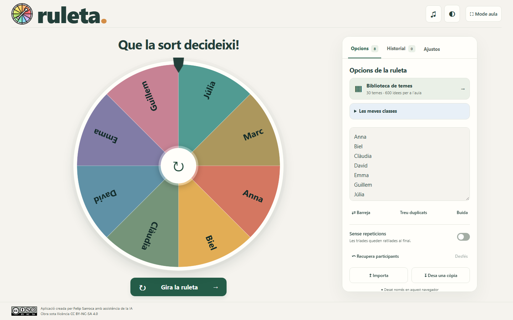
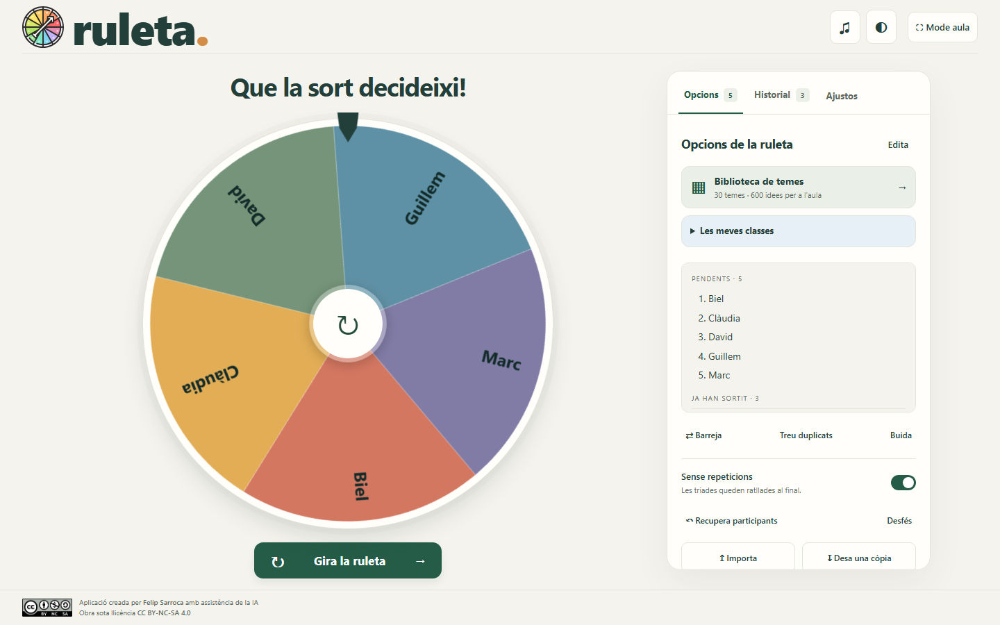
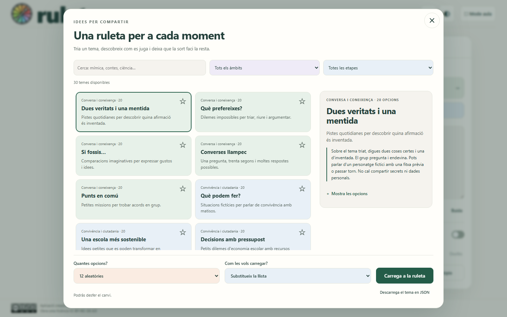
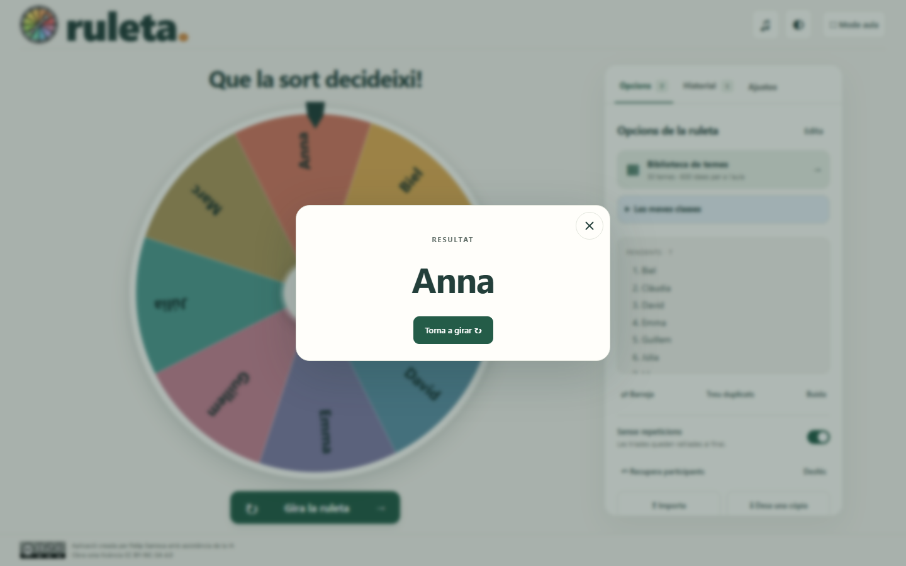
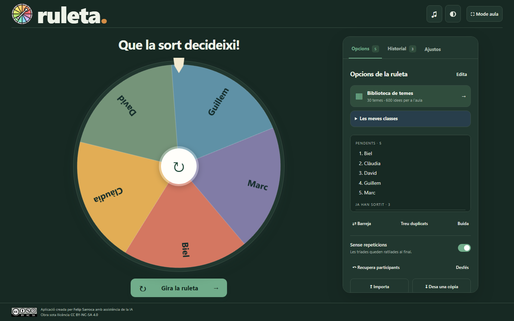

# Ruleta App

**Tria un nom. Encén una conversa. Posa l’aula en moviment.**

Una ruleta en català amb frenada suau, so sincronitzat i una biblioteca de **30 activitats i 600 propostes originals**. Sense anuncis, comptes ni enviament de les llistes a un servidor.

[**Obre Ruleta App →**](https://ja.cat/ruletapp) · [Accés directe](https://felipsarroca.github.io/util-apps/Atzar/Ruleta/) · [Propostes de millora](docs/PROPOSTES.md)

Forma part d’[**Atzar a l’aula**](../README.md) ([ja.cat/atzar](https://ja.cat/atzar)), amb Sorteig, Equips, Temps, Moneda, Daus, Cartes i Nombres. Les classes desades aquí també es poden carregar a Sorteig i Equips.



## Comença en un minut

1. Escriu o enganxa una opció per línia, o obre **Biblioteca** i carrega una activitat.
2. Activa **Evita repeticions** si vols que tothom tingui el seu torn.
3. Prem **Gira la ruleta**, el centre de la roda o la barra d’espai.
4. El resultat es destaca en una finestra. Tanca-la amb la creu o amb Esc per continuar.

Pots personalitzar el títol, canviar la paleta, ajustar el volum i la durada del gir, o activar el mode aula.

## Cada torn compta

Amb **Evita repeticions**, l’opció triada desapareix automàticament de la roda. A la llista es manté **en gris, ratllada i al final**, després de totes les opcions pendents. Aquest estat es conserva en recarregar la pàgina.



- **Recuperar** permet tornar a començar amb la llista completa; **Desfer** recupera l’estat anterior.
- Si hi ha línies exactament iguals, en sortir aquell resultat se’n retiren totes en mode sense repeticions. Per distingir dues persones amb el mateix nom, afegeix una inicial o un altre identificador.
- Amb repeticions permeses, cada línia és una participació: duplicar-la n’augmenta la probabilitat. L’app avisa dels duplicats i permet eliminar-los.
- **Edita** obre l’editor. Modificar-lo estableix una nova llista i reactiva les opcions; afegir una activitat des de la biblioteca conserva les retirades.

## Les teves classes, a un clic

Obre **Les meves classes**, escriu el nom del grup i prem **Desa**. Es guarda la llista completa, incloses les persones que ja han sortit. Clica el nom d’una classe per recuperar tots els participants i començar una nova ronda; **Desfer** permet tornar a l’estat anterior.

Pots desar fins a 50 classes. Desar amb el mateix nom actualitza la llista; la creu elimina la classe desada sense alterar la ruleta actual. Les classes es conserven en aquest navegador i dispositiu. L’exportació JSON continua desant la llista actual, no totes les classes juntes.

## Una biblioteca per a l’aula

30 temes, amb 20 entrades cadascun, repartits en sis àmbits: conversa, expressió, creativitat, llengua, descoberta i convivència. Són propostes pròpies en català, pensades per a primària i ESO, amb indicacions per conduir cada dinàmica.



Marca l’estrella d’una activitat per guardar-la com a **preferida**. Selecciona **★ Preferides** al menú d’àmbits per veure només les marcades; les estrelles es conserven entre sessions en aquest navegador. Cada àmbit té un fons pastel suau, també adaptat al tema fosc.

Cerca activitats, filtra pel nivell i l’àmbit, consulta’n les instruccions i carrega **6, 12 o totes les opcions**. Pots substituir la llista, ampliar-la o descarregar l’activitat en JSON. Les mostres es trien aleatòriament.

La proposta «Dues veritats i una mentida» i altres formats de dinàmica prenen com a referència funcional el [catàleg de Piliapp](https://es.piliapp.com/random/wheel/two-truths-and-a-lie/). Les entrades d’aquesta biblioteca són originals; no se n’han copiat les llistes.

Adapta la dificultat i permet passar torn, respondre per escrit o imaginar una situació fictícia quan calgui. La ruleta ajuda a distribuir torns; el docent continua decidint com acompanyar la participació.

## Una experiència clara i agradable

| Funció | Què aporta |
| --- | --- |
| Frenada progressiva | Un final suau i amb suspens, amb durades nominals de 3, 6 o 10 segons. |
| Variació discreta | La durada varia ±2 % i la corba canvia lleugerament entre tirades. |
| Resultat protagonista | Nom destacat, accions essencials i tancament fàcil. |
| So sincronitzat | Clics en passar pels sectors i acord final, amb volum i silenci. |
| Mode aula | Amaga el panell i sol·licita pantalla completa. |
| Tema clar o fosc | Tres paletes i una visualització adaptable a l’espai disponible. |
| Historial | Fins a 200 resultats desats localment i exportables en CSV. |
| Importació i còpies | Llistes TXT i JSON; exportació en JSON per conservar-les o traslladar-les. |





## Pantalles, teclat i ús tàctil

La roda es dimensiona segons **l’amplada i l’alçada útils** de la finestra. Es recalcula en redimensionar-la; en mòbils i finestres petites es permet desplaçar verticalment. El zoom del navegador es respecta.

Els controls principals tenen una alçada mínima de 44 píxels. Hi ha focus visible, diàlegs modals, dreceres de teclat i una creu SVG centrada. Si el sistema demana moviment reduït, s’ometen el gir llarg i el confeti. L’àudio s’activa després d’una interacció de l’usuari, d’acord amb el comportament dels navegadors.

Els textos dels sectors aprofiten fins a dues línies equilibrades. La mida de la lletra s’ajusta moderadament i es deixen marges respecte de les vores i del botó central; només es mostren punts suspensius quan el text complet no hi cap. El text original es conserva sencer a la llista i al resultat. Amb més de 48 opcions es mostren referències numèriques espaiades per evitar encavalcaments.

## Com funciona l’atzar

La selecció utilitza `crypto.getRandomValues` amb mostreig per rebuig per evitar el biaix del mòdul. **Primer es tria una línia equiprobable; després s’anima la roda fins al seu sector.** La velocitat i el nombre de voltes no determinen el guanyador. Amb repeticions permeses, tornar a obtenir el mateix resultat és possible i legítim.

El canvas es dibuixa segons la densitat de píxels del dispositiu. L’animació utilitza `requestAnimationFrame` i transformacions CSS; el so se sintetitza amb Web Audio, sense descarregar àudios externs.

## Privacitat i ús sense connexió

Les llistes, els ajustos i l’historial es desen al navegador del dispositiu. Esborrar les dades del navegador els elimina. En ordinadors compartits, evita deixar-hi dades personals innecessàries i exporta una còpia quan la necessitis.

Per utilitzar-la sense connexió, descarrega **tota la carpeta `Ruleta`** (o tota la carpeta `Atzar`, si vols totes les apps) i obre `index.html`. Conserva els fitxers i les carpetes `assets` i `data`. La biblioteca s’inclou en un fitxer JavaScript local i no necessita peticions a un servidor. El desament sota `file://` pot variar segons el navegador i la ubicació del fitxer.

No cal instal·lar Node.js per fer servir l’app.

## Desenvolupament i verificació

```text
Ruleta/
├── index.html, style.css, script.js
├── favicon.svg
├── assets/
├── data/                 # Sis bases JSON i biblioteca generada
├── scripts/build-library.cjs
├── tests/                # Regressió, ús tàctil i biblioteca
└── docs/                 # Captures i propostes de millora
```

Per editar la biblioteca, modifica els JSON de `data/` i regenera el paquet. El validador comprova identificadors, nivells, longituds i duplicats:

```sh
npm ci
npm run library:build
npm test
```

Les proves requereixen Node.js i Chrome. Per provar Edge en PowerShell:

```powershell
$env:BROWSER_CHANNEL = 'msedge'
npm test
```

La suite cobreix correspondència entre agulla i resultat, bloqueig durant el gir, duplicats, retirada automàtica, ordre de la llista, persistència, desfer, límits de 200 opcions i 80 caràcters, text HTML, importació/exportació, biblioteca, tema fosc i emulació tàctil. S’han revisat escriptori, portàtil de 1366 × 768, 1080 × 1240, finestres equivalents a escalats de 125 % i 150 %, i mòbils de 390 i 320 píxels.

Les proves amb finestres i entrada tàctil emulada no substitueixen una comprovació al panell tàctil físic concret ni a Safari/iOS. No es declara una certificació completa d’accessibilitat.

## Autoria i llicència

Aplicació creada per **Felip Sarroca** amb assistència de la IA. [CC BY-NC-SA 4.0](https://creativecommons.org/licenses/by-nc-sa/4.0/deed.ca).

Es conserven els fitxers originals `InstruccionsInicials.txt`, `ruleta.mp3`, `ruleta.svg` i `CC_BY-NC-SA.svg`; la nova versió no depèn de l’àudio antic.
