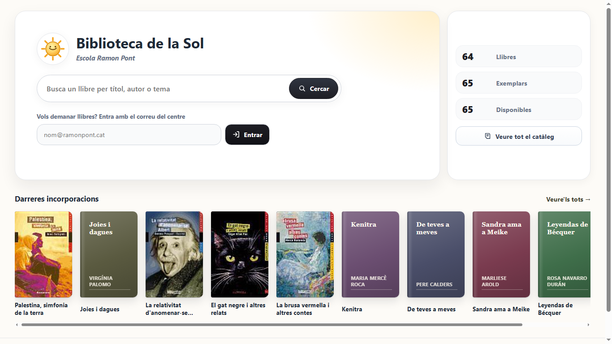
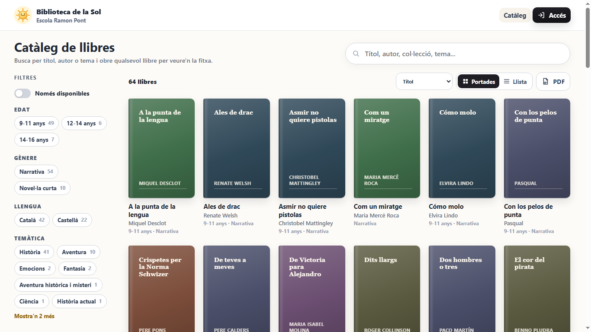
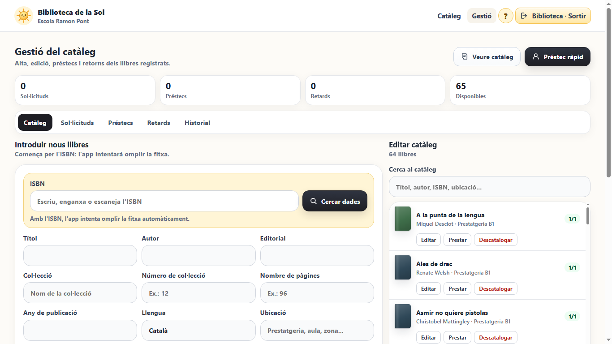
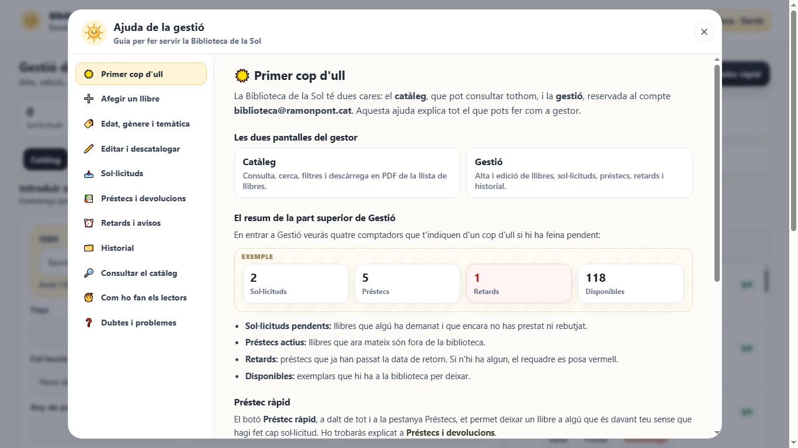

# Biblioteca de la Sol

Aplicació web per gestionar i consultar el catàleg de la biblioteca escolar de l'**Escola Ramon Pont** (Terrassa). L'alumnat i el professorat hi busquen llibres i en demanen el préstec. La persona responsable de la biblioteca dona d'alta els llibres (amb l'ajuda de l'ISBN), gestiona les sol·licituds, els préstecs, les devolucions i els retards.

**Enllaç de l'app:** [felipsarroca.github.io/util-apps/BibliotecaSol](https://felipsarroca.github.io/util-apps/BibliotecaSol/)

| Portada | Catàleg |
|---|---|
|  |  |

| Gestió: alta d'un llibre per ISBN | Ajuda integrada per al gestor |
|---|---|
|  |  |

---

## Índex

1. [Què fa l'app](#què-fa-lapp)
2. [Funcionalitats en detall](#funcionalitats-en-detall)
3. [Arquitectura](#arquitectura)
4. [Estructura de fitxers](#estructura-de-fitxers)
5. [Base de dades](#base-de-dades)
6. [Funcions del servidor i secrets](#funcions-del-servidor-i-secrets)
7. [Manteniment habitual](#manteniment-habitual)
8. [Seguretat i privacitat](#seguretat-i-privacitat)
9. [Historial de canvis](#historial-de-canvis)
10. [Duplicar l'app per a una altra escola](#duplicar-lapp-per-a-una-altra-escola)
11. [Autoria i llicència](#autoria-i-llicència)

---

## Què fa l'app

L'app té tres maneres d'accedir-hi:

| Perfil | Com hi entra | Què pot fer |
|---|---|---|
| **Visitant** | Enllaç *Consultar el catàleg sense entrar* de la portada | Consultar el catàleg, cercar, filtrar i descarregar la llista en PDF. No pot demanar llibres. |
| **Lector** (alumnat i professorat) | Escriu el seu correu `@ramonpont.cat` a la portada. No cal contrasenya. | Tot el que fa el visitant i, a més, triar llibres i enviar-ne la sol·licitud de préstec. |
| **Gestor** (biblioteca) | Correu `biblioteca@ramonpont.cat` i contrasenya | Pantalla de **Gestió**: alta, edició i baixa de llibres, sol·licituds, préstecs, retards, historial i ajuda integrada. |

## Funcionalitats en detall

### Catàleg (tots els perfils)

- **Cerca** simultània en el títol, l'autor, l'editorial, l'ISBN, la col·lecció, l'edat, la temàtica, el gènere, la ubicació i el resum.
- **Filtres combinables** per edat, temàtica, gènere i disponibilitat.
- **Ordenació** per nom, autor, edat (de petites a grans), temàtica, gènere, disponibilitat o any, en ordre ascendent o descendent.
- **Descàrrega en PDF** de la llista que es veu en pantalla, amb els filtres aplicats.
- Cada fila mostra el títol, l'editorial, l'ISBN, la col·lecció i el número, les pàgines, l'autor, l'edat, la temàtica, el gènere, la disponibilitat (*disponibles/totals*), la ubicació i l'any.

### Sol·licituds de préstec (lectors)

1. El lector entra amb el correu del centre.
2. Al catàleg, cada llibre té el botó **Triar**. En pot triar diversos.
3. Al requadre *Sol·licitud de llibres* prem **Enviar sol·licitud**.
4. La sol·licitud apareix a la pestanya *Sol·licituds* del gestor i la biblioteca en rep un avís per correu (si el correu està configurat).

### Gestió (gestor)

- **Resum superior** amb quatre comptadors: sol·licituds pendents, préstecs actius, retards i exemplars disponibles.
- **Alta de llibres per ISBN.** En escriure, enganxar o escanejar l'ISBN (també amb lector de codis de barres USB):
  - es valida la xifra de control (ISBN-10 i ISBN-13);
  - s'avisa si el llibre ja és al catàleg i s'ofereix obrir-ne la fitxa;
  - es consulten alhora **Open Library** i **Google Books** i s'omplen només els camps buits (títol, autor, editorial, col·lecció, número, pàgines, any, resum i llengua), que s'il·luminen un moment;
  - si no es troba, es pot omplir la fitxa a mà.
- **Camps de la fitxa:** títol, autor, editorial, ISBN, col·lecció, número de col·lecció, nombre de pàgines, any, llengua, edat, gènere, temàtica, ubicació, exemplars totals i disponibles, i resum.
- **Edat, gènere i temàtica amb botons.** Un clic tria i un altre desfà. El botó *+ Altre* hi afegeix un valor nou, que es desa a la base de dades i queda disponible per a tothom.
- **Edició i baixa.** Llista cercable de tots els llibres amb els botons *Editar* i *Descatalogar*. Descatalogar amaga el llibre del catàleg sense esborrar-lo.
- **Sol·licituds**, ordenades per ubicació per recollir els llibres d'una sola passada: *Fer préstec* (15 dies), *Rebutjar* i *Contactar* (correu).
- **Préstecs**, ordenats per data de retorn: *Registrar devolució*, *Renovar 15 dies* i *Contactar*.
- **Retards**: préstecs vençuts, ordenats pels dies de retard.
- **Historial**: les últimes 80 devolucions.
- **Ajuda integrada.** El botó **?** de la capçalera, visible només per al gestor, obre una guia il·lustrada amb onze apartats. S'obre directament a l'apartat de la pestanya activa.

### Avisos automàtics per correu

Cada dia a les 06.30 UTC (7.30 a l'hivern i 8.30 a l'estiu) una tasca programada revisa els préstecs i envia:

- a qui té el llibre, un recordatori quan falten dos dies o menys, un altre el dia del termini i un altre quan ha vençut;
- a la biblioteca, un resum dels retards.

A més, la biblioteca rep un avís cada vegada que es crea una sol·licitud. Cada avís queda registrat a la taula `email_notifications` i no es repeteix.

> **Estat actual:** l'enviament de correus no està operatiu perquè el servei de correu no està configurat del tot (vegeu [Pendents](#pendents)).

## Arquitectura

```text
┌──────────────────────────────┐        ┌─────────────────────────────────────────┐
│ Navegador (GitHub Pages)     │        │ Supabase (projecte BibliotecaSol)       │
│ HTML + CSS + JavaScript pur  │──REST──▶ PostgreSQL + Row Level Security         │
│ sense compilació             │        │ Funcions SQL (reserves, préstecs...)    │
│                              │──Auth──▶ Supabase Auth (compte del gestor)       │
│                              │──────────▶ Edge Functions (Deno)                 │
└──────────────┬───────────────┘        │   · isbn-lookup ──▶ Google Books API    │
               │                        │   · notify-reservation ──▶ correu       │
               ▼                        │   · daily-loan-reminders ──▶ correu     │
        Open Library API                │ pg_cron: tasca diària dels avisos       │
        (directament)                   └─────────────────────────────────────────┘
```

- **Frontend:** HTML, CSS i JavaScript sense frameworks ni compilació. Es publica a GitHub Pages amb el flux de treball del repositori `util-apps` cada vegada que es fa `push` a `main`.
- **Backend:** Supabase (projecte `jqabmywmbvvlacpzujup`, regió `eu-west-1`), associat al compte felip.sarroca@gmail.com.
- **Dades al navegador:** l'app guarda una còpia del catàleg a `localStorage` per si Supabase no respon, i la sessió a `sessionStorage`.
- **Google Cloud:** projecte `biblioteca-sol-ramonpont`, amb una clau limitada a l'API de Google Books.

## Estructura de fitxers

| Fitxer o carpeta | Funció |
|---|---|
| `index.html` | Portada: accés amb el correu del centre, enllaç al catàleg públic i comptadors. |
| `cataleg.html` | Catàleg amb cerca, filtres, ordenació, PDF i selecció de llibres. |
| `editor.html` | Gestió: formulari d'alta, llista d'edició i pestanyes de circulació. |
| `login.html` | Pàgina d'accés alternativa (lector i gestor). |
| `css/styles.css` | Tots els estils, inclosos els de la finestra d'ajuda. |
| `js/config.js` | Domini permès, URL i clau pública (anon) de Supabase i versió. |
| `js/supabaseClient.js` | Totes les crides a Supabase (REST, RPC, Auth i Edge Functions) i la conversió entre els noms de la base de dades i els de l'app. |
| `js/shared.js` | Dades compartides, sessió, accés, opcions (ordenació de les edats), targetes de llibre i botó d'ajuda. |
| `js/cataleg.js` | Lògica del catàleg i de la portada. |
| `js/editor.js` | Lògica de la gestió: formulari, cerca per ISBN, botons de classificació i circulació. |
| `js/ajuda.js` | Contingut i funcionament de la finestra d'ajuda (es carrega només quan s'obre). |
| `js/auth.js` | Formularis de `login.html`. |
| `assets/logo-sol.svg` | Logotip i icona del navegador. |
| `captures/` | Captures d'aquest README. |
| `supabase/schema.sql` | Esquema complet: taules, índexs, vista, funcions, RLS i opcions inicials. |
| `supabase/2026-11-10_*.sql` | Migracions aplicades després de l'esquema inicial. |
| `supabase/scheduled_reminders.sql` | Programació de la tasca diària amb `pg_cron`. |
| `supabase/email_notifications_patch.sql` | Ajust de la taula d'avisos. |
| `supabase/functions/` | Edge Functions: `isbn-lookup`, `notify-reservation`, `daily-loan-reminders` i el mòdul comú `_shared/mailer.ts`. |
| `supabase/README.md` | Notes tècniques de Supabase (correu, cron i Google Books). |
| `Instruccions.md` / `Instruccions.pdf` | Document de requisits original amb què es va encarregar l'app. |
| `LICENSE.txt` | Llicència AGPLv3 del codi. |

## Base de dades

### Taules

| Taula | Contingut | Camps principals |
|---|---|---|
| `books` | Catàleg | `title`, `author`, `publisher`, `isbn`, `collection`, `collection_number`, `page_count`, `publication_year`, `language`, `recommended_level`, `topic`, `genre`, `summary`, `location`, `total_copies`, `available_copies`, `active` |
| `book_options` | Valors dels botons i suggeriments | `field_name` (`recommended_level`, `topic`, `genre`, `location`), `value` |
| `app_users` | Persones que han entrat a l'app | `email`, `display_name`, `role` (`lector` o `gestor`), `access_count`, `last_seen_at` |
| `access_logs` | Registre d'accessos | `email`, `role`, `accessed_at`, `user_agent` |
| `reservations` | Sol·licituds | `book_id`, `user_email`, `status` (`pendent`, `acceptada`, `rebutjada`, `convertida`), `requested_at` |
| `loans` | Préstecs | `book_id`, `user_email`, `status` (`actiu`, `retornat`), `loaned_at`, `due_at`, `returned_at` |
| `returns` | Devolucions | `loan_id`, `book_id`, `user_email`, `returned_at`, `condition_notes` |
| `email_notifications` | Avisos enviats, omesos o fallits | `notification_type`, `recipient_email`, `status`, `error_message` |

La vista `catalog_books` mostra els llibres actius.

### Funcions SQL (RPC)

| Funció | Qui la fa servir | Què fa |
|---|---|---|
| `register_access(user_email, user_agent_text)` | Tothom en entrar | Valida el domini, crea o actualitza l'usuari i registra l'accés. |
| `reserve_book(target_book_id, input_user_email, note)` | Lectors | Crea una sol·licitud i evita duplicar-ne una d'activa per al mateix llibre. |
| `register_loan(...)` | Gestor | Crea el préstec, descompta un exemplar disponible i tanca la sol·licitud. |
| `register_return(...)` | Gestor | Tanca el préstec, registra la devolució i suma un exemplar disponible. |

### Regles d'accés (RLS)

Totes les taules tenen la Row Level Security activada. El catàleg actiu i les opcions són de lectura pública. Les operacions d'escriptura de llibres, opcions, préstecs, devolucions i sol·licituds només s'accepten si el testimoni de Supabase Auth correspon al correu del gestor.

## Funcions del servidor i secrets

| Edge Function | Quan s'executa | Secrets que fa servir |
|---|---|---|
| `isbn-lookup` | Quan el gestor cerca un ISBN | `GOOGLE_BOOKS_API_KEY` |
| `notify-reservation` | Quan es crea una sol·licitud | `GOOGLE_MAIL_WEBHOOK_URL` + `GOOGLE_MAIL_WEBHOOK_TOKEN`, o bé `RESEND_API_KEY` + `RESEND_FROM`; `LIBRARY_EMAIL` |
| `daily-loan-reminders` | Cada dia a les 06.30 UTC (`pg_cron`) | Els mateixos de correu que l'anterior |

Els secrets es guarden a Supabase i no apareixen mai al codi.

## Manteniment habitual

Totes les ordres s'executen des d'aquesta carpeta, que ja està vinculada al projecte de Supabase.

```powershell
# Consultar dades
supabase db query --linked "select count(*) from books where active"

# Aplicar una migració nova (deseu-la abans a supabase/AAAA-MM-DD_descripcio.sql)
supabase db query --linked -f supabase/AAAA-MM-DD_descripcio.sql

# Publicar una Edge Function després de modificar-la
supabase functions deploy isbn-lookup --use-api

# Canviar un secret
supabase secrets set GOOGLE_BOOKS_API_KEY=NOVA_CLAU

# Recuperar un llibre descatalogat
supabase db query --linked "update books set active = true where title = 'Títol exacte'"
```

Per publicar canvis del frontend n'hi ha prou amb fer *commit* i *push* a `main` del repositori `util-apps`. GitHub Pages es reconstrueix en uns minuts.

## Seguretat i privacitat

- La clau `anon` de `js/config.js` és pública per disseny; la seguretat depèn de les regles RLS.
- La clau `service_role` i la de Google Books només són a Supabase, mai al navegador.
- El gestor s'autentica només amb Supabase Auth: el codi no conté cap contrasenya. La sessió es renova automàticament amb el testimoni de renovació.
- Les taules amb dades personals (`app_users`, `access_logs`, `reservations`, `loans`, `returns` i `email_notifications`) només les pot llegir el gestor autenticat. Els lectors creen sol·licituds a través de la funció `reserve_book`.
- La validació del domini `@ramonpont.cat` es fa al navegador i també a la funció `register_access`.
- Les dades personals que es guarden són el correu del centre, els accessos i l'historial de préstecs.

### Pendents

- Configurar l'enviament de correus (Apps Script de Google o domini verificat a Resend).

## Historial de canvis

| Data | Canvis |
|---|---|
| Maig de 2026 | Primera versió: catàleg, accés per correu, gestió, sol·licituds, préstecs, devolucions i avisos. |
| 10/11/2026 (2) | Seguretat: el gestor entra només amb Supabase Auth, fora la contrasenya i el botó de prova del codi, sessió que es renova sola, i lectura de les dades personals restringida al gestor. |
| 10/11/2026 | Col·lecció, número de col·lecció i pàgines a la fitxa. Edat «14-16 anys» (substitueix «15-16») i gènere «Conte». Cerca per ISBN amb Open Library i Google Books. Botons per a edat, gènere i temàtica. Descatalogar i les opcions noves es desen a Supabase. Edats ordenades de petites a grans. Eliminats els 30 llibres de mostra. Ajuda integrada per al gestor. |

---

## Duplicar l'app per a una altra escola

Aquesta secció explica com crear una còpia independent de l'app per a una altra escola, amb la seva pròpia base de dades. Primer hi ha la preparació que ha de fer una persona i després el text que cal donar a un assistent d'IA amb accés al terminal (Claude Code, Codex o similar).

### 1. Què ha de preparar una persona

| Què | On | Per què |
|---|---|---|
| Compte de GitHub i un repositori nou amb GitHub Pages activat | github.com | Per publicar l'app. |
| Compte de Supabase i un projecte nou (regió `eu-west-1` o `eu-central-1`) | supabase.com | Base de dades, autenticació i funcions. El pla gratuït n'hi ha prou. |
| Supabase CLI instal·lada i amb la sessió iniciada (`supabase login`) | Ordinador | Perquè l'IA pugui crear les taules i publicar les funcions. |
| Google Cloud CLI amb la sessió iniciada (`gcloud auth login`) | Ordinador | Per crear la clau de Google Books (opcional, però recomanat). |
| Un compte de correu per a la biblioteca de l'escola | Google Workspace de l'escola | Serà el compte gestor i el remitent dels avisos. |
| Les dades de l'escola | — | Nom de l'escola, nom de la biblioteca, domini de correu, logotip i colors. |

### 2. Text per a l'assistent d'IA

Copieu aquest text, substituïu els valors entre `«»` i doneu-lo a l'assistent des de la carpeta on vulgueu crear el projecte:

````text
Vull crear una app web de biblioteca escolar a partir de «Biblioteca de la Sol»,
el codi de la qual és a https://github.com/felipsarroca/util-apps/tree/main/BibliotecaSol
(llicència AGPLv3: la còpia ha de mantenir la mateixa llicència i citar l'autoria original).

DADES DE LA NOVA ESCOLA
- Nom de l'app: «Biblioteca de ...»
- Escola: «Nom de l'escola» («Població»)
- Domini de correu permès: «@escola.cat»
- Correu del compte gestor: «biblioteca@escola.cat»
- Logotip: «ruta del fitxer SVG o PNG, o "crea'n un de senzill i amable"»
- Colors principals: «per exemple, verd i crema», o manté els de l'original
- Franges d'edat: «3-5, 6-8, 9-11, 12-14, 14-16 anys i Mestres», o les que calguin
- Gèneres inicials: «Àlbum il·lustrat, Còmic, Conte, Divulgació, Narrativa, Novel·la curta, Poesia, Teatre»
- Temàtiques inicials: «Aventura, Ciència, Coneixements, Convivència, Emocions, Fantasia, Història, Misteri, Natura»
- Ubicacions inicials: «Prestatgeria A1, A2, B1...»
- Termini de préstec: «15» dies
- Repositori de GitHub on es publicarà: «usuari/repositori»
- Projecte de Supabase: «referència del projecte», ja creat i amb la CLI amb la sessió iniciada

QUÈ HAS DE FER
1. Descarrega la carpeta BibliotecaSol de l'original i llegeix-ne tot el codi, el README
   i supabase/schema.sql abans de modificar res.
2. Mantén la mateixa tecnologia: HTML, CSS i JavaScript pur, sense frameworks ni
   compilació; Supabase com a backend; GitHub Pages per publicar.
3. Substitueix totes les referències a l'escola original (nom, domini, correu del
   gestor, textos, peu de pàgina, logotip, js/config.js, funcions SQL, polítiques RLS,
   Edge Functions i textos de l'ajuda de js/ajuda.js). Cerca "ramonpont", "Ramon Pont",
   "Sol" i "biblioteca@" per no deixar-te'n cap.
4. Elimina qualsevol dada de mostra: el catàleg ha de començar buit o amb els llibres
   que jo et doni.
5. Base de dades: crea l'esquema al projecte de Supabase a partir de
   supabase/schema.sql més les migracions supabase/2026-11-10_*.sql, adaptant-ne els
   valors. Desa-ho tot com a fitxers .sql dins del repositori nou.
6. SEGURETAT (obligatori; millora respecte de l'original):
   - El compte gestor s'ha d'autenticar NOMÉS amb Supabase Auth. No hi pot haver cap
     contrasenya escrita al codi, ni cap botó de "perfil de prova", ni cap contrasenya
     al README. Crea l'usuari gestor amb una contrasenya llarga i aleatòria, i dona-me-la
     a mi per un canal privat.
   - El rol de gestor s'ha de decidir a la base de dades (per exemple, una taula de
     gestors o el camp role de app_users consultat amb auth.jwt()), no al JavaScript.
   - Les taules app_users, access_logs, reservations, loans, returns i
     email_notifications només les pot llegir el gestor autenticat. Els lectors creen
     sol·licituds a través de la funció reserve_book (security definer) i no han de
     poder llegir les dades d'altres persones.
   - Valida el domini del correu a la base de dades, no només al navegador.
   - Comprova les regles amb la clau anon: un visitant no ha de poder llegir correus
     ni préstecs, ni escriure al catàleg.
7. Cerca per ISBN: publica l'Edge Function isbn-lookup. Si tinc gcloud amb la sessió
   iniciada, crea un projecte de Google Cloud, activa books.googleapis.com, crea una
   clau limitada a aquesta API i desa-la com a secret GOOGLE_BOOKS_API_KEY sense
   mostrar-la per pantalla.
8. Correu: configura els avisos amb un Apps Script del compte de la biblioteca
   (GOOGLE_MAIL_WEBHOOK_URL i GOOGLE_MAIL_WEBHOOK_TOKEN) i programa la tasca diària
   amb supabase/scheduled_reminders.sql. Si no és possible, deixa-ho documentat.
9. Adapta la interfície a la pantalla: ha de funcionar bé a 1920×1080, a un portàtil
   de 1366×768 i al mòbil, sense desplaçament horitzontal.
10. Revisa l'ortografia i la gramàtica catalanes de tota la interfície i de l'ajuda.
11. Prova-ho tot al navegador abans de donar-ho per acabat: entrada de lector,
    sol·licitud, entrada de gestor, alta per ISBN, préstec, renovació, devolució,
    descatalogació, botó d'ajuda i catàleg públic. Esborra les dades de prova.
12. Publica a GitHub Pages, comprova que la versió publicada és la mateixa que la local
    i escriu un README complet amb captures, com el de l'original.
13. Al final, dona'm: l'enllaç de l'app, com entrar com a gestor i la llista del que
    hagi quedat pendent.
````

### 3. Comprovacions finals

- [ ] Amb un correu d'un altre domini no es pot entrar.
- [ ] Un lector pot demanar un llibre i el gestor el veu a *Sol·licituds*.
- [ ] El catàleg públic no mostra cap correu.
- [ ] Amb la clau `anon`, `/rest/v1/loans` i `/rest/v1/app_users` no retornen dades.
- [ ] La cerca per ISBN omple la fitxa d'un llibre conegut.
- [ ] El botó **?** només apareix per al gestor.
- [ ] El codi no conté cap contrasenya ni cap clau secreta.

---

## Autoria i llicència

- Autoria: [Felip Sarroca](https://ja.cat/felipsarroca), amb l'assistència de la IA.
- Codi: [AGPLv3](LICENSE.txt). Continguts: [CC BY-NC-SA 4.0](https://creativecommons.org/licenses/by-nc-sa/4.0/deed.ca).
- Dades bibliogràfiques: [Open Library](https://openlibrary.org/) i [Google Books](https://books.google.com/).
- Suggeriments i errors: [formulari d'incidències](https://github.com/felipsarroca/util-apps/issues/new?template=biblioteca-sol.yml).
