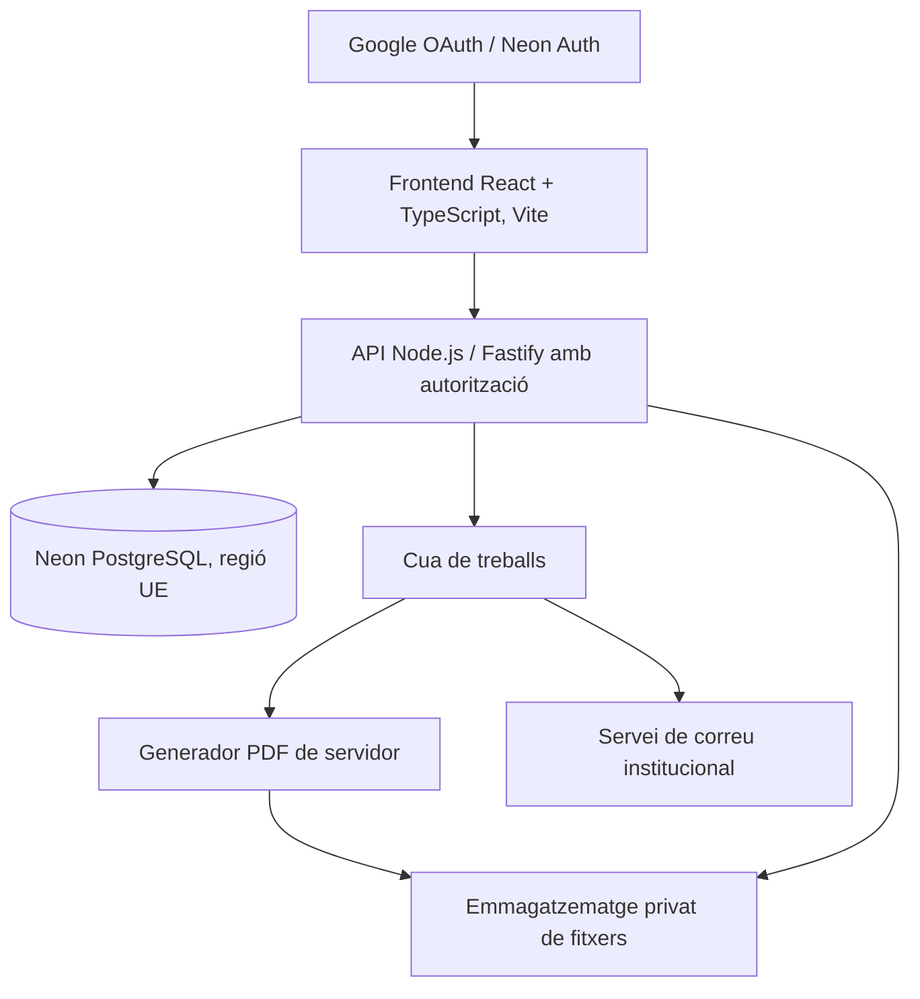

# La teva veu — Especificació funcional, identitat i criteris de desenvolupament

**Versió:** 2.0 · 31 d'octubre de 2026  
**Projecte:** Escola Ramon Pont  
**Destinatari:** equip de desenvolupament / programador  
**Estat:** document de planificació, no equival a una aplicació desenvolupada ni desplegada  
**Abast:** dues eines germanes orientades a l'alumnat: autoavaluació personal i valoració de l'experiència docent.

> **Resum executiu.** «La teva veu» és el nom de la plataforma. Conté dos espais: **«Em miro»** (l'alumne reflexiona sobre el seu procés d'aprenentatge) i **«Et veig»** (l'alumne expressa com viu la docència). Els informes resultants s'anomenen, respectivament, **«Així em veig»** (individual) i **«Així et veiem»** (agregat per docent). Els noms d'aquesta frase estan **acordats**; la implementació tecnològica i alguns detalls funcionals encara s'han de concretar.

## 0. Decisions acordades: nomenclatura i arquitectura de producte

### 0.1 Nom principal i lema

- **Nom del producte / plataforma:** `La teva veu`.
- **Lema de referència, proposat però no formalment aprovat:** «La teva mirada ens ajuda a millorar».
- **To de comunicació:** proper, clar, respectuós i constructiu. Evitar presentar les eines com a mecanismes de vigilància, sanció o qualificació del professorat.
- **Idioma base:** català normatiu. Títols i subtítols en majúscula inicial només a la primera paraula, tret dels noms propis.

### 0.2 Dos espais i dos informes

| Element | Nom definitiu | Usuari que hi actua | Finalitat | Resultat |
|---|---|---|---|---|
| Plataforma mare | **La teva veu** | Alumnat, professorat i administració | Donar espai a la mirada de l'alumnat i transformar-la en informació útil | Dos mòduls coherents |
| Mòdul d'autoavaluació | **Em miro** | Cada alumne | Valorar el propi esforç, hàbits, comprensió, resultats previstos i objectius de millora | Informe **Així em veig** |
| Mòdul de valoració de la docència | **Et veig** | Cada alumne, respecte del professorat que li correspon | Explicar com percep les classes i què ajuda o dificulta aprendre | Informe **Així et veiem** per al docent, amb informació agregada |
| Document del mòdul «Em miro» | **Així em veig** | Document d'un alumne concret | Sintetitzar la seva reflexió personal en un període determinat | PDF **individual i identificat**, amb lliurament familiar segons autorització |
| Document del mòdul «Et veig» | **Així et veiem** | Informe destinat a un docent | Recollir la perspectiva conjunta dels alumnes sobre les classes | PDF **agregat**, sense divulgar identitats ni respostes individuals |

**Lògica expressiva deliberada:**

1. **Em miro**: l'acció és individual i cap a un mateix.
2. **Així em veig**: el document reflecteix la percepció de l'alumne.
3. **Et veig**: cada alumne s'adreça al professorat des de la seva experiència.
4. **Així et veiem**: els resultats es presenten de forma conjunta; el pas de «jo» a «nosaltres» és intencional.

**Ortografia i puntuació:** emprar exactament `La teva veu`, `Em miro`, `Et veig`, `Així em veig`, `Així et veiem`, **sense punts suspensius** en els noms d'apartats i dels informes.

### 0.3 Proposta de navegació

```text
LA TEVA VEU
├── Em miro
│   ├── La meva autoavaluació
│   ├── Continuar / començar
│   ├── Repàs i lliurament
│   └── Informe «Així em veig» (si la configuració ho permet)
└── Et veig
    ├── La meva mirada al professorat
    ├── Professorat / matèries que em corresponen
    ├── Valoracions
    └── Finalització

ESPAI PROFESSORAT / ADMINISTRACIÓ
├── Em miro: seguiment, informes individuals i famílies
├── Et veig: informes agregats per docent
└── Configuració i administració: perfils, cursos, preguntes i períodes
```

Aquesta és **una proposta d'organització**, no la decisió definitiva de si hi haurà una sola web amb dos mòduls o dues aplicacions amb infraestructura comuna. Per a l'usuari, convé una entrada coherent amb dos apartats ben diferenciats.

### 0.4 Textos de la interfície (proposta)

**Pantalla principal**

- Títol: **La teva veu**.
- Subtítol: «La teva mirada ens ajuda a millorar».
- Targeta 1: **Em miro** — «Penso en com aprenc, què faig bé i què puc millorar».
- Targeta 2: **Et veig** — «Explico com visc les classes i què m'ajuda a aprendre».
- Evitar que l'alumnat confongui el retorn docent amb una avaluació de persones, fent explícit que el propòsit és **millorar l'ensenyament i l'aprenentatge**.

**Capçalera de cada PDF**

```text
LA TEVA VEU · EM MIRO
Així em veig
Autoavaluació personal de [Nom i cognoms]
[Curs i grup] · [Avaluació] · [Curs acadèmic]

LA TEVA VEU · ET VEIG
Així et veiem
La mirada conjunta de l'alumnat sobre les classes de [Docent]
[Cursos/grups inclosos] · [Període] · [Curs acadèmic]
```

La tipografia, els colors, les icones i el logotip **no són decisions tancades**. Recomanació visual: fer els dos mòduls recognoscibles amb una família gràfica compartida i dos colors/accentos, sense dependre només del color per distingir-los. Contrast i accessibilitat són obligatoris.

### 0.5 Convencions tècniques de noms (proposta, no obligatòria)

Evitar accents, apòstrofs i espais en identificadors tècnics; conservar els noms catalans amb accents a la UI:

| Concepte | Nom visible | Identificador suggerit | Ruta suggerida |
|---|---|---|---|
| Plataforma | La teva veu | `la_teva_veu` | `/` |
| Autoavaluació | Em miro | `em_miro` | `/em-miro` |
| Valoració del professorat | Et veig | `et_veig` | `/et-veig` |
| Informe individual | Així em veig | `aixi_em_veig` | `report_type=student_self` |
| Informe conjunt | Així et veiem | `aixi_et_veiem` | `report_type=teacher_feedback` |

Exemples de fitxers: `Aixi_em_veig_2026-2027_1a_avaluacio_<id>.pdf` i `Aixi_et_veiem_2026-2027_1a_avaluacio_<id_docent>.pdf`. Els noms dels fitxers no han d'incloure dades personals innecessàries quan es distribueixin.

### 0.6 Regles d'identitat visual i de producte

- Mateixa capçalera i llenguatge visual per als dos mòduls.
- Diferenciar inequívocament els **informes individuals** i els **agregats** (també en el títol, les metadades i els permisos d'accés).
- A «Et veig», **l'inici de sessió individual no implica que el docent pugui identificar qui ha respost què**. La política exacta de privacitat de les respostes s'ha d'aprovar abans del desplegament.
- Les marques anteriors com «M'avaluo», «VeuAlumnat» o «La veu de l'alumnat» poden conservar-se com a noms de projectes/fitxers llegats, però **no són els títols públics aprovats per a la nova experiència**.
- Els noms rebutjats en les rondes de brainstorming **no s'han d'utilitzar** com a títols de pantalles ni com a etiquetes definitives.

---

# Part I. Em miro — Especificació funcional i tècnica de l'autoavaluació

Aquesta part incorpora la planificació funcional **ja treballada** per a l'app d'autoavaluació, i s'ha de llegir conjuntament amb les decisions de nom de l'apartat 0. Quan en el text històric apareix «Veu de l'alumnat» com a nom de treball, cal entendre la marca actual **«La teva veu»** i el mòdul **«Em miro»**. El PDF d'autoavaluació es titularà **«Així em veig»**.

## 1. Finalitat i principis

Plataforma escolar que permet identificar l’alumnat amb Google, recollir autoavaluacions adaptades a l’edat i a cada període, gestionar-les amb permisos, generar PDFs individuals ben maquetats i preparar-ne la impressió i el lliurament familiar.

**Principis:** (1) el menor nombre de clics possible; (2) lectura accessible segons l’edat; (3) dades privades i segregades; (4) configuració sense programar; (5) qüestionaris versionats; (6) reproducció fidel dels informes històrics; (7) enviaments amb validació prèvia i traçabilitat; (8) manteniment sostenible al llarg dels anys.

**Criteris d’èxit:** un alumne validat pot identificar-se, contestar només el qüestionari i les matèries que li corresponen, interrompre la sessió i reprendre-la; un administrador pot canviar preguntes i matèries sense tocar codi; cap canvi posterior no altera una recollida publicada; cada informe PDF reflecteix les respostes exactes; els enviaments no es dupliquen; l’escola pot auditar cada operació.

## 2. Què es reaprofita de l’aplicació existent

**Repositori verificat:** `felipsarroca/util-apps/VeuAlumnat` a https://github.com/felipsarroca/util-apps/tree/main/VeuAlumnat. És una aplicació Google Apps Script orientada sobretot al professorat i les autoavaluacions d’ESO mitjançant Google Forms.

**Fitxers analitzats:** `GUIA.md`, `apps-script/Core.gs`, `Forms.gs`, `Data.gs`, `Reports.gs`, `Pdf.gs`, `Mail.gs` i `App.gs`. Existeixen proves locals en `tests/local.test.mjs`.

**Capacitats que ja existeixen i que han de servir de referència o ser adaptades:**
- Cens per curs importat des de Google Sheets, amb identificador d’alumne, nom i correu escolar; control de duplicats i de registres incomplets.
- Directori familiar importat de CSV; detecció de capçaleres, associació al cens i revisió manual de noms ambigus.
- Permisos per correu institucional i curs; tutors amb accés per curs i rols de coordinació.
- Cicle de recollida `preparar → obrir → tancar → revisar → generar → aprovar i enviar`.
- Lectura dinàmica de les seccions i preguntes de Google Forms per construir l’informe; omissió de preguntes sense resposta.
- PDF A4 propi, paginat, amb divisió de blocs llargs, colors imprimibles i acusament de lectura.
- Preparació d’un PDF únic per imprimir tots els informes o només els dels alumnes sense correu familiar, amb inici de cada informe en cara nova.
- Previsualització, enviament de prova, lots, comprovació de quota i registre d’estats d’enviament.

**Límits de la versió existent:** les preguntes i matèries reals depenen dels Google Forms vinculats i no es poden inferir íntegrament dels fitxers del repositori; el catàleg de cursos del codi és `1r.ESO` a `4t.ESO`; els usuaris alumnes no emplenen un formulari web propi de l’aplicació; la persistència es fa principalment amb Google Sheets, Forms i Drive, no amb Neon. La nova aplicació conserva els fluxos i pot portar-ne els algoritmes, però no pot reutilitzar sense adaptació les crides de Google Apps Script en un backend Node. Cal comparar el PDF antic i el nou amb casos de regressió.

## 3. Cursos, usuaris i permisos

### 3.1 Organització

Cursos independents: `3r EP`, `4t EP`, `5è EP`, `6è EP`, `1r ESO`, `2n ESO`, `3r ESO`, `4t ESO`; cada curs pertany a una etapa/cicle. Grups opcionals (`A`, `B`...), configurables. L’**any acadèmic** i la **matrícula** de l’alumne en el curs/grup són entitats separades de la identitat. El pas de curs crea una nova matrícula; les dades de cursos anteriors es conserven d’acord amb la política de retenció del centre.

### 3.2 Rols

- **Administrador:** gestió completa; configuració global; accés auditat; dades sensibles només quan la funció ho justifica.
- **Professor:** només grups i alumnes assignats; consulta del progrés, revisió, visualització i exportació individual o de grup segons els permisos rebuts.
- **Alumne:** només matrícula pròpia, qüestionaris oberts, esborranys i enviaments propis; cap cens general.
- **Permisos futurs opcionals:** coordinació pedagògica, tutoria, revisor d’informes, operador d’enviaments, sense necessitat de crear més rols bàsics d’entrada.

**Alta i identificació:** Google OAuth/OIDC amb identificador estable `sub`, no només el correu, que pot canviar. Es recomana limitar el domini institucional, però el domini no atorga automàticament accés a dades: cada compte s’ha d’enllaçar a un registre de matrícula validat. Un correu institucional no reconegut queda pendent de verificació, sense accés a altres alumnes. Els administradors inicials es provisionen de forma segura al servidor, i els posteriors s’atorguen per una acció d’administració auditada. Permisos contrastats a cada endpoint del backend; mai únicament amb condicions visuals del frontend.

**Pantalla inicial alumne:** el nom i el curs es mostren automàticament. En el primer accés o en cas de discrepància: confirmació i petició de correcció a l’administrador, no assignació lliure d’un altre curs. Tancament de sessió visible per a dispositius compartits.

## 4. Matèries configurables

### 4.1 Base de primària

D’acord amb el Decret 175/2022 (i tenint presents les modificacions posteriors), la base d’àrees és: Llengua Catalana i Literatura; Llengua Castellana i Literatura; Llengua Estrangera; Matemàtiques; Coneixement del Medi Natural, Social i Cultural; Educació Artística; Educació Física. Religió és ofertada i s’inclou només per als alumnes que la cursin. Educació en Valors Cívics i Ètics s’incorpora en algun dels cursos de 5è/6è i pot aparèixer en altres cursos segons el centre. A l’Aran, aranès segons el currículum aplicable.

El centre pot presentar àrees integrades («Medi»), separar visualment Música/Plàstica o afegir projectes i tallers, sense confondre la divisió didàctica amb les àrees normatives.

### 4.2 ESO

El catàleg inicial definitiu s’haurà d’importar de les plantilles reals de Google Forms associades a l’aplicació existent o de la configuració del centre. El codi GitHub conté cursos d’ESO, però **no** un inventari complet i estàtic de les assignatures impartides per cada nivell. Com a base provisional: Català, Castellà, Anglès/llengua estrangera, Matemàtiques, Ciències Socials, Educació Física; més Biologia i Geologia, Física i Química, Tecnologia i Digitalització, Música, Educació Plàstica, Visual i Audiovisual, Religió, Educació en Valors, optatives i projectes segons curs, oferta i matrícula. Evitar assignar la mateixa combinació a tots quatre cursos.

**Model necessari:** catàleg central de matèries; vincle matèria-curs-any; matèries optatives assignades a alumnes; ordre de presentació; nom curt i llarg; vigència; exclusió motivada; id immutable. Desactivar en comptes d’esborrar si hi ha respostes històriques.

## 5. Qüestionaris inicials

### 5.1 Cicle mitjà (3r i 4t)

Basat en `Autoavaluacio_3r_4t_primaria.pdf`: quatre afirmacions («He intentat acabar les feines», «Quan no entenia una cosa, he preguntat o he buscat ajuda», «He revisat una feina després de rebre un consell», «He escoltat i he col·laborat amb els companys»); escales senzilles, valoració per àrea de l’autonomia i dues reflexions: «Aquest trimestre he après a…» i «El trimestre vinent vull practicar…». Targetes de pantalla gran, vocabulari directe, poc text lliure.

### 5.2 Cicle superior (5è i 6è)

Basat en `Autoavaluacio_5e_6e_primaria.pdf`: cinc afirmacions generals; valoració de cada àrea segons domini/autonomia; evidència d’una feina, dificultat i resposta, objectiu concret per al trimestre següent, més seguiment de l’objectiu anterior (`Assolit / Hi avanço / Canviaré el pla`). No exigir una observació llarga per cada assignatura.

### 5.3 ESO

Basat en `Autoavaluacio_ESO_model_mostra.pdf`: catorze afirmacions agrupades en «Temps, preparació i constància», «Participació i manera d’aprendre» i «Treball amb els altres i compromís». Escala `Mai / De vegades / Sovint / Sempre / No escau`. Matèries: `resultat que preveig`, `esforç que he fet`, `comprensió del que hem fet` i camp de text «Què puc fer o què em cal?». Les escales i la seva interpretació han de ser administrables i específiques del tipus de pregunta. Incloure una acció personal prioritària de millora al final.

**Optimització d’ús:** no mostrar una taula gegant ni obligar a escriure un text llarg en totes les matèries. Es presenten les valoracions en una targeta per matèria; les observacions poden ser opcionals o prioritzades, segons configuració, sense perdre la possibilitat del PDF complet. L’administrador pot definir obligatorietat, màxim de caràcters i text d’ajuda.

## 6. Motor de qüestionaris sense programació

Entitats: `question_bank`, `questionnaire_templates`, `template_versions`, `sections`, `question_items`, `answer_scales`, `answer_options`, `applicability_rules`, `campaigns`, `campaign_questions_snapshot`.

**Tipus de pregunta a suportar:** resposta única, escala de freqüència, escala d’aprenentatge, nivell previst, resposta curta, resposta llarga, camp per matèria, objectiu recuperat de l’avaluació anterior, text informatiu i, si cal més endavant, resposta múltiple.

Per cada pregunta es configura: id estable, text, instrucció, etapa/cursos, bloc, tipus, opcions o escala, obligatorietat, `No escau`, longitud, ordre, dependències visibles, activació/desactivació, etiqueta de PDF i resum opcional.

**Important:** el formulari és una **versió publicada immutable**. Les modificacions només afecten un esborrany o una nova versió; mai canvien la definició de preguntes amb respostes recollides. Si s’ha de modificar una recollida activa, fer una versió nova amb política explícita de migració o mantenir les respostes ja enviades vinculades a la seva versió original.

L’editor administratiu ha de tenir: llista ordenable d’apartats, biblioteca de preguntes, duplicar, reordenar, preview d’alumne, preview d’informe, comprovació automàtica de validesa, publicació amb resum de canvis i test de PDF sobre respostes fictícies curtes/llargues.

## 7. Experiència d’alumnat

**Flux recomanat:** 1) entrar amb Google; 2) veure nom i curs assignats; 3) veure l’avaluació activa; 4) contestar hàbits per grups; 5) valorar les àrees/matèries cursades; 6) escriure una reflexió prioritària; 7) revisar omissions; 8) enviar i rebre confirmació.

**Característiques:** disseny responsiu (mòbil, tauleta, ordinador i pantalla de classe), botons i àrees tàctils generoses, contrast AA, navegació amb teclat, text llegible i sense colors com a únic codi de significat. Una pregunta o bloc curt per pantalla a primària; blocs compactes i navegables a ESO. Barra de progrés i nombre de matèries pendents. Desa automàticament l’esborrany al servidor i recupera’l al reingrés. Avisos discrets per camps obligatoris; no penalitzar temps ni mostrar puntuacions competitives.

**Durada de referència a provar, no promesa:** 3r/4t aproximadament 4–7 minuts; 5è/6è 6–10; ESO 10–15, condicionat al nombre real de matèries i camps oberts. Fer prova amb alumnat real abans de fixar preguntes i camps obligatoris.

**Modes opcionals a estudi:** lectura facilitada (frases simplificades sense canviar significat), explicació contextual dels nivells, dispositiu compartit amb tancament automàtic de sessió, mode de resposta assistida supervisat. No enviar les respostes a cap IA externa per defecte.

## 8. Avaluacions i estats

Cada recollida està associada a `(any acadèmic, curs, grup opcional, avaluació/període, versió del qüestionari, inici, fi, data de tancament, responsable)`. Els terminis es defineixen al centre amb zona `Europe/Madrid`; configurar per curs, amb opció d’heretar dates del trimestre.

**Estats:** `ESBORRANY → PROGRAMADA → OBERTA → TANCADA → EN_REVISIÓ → INFORMES_GENERATS → VALIDADA → DISTRIBUÏDA → ARXIVADA`.

**Per alumne:** `NO_INICIADA / EN_CURS / LLIURADA / VALIDADA / INCIDÈNCIA`. Un alumne pot tenir només una autoavaluació activa per recollida, però se’n conserven les versions de resposta si es permet modificar fins al tancament. Els canvis extraordinaris posteriors són una rectificació auditada, mai una edició silenciosa.

**Regles:** no enviar informes d’una recollida oberta; no duplicar versions publicades amb dades; cap informe pot tenir una referència incorrecta d’alumne, curs o any; l’administrador pot ampliar un termini amb registre de motiu; possibilitat de tancar per grup si el centre ho necessita.

## 9. Professors i administració: pantalles

### 9.1 Tauler

Indicadors: avaluacions actives, percentatge de participació, esborranys pendents, incidències d’identitat, PDFs pendents, correus pendents/fallits i casos de lliurament en paper. Comparatives entre grups només agregades i sense exposar informació individual fora dels permisos.

### 9.2 Usuaris i cens

Alta/baixa de professors, assignació de cursos/grups, importació CSV, comprovacions d’IDs i adreces, canvi anual de matrícula, comptes pendents d’enllaçar. Previsualització abans de guardar. No barrejar `user` amb `student_enrollment`.

### 9.3 Matèries

Graella per curs amb ordre, activació, optativitat, alumnat inscrit i període de vigència. Vista prèvia de com apareixeran a l’alumne i al PDF. Import inicial de catàleg i modificació posterior sense codi.

### 9.4 Preguntes

Editor visual de plantilla i versions, preguntes per etapa/curs, escales, obligatorietat, ajuda, preview i publicació controlada. Test de paginació per text llarg.

### 9.5 Períodes

Calendari de trimestres, dates per curs, publicació i tancament, recordatoris configurables només si el centre els aprova, duplicació de configuració de l’avaluació anterior.

### 9.6 Seguiment

Cercador per curs/grup/estat, alumnes sense resposta, amb esborrany, completats; incidències; visualització individual conforme a permisos. No donar per «absent» qui encara és dins del termini.

### 9.7 Informes i distribució

Taula de selecció múltiple amb `Alumne | Curs | Estat de resposta | PDF | Correu familiar validat | Canal | Estat d’enviament`. Filtres i accions: veure un PDF, regenerar abans de la distribució, descarregar individualment, generar PDF únic seleccionats, generar PDF només sense correu, marcar «no enviar», preparar destinataris, enviar prova, validar, enviar lots, veure incidències, reintentar només fallits. Botó d’impressió amb salts a cara nova i comprovació de pàgines en blanc quan sigui necessari per doble cara.

## 10. Generació d’informes PDF

**Plantilles independents dels continguts:** una versió gràfica per etapa i un esquema de components comunes: capçalera, metadades, escala, graella de respostes, fitxes de matèria, comentaris, objectius i peu. L’administrador edita contingut i ordre, no CSS arbitrari ni HTML executable.

**Per cada informe es congelen:** qui respon, avaluació, versió de formulari, respostes, dades d’identificació aprovades, plantilla PDF i versió del generador. Una regeneració explícita crea nova versió i manté la traçabilitat.

**Regles de maquetació:** A4, tipografia catalana amb caràcters Unicode, marges coherents, blocs sense sobreimpressió, continuació de preguntes llargues, salt de pàgina controlat, escales llegibles en blanc i negre, indicació «No escau», omissions explicites quan cal, i com a mínim un test amb text llarg i matèries opcionals. Prohibida la retallada silenciosa de respostes; limitar el text lliure només si l’alumne coneix clarament el límit. Plantilla identificable i sense qualificacions automàtiques no sol·licitades.

**Motor recomanat:** PDF a partir de components de servidor renderitzats com HTML/CSS amb Playwright/Chromium en un treballador de backend, o motor PDF dedicat si la primera prova demostra millor robustesa. Es poden reaprofitar la paginació i l’algoritme de blocs de `Pdf.gs`, però cal millorar tipografia Unicode i provar l’escala real. Els PDF amb dades personals no es publicaran en URLs obertes.

## 11. Famílies, correus i impressió

**Importació CSV:** admet `id_alumne`, `curs`, `nom_alumne`, `nom_responsable`, `email_responsable`, `autoritzat_envio`, `actiu`, amb mapatge de columnes flexible. Prioritzar vincle per ID estable; si només hi ha nom, resoldre coincidències amb verificació humana. Suport per diversos responsables per alumne i restriccions de comunicació quan les tingui registrades i validades el centre. No inferir destinataris per cognoms compartits. Validar email, duplicats, absències i autorització/aptitud per rebre aquest tipus d’informe. No publicar els CSV ni incloure’ls al repositori.

**Enviament:** previsualitzar informe i text del correu, enviar una prova a professor/a, validar destinataris i fer una aprovació final inequívoca. Enviament des del servidor amb cua i clau idempotent per `(avaluació, alumne, responsable, versió_pdf)`; registrar `pendent / en_curs / enviat / fallit / confirmat`, data, operació i error sense dades sensibles en logs. Un reintent no ha de duplicar un enviament ja completat. El compte remitent ha de ser institucional i amb resposta a una bústia autoritzada.

**Dos canals avaluables:** PDF adjunt, com es fa ara, o enllaç privat autenticat/caducable, segons decisió de centre i delegat de protecció de dades. Evitar enllaços públics de Drive. Permetre imprimir només els seleccionats i llistar els no enviats. L’acusament de lectura retallable de la versió antiga és una funcionalitat opcional que convé conservar.

**Missatge:** presentar-lo com a autoavaluació personal de l’alumne, no com a qualificació oficial. Contingut adaptat a l’etapa, amb oportunitats d’acompanyament positiu i sense reproduir dades d’altres alumnes.

## 12. Disseny de dades a Neon PostgreSQL

Esquema orientatiu de taules amb IDs UUID, claus foranes, dates, estat i auditoria:

| Domini | Taules | Objectiu |
|---|---|---|
| Identitat | `users`, `user_roles`, `teacher_group_assignments` | Google `sub`, usuari actiu, permisos i grups assignats |
| Acadèmic | `academic_years`, `grades`, `class_groups`, `students`, `enrollments` | Any acadèmic, cursos, alumnes i matrícules històriques |
| Famílies | `guardians`, `student_guardians`, `contact_imports`, `import_issues` | Destinataris validats i importacions traçables |
| Matèries | `subjects`, `grade_subjects`, `student_subjects` | Catàleg i matèries efectivament cursades |
| Formularis | `question_banks`, `questionnaire_templates`, `template_versions`, `sections`, `questions`, `scale_options` | Preguntes configurables i versionades |
| Recollida | `campaigns`, `campaign_assignments`, `responses`, `answer_items`, `response_revisions` | Períodes, esborranys, lliuraments i versions |
| Documents | `pdf_templates`, `generated_reports`, `report_bundles`, `report_assets` | Versions de plantilla, PDF i paquets per imprimir |
| Comunicació | `delivery_batches`, `delivery_recipients`, `delivery_attempts` | Cua, enviaments, errors i confirmacions |
| Governança | `app_settings`, `audit_log`, `export_jobs` | Configuració, traça i exportació |

**Restriccions clau:** unicitat de `google_sub`; matrícula activa coherent amb curs i any; un lliurament principal per alumne i campanya; opció de vincular cada matèria cursada; claus idempotents de comunicació; integritat entre resposta, qüestionari publicat i campanya; esborrats lògics per a preguntes/assignatures usades; restriccions i polítiques d’accés al servidor i, si escau, RLS.

**Dades personals:** el correu familiar no és el login de l’alumne. No reutilitzar un email com a identificador històric únic. Mantenir separades la identitat Google, la persona alumna i la matrícula acadèmica. Les dates de naixement, salut, notes oficials i dades familiars addicionals no s’han de recollir si no són necessàries.

## 13. Arquitectura tecnològica proposada



**Opció coherent amb l’ecosistema de desenvolupament existent:** frontend React+TypeScript/Vite, backend Node/Fastify, ORM Drizzle o Prisma, Neon PostgreSQL i un proveïdor d’enviament adequat. El frontend estàtic es pot publicar amb GitHub Actions, però GitHub Pages, per si sol, **no** proporciona el backend segur necessari per autenticar, gestionar Neon, generar PDF i enviar correus. El backend i el treballador PDF s’han de desplegar en un entorn amb secrets de servidor i recursos suficients, preferentment a la UE.

**Autenticació:** avaluar Neon Auth actual amb Google OIDC; l’existència d’un compte autenticat no supleix l’autorització escolar. Sessions segures i límits d’accés al servidor. No exposar la cadena de connexió SQL ni les credencials d’enviament a JavaScript públic.

**Cua:** processos grans idempotents, amb reintents limitats, comprovació de resultat, registres de fallada i possibilitat de reprendre. No iniciar enviaments massius en una petició que pugui expirar.

**Emmagatzematge privat:** base Neon per als registres i metadades; fitxers PDF en espai privat per fitxers, amb identificador, checksum, política de retenció i enllaços restringits. És possible guardar PDFs a PostgreSQL, però no és l’opció preferent per documents binaris nombrosos.

## 14. Seguretat i compliment

Cal validar el projecte amb direcció i el delegat/ada de protecció de dades del centre abans d’introduir dades reals de menors. Responsable del tractament: el centre, en el seu àmbit; proveïdors externs: revisar contractes d’encàrrec del tractament (art. 28 RGPD), subencarregats, transferències internacionals, regió efectiva i retenció. No assumir que un pla gratuït o un servidor europeu resol per si sol el compliment.

**Controls mínims:** mínim privilegi, xifrat en trànsit, secret de servidor, protecció de sessió, registre d’auditoria, còpies de seguretat i restauració provada, exportació al centre, procediment de baixa, retenció definida, verificació humana de destinataris, protecció contra CSV maliciós i injecció de contingut, anàlisi de riscos i informació de privacitat adequada. La base jurídica del tractament educatiu l’ha de determinar el centre; no s’ha d’afirmar que tot tractament exigeix consentiment parental, ni que mai no l’exigeix.

**Google Workspace for Education:** les aplicacions de tercers no configurades poden estar bloquejades per a menors de 18 anys; el centre ha d’aprovar l’OAuth que s’utilitzi, amb els permisos mínims d’inici de sessió. Validar el funcionament amb comptes d’alumnat de 3r de primària, 6è i ESO abans del desplegament.

**Evitar especialment:** app pública que mostri noms o respostes; còpies de la BD real en entorns de proves; enviaments a adreces familiars deduïdes automàticament; registrar les respostes personals en analytics externs; aparició de contingut d’un alumne en la sessió compartida del següent.

## 15. Proves i criteris d’acceptació

1. Un usuari no matriculat no pot accedir a cap alumne, encara que tingui email `@ramonpont.cat`.
2. Un alumne de 4t de primària no pot modificar el curs ni consultar cap informació d’un altre.
3. Un professor d’un curs no pot veure PDFs ni respostes d’un altre curs, si no té assignació.
4. Cada recollida conserva versió exacta de preguntes i escales després d’una modificació de plantilla.
5. Una pregunta desactivada amb respostes antigues no trenca la generació de PDFs històrics.
6. Les optatives no cursades no apareixen a l’alumne ni s’imprimeixen com si hagués suspès o faltés respondre.
7. Una pausa o desconnexió no esborra el treball desat.
8. PDF amb observacions llargues, accents, símbols, matèries diverses i més d’una pàgina no talla res.
9. Un lot interromput es pot reprendre sense correus duplicats.
10. CSV amb noms ambigus no produeix correspondència automàtica definitiva.
11. Abans d’enviar es pot veure exactament l’alumne, els destinataris i la versió PDF.
12. Es pot generar un sol PDF d’impressió per a seleccionats, respectant les cares inicials.
13. Els informes són llegibles en blanc i negre i compatibles amb lectura amb teclat i suport assistiu a la web.
14. Es prova una restauració i una baixa/canvi anual de cursos sense pèrdua d’històric.
15. Es valida l’entrada Google amb comptes d’alumnat menors d’edat sota les polítiques del centre.

## 16. Fases de construcció recomanades

| Fase | Resultat verificable | Prioritat |
|---|---|---|
| 0. Definició | Congelar criteris d’accés, curs/any, plantilles, origen de cens i regles de privacitat. Inventari real de Google Forms d’ESO. | Crítica |
| 1. Fonaments | Repositori, proves, Google login, rols, esquema Neon, importació de cens, cursos i grups. | Crítica |
| 2. Experiència alumne | Qüestionari d’ESO complet, auto-desa, resum, lliurament, pantalla responsiva i accessibilitat. | Crítica |
| 3. Primària | Perfils diferenciats 3r-4t i 5è-6è, matèries pròpies i objectius de seguiment. | Alta |
| 4. Editor i períodes | Editor de preguntes, versions, assignatures, períodes i previsualització. | Alta |
| 5. Documents | Motor PDF, tres plantilles, test de paginació, informes per lots i impressió selectiva. | Crítica |
| 6. Famílies | CSV, conciliació amb IDs, destinataris, prova, aprovació, cua de correu i reintents. | Crítica |
| 7. Pilot i qualitat | Prova escolar amb dades fictícies primer; després pilot controlat autoritzat. Auditoria i ajustos d’UX. | Crítica |
| 8. Evolució | Historial d’objectius, estadístiques agregades, personalització avançada, millores i exportacions. | Opcional |

**Ordre alternatiu pragmàtic:** fer primer un pilot end-to-end només d’ESO (login → pregunta → Neon → PDF → prova d’enviament fictici) per validar l’arquitectura i tot seguit generalitzar el motor a primària i al catàleg complet. No desplegar correus reals sense la fase de control.

## 17. Decisions pendents que no bloquegen la planificació

- Assignar tots els alumnes per un cens oficial importat (opció recomanada) o permetre una alta guiada pendent d’aprovació.
- Concretar si els professors només revisen o també poden publicar i enviar informes de la seva tutoria.
- Formulari inicial d’ESO: inventari exacte i actual dels Google Forms i matèries dels quatre cursos.
- Obrir de nou una resposta fins al tancament o exigir rectificació del tutor quan ja s’ha lliurat.
- Un destinatari o diversos responsables per alumne, aplicant el directori de comunicacions aprovat del centre.
- PDF adjunt o enllaç privat; conservar la possibilitat d’impressió i acusament en paper.
- Quines preguntes i camps oberts seran realment obligatoris a cada etapa.
- Política de retenció, allotjament dels PDFs, servei de correu i gestor de còpies autoritzats per direcció.

**Proposta per defecte:** importar cens; permetre esborranys i canvis fins al tancament; professorat consulta/valida només grups propis; administració controla plantilles globals; PDF adjunt només després de prova i validació de destinatari, amb opció de lliurament privat en futur; conservar objectius dels trimestres; gestionar el curs amb matrícules històriques.

## 18. Fonts contrastades

- Repositori existent: https://github.com/felipsarroca/util-apps/tree/main/VeuAlumnat
- Guia de l’aplicació: https://github.com/felipsarroca/util-apps/blob/main/VeuAlumnat/GUIA.md
- XTEC, currículum de primària Decret 175/2022: https://xtec.gencat.cat/ca/curriculum/primaria/curriculum-175-2022/
- Departament d’Educació, normativa d’educació i modificacions: https://educacio.gencat.cat/ca/departament/normativa/normativa-educacio/
- Google Workspace for Education, accés a apps de tercers per a menors: https://knowledge.workspace.google.com/admin/getting-started/editions/manage-access-to-unconfigured-third-party-apps-for-users-designated-as-under-18
- APDCAT, preguntes freqüents de protecció de dades als centres educatius: https://apdcat.gencat.cat/web/.content/04-actualitat/menors-i-joves/documents/PAUTES-MENORS-PREGUNTES-FREQUeENTS-ESCOLES.pdf
- Neon Auth, arquitectura actual basada en Better Auth: https://neon.com/blog/neon-auth-branchable-identity-in-your-database
- Models de treball ja elaborats: `Autoavaluacio_3r_4t_primaria.pdf`, `Autoavaluacio_5e_6e_primaria.pdf`, `Autoavaluacio_ESO_model_mostra.pdf`.


---

# Part II. Et veig — Disseny inicial del mòdul de valoració del professorat

> **Important:** aquest mòdul s'ha descrit conceptualment però **encara no s'ha tancat amb el mateix nivell de detall que «Em miro»**. Els punts següents especifiquen els requisits confirmats i separen clarament les recomanacions de les decisions pendents. No atribuir a l'usuari decisions que no s'han pres.

## 19. Objectiu i particularitats

En aquest segon mòdul cada alumne podrà fer una valoració de la seva experiència amb el professorat que li imparteix classe. L'objectiu és proporcionar **retorn útil per millorar la pràctica docent**, no elaborar notes públiques, classificacions de professors ni substituir l'avaluació professional formal.

**Requisits ja expressats:**

- Identificació de l'alumnat amb compte Google del domini institucional `@ramonpont.cat`.
- Persistència en base de dades Neon/PostgreSQL, en comptes de dependre únicament de Google Forms.
- Relacions alumne–curs–matèria–docent: el professorat que aparegui serà el que correspon a cada alumne i el catàleg variarà segons el curs.
- Preguntes configurables i editables per l'administrador, amb períodes d'obertura i tancament.
- Informe individualitzat **per docent**, de conjunt, molt visual.
- Visió per a l'equip directiu amb informació general agregada de docents, etapes o nivells, subjecta a permisos i garanties de confidencialitat.

## 20. Experiència de l'alumnat: proposta de recorregut

1. L'alumne entra a **La teva veu** amb Google i obre **Et veig**.
2. Se li mostra el període actiu i el professorat/matèries que li correspon valorar segons matrícula i assignacions validades.
3. Cada docent es presenta en una targeta clara, associada a l'assignatura o assignatures concretes que li imparteix; no hi ha cercador obert de tots els docents del centre.
4. Respon les preguntes de l'experiència educativa; l'aplicació ofereix preguntes tancades i, si s'habiliten, comentaris constructius amb instruccions sobre què descriure.
5. Pot desar i continuar el treball durant el període permès. No es mostrarà una llista pública de valoracions d'altres alumnes.
6. Revisa què ha completat i lliura la valoració; apareix confirmació clara de finalització.

**Recomanació:** evitar valoracions de tots els docents en una única pantalla llarguíssima. Prioritzar una seqüència guiada per professor o matèria i mostrar el progrés real. Afegir opcions «No ho puc valorar / No escau» si una pregunta no correspon al cas, en lloc d'obligar a donar puntuacions arbitràries.

## 21. Preguntes inicials per explorar (no aprovades)

Cal redactar i validar un qüestionari específic abans de programar-lo com a definitiu. Dimensions candidates:

| Dimensió | Exemple de pregunta formulada des de l'experiència de l'alumne |
|---|---|
| Claredat | «Entenc què hem d'aprendre i què s'espera de mi en aquesta matèria» |
| Explicacions | «Les explicacions i els exemples m'ajuden a entendre el que treballem» |
| Acompanyament | «Quan tinc dubtes, trobo una manera de demanar ajuda» |
| Retroalimentació | «Els comentaris que rebo m'ajuden a millorar les feines» |
| Participació | «Tinc oportunitats de participar i fer preguntes» |
| Ambient | «A classe puc aprendre en un ambient respectuós» |
| Organització | «Sé quines tasques he de fer i com es valoraran» |
| Millora | «Una cosa que m'ajudaria a aprendre millor en aquesta matèria és…» |

**Criteri pedagògic:** no afirmar automàticament que una mala experiència de l'alumne mesura per si mateixa la qualitat del docent. Les preguntes han de descriure experiències observables i accions de millora, no trets personals, rumors o acusacions infundades. El text lliure requereix una política específica de moderació, incidències i privacitat.

## 22. Informe «Així et veiem»: contingut i privacitat

**Nom fix:** `Així et veiem`.

L'informe d'un docent pot contenir, en aquesta seqüència orientativa:

1. Portada breu amb nom del docent, curs acadèmic, període i grups/matèries **només quan la seva publicació sigui segura**.
2. Nombre de participacions vàlides i contextualització de la mostra; no exposar una categoria tan petita que identifiqui alumnat.
3. Distribució de respostes i gràfics per dimensió: prioritzar percentatges, comptes i etiquetes clares, no generar una nota única de professor.
4. Aspectes reconeguts positivament per l'alumnat.
5. Àmbits de millora descrits de manera descriptiva i respectuosa.
6. Comentaris oberts, **només si han passat el control de privacitat i el procediment aprovat**; evitar cites que identifiquin estudiants per fets particulars o formes d'expressar-se.
7. Tancament orientat a la reflexió i, opcionalment, espai de proposta de millora docent.

**Diferència essencial:** `Així em veig` és un PDF amb identitat i respostes d'un alumne; `Així et veiem` és un PDF de **retorn agregat** sobre un docent. No compartir models d'autorització ni permisos sense separar aquests dos casos.

**Condicions abans d'emetre resultats:**

- El docent **no ha de poder accedir** a taules de respostes associables a alumnes ni al mapa de qui ha puntuat què.
- Garantir un llindar mínim de participants i suprimir desglossaments petits, amb criteris aprovats pel centre. **No hi ha un llindar numèric definitiu acordat.**
- Valorar el risc de reidentificació per combinació de grup, matèria, curs i comentaris, fins i tot quan es treuen els noms.
- Els responsables administratius poden necessitar controlar participacions i incidències per garantir una sola resposta per alumne; això no implica que el professorat que rep l'informe accedeixi a la identitat del participant.
- Les estadístiques per a direcció han de tenir controls de permisos, finalitat documentada i absència de rànquings públics.
- **No qualificar les respostes com a plenament anònimes** fins que el disseny real de recollida, anonimització/pseudonimització i accessos ho justifiqui. Preferir «informes agregats i confidencials» en la comunicació inicial.

## 23. Estructura de dades complementària (proposta)

La mateixa arquitectura pot compartir usuaris, cursos i matrícules amb «Em miro», però els registres de valoració i els seus permisos han de quedar segregats lògicament:

| Taula / concepte | Responsabilitat |
|---|---|
| `teaching_assignments` | Quina matèria imparteix quin docent a quin grup, en quin període |
| `teacher_feedback_campaigns` | Períodes actius i versions de preguntes de «Et veig» |
| `teacher_feedback_targets` | Conjunt de docents/matèries que un alumne té assignats a valorar |
| `teacher_feedback_submissions` | Control tècnic de participació i prevenció de duplicats amb accés molt restringit |
| `teacher_feedback_answers` | Respostes emmagatzemades amb separació de la identitat quan sigui viable i d'acord amb l'arquitectura de privacitat validada |
| `teacher_feedback_reports` | Agregacions, versions d'informes, controls de supressió de mostres petites |
| `teacher_feedback_publication_log` | Traça de qui autoritza, visualitza o exporta informes |

**Decisió tècnica pendent:** establir si l'autenticació i la garantia d'una sola resposta es fan mitjançant tokens de participació no vinculables a les respostes, o amb una altra estratègia que permeti protegir de debò la confidencialitat. No barrejar sense necessitat correus escolars amb comentaris qualitatius.

## 24. Administració d'«Et veig»

Un administrador hauria de poder:

- Importar o configurar les assignacions docents per grup i matèria (i detectar professorat absent, duplicat o mal assignat).
- Crear, editar, duplicar, publicar i versionar qüestionaris.
- Fixar dates per etapa, curs o grup i decidir quins docents participen en cada recollida.
- Consultar el progrés **sense exposar respostes individuals** innecessàriament.
- Previsualitzar «Així et veiem» amb dades de prova i verificar que cap resultat petit o comentari permet identificar alumnes.
- Autoritzar la publicació, la descàrrega o l'enviament dels informes corresponents.
- Accedir a dades agregades de centre segons un model de permisos específic per direcció/coordinació.

**Aspectes pendents:** definició exacta dels rols que poden veure resultats; si cal desglossar per matèria o només per docent; com tractar grups amb un sol professor o docents compartits; política de comentaris; periodicitat; llindars de protecció; i si els informes s'envien per correu o es consulten en un espai restringit.

---

# Part III. Requisits comuns, prioritats i decisions obertes

## 25. Principis comuns a les dues eines

- Autenticació centralitzada Google, amb validació de domini i assignació real de permisos al backend.
- Interfície responsiva, accessible i adaptada a l'edat, amb poques accions i avanç visual.
- Separació entre el concepte de **persona**, el seu **usuari Google**, la **matrícula**, els **rols** i les **assignacions docents**.
- Preguntes editables per administradors, però versions publicades congelades per conservar la fidelitat de les respostes i documents històrics.
- Resultats a Neon/PostgreSQL; fitxers PDF en emmagatzematge privat autoritzat.
- Registre d'auditoria dels canvis i de l'accés als informes, amb polítiques diferents per a dades individuals i agregades.
- Cap enviament de correus reals ni exposició de documents a l'exterior sense verificació humana i sense haver definit qui té dret a rebre'ls.
- Compliment de la normativa de protecció de dades i de les polítiques de Google Workspace del centre, amb validació prèvia per direcció i pel responsable/delegat de protecció de dades.

## 26. Estat de les decisions

| Qüestió | Estat | Comentari |
|---|---|---|
| Plataforma: «La teva veu» | **Acordat** | Títol principal |
| Apartat d'autoavaluació: «Em miro» | **Acordat** | Es mostra a l'alumnat |
| Apartat de valoració del professorat: «Et veig» | **Acordat** | Es mostra a l'alumnat |
| Informe individual: «Així em veig» | **Acordat** | PDF per alumne |
| Informe docent: «Així et veiem» | **Acordat** | PDF agregat |
| Ús de comptes de Google del centre | **Requisit expressat** | Cal validar Google Workspace menors |
| Neon com a persistència principal | **Orientació de disseny expressada** | Arquitectura i allotjament pendents de tancar |
| Administrador configurable, docents i alumnat | **Requisit expressat** | Mínim un o dos admins inicials |
| Tres franges d'edat amb models diferents | **Requisit expressat** | 3r–4t EP, 5è–6è EP, ESO |
| Preguntes i matèries editables | **Requisit expressat** | Versions immutable quan es publiquen: recomanació |
| PDF familiars i impressió selectiva a «Em miro» | **Requisit expressat** | Reutilitzar referents de l'app anterior |
| Informe de conjunt per docent a «Et veig» | **Requisit expressat** | Protecció contra reidentificació per dissenyar |
| Eines separades o web única amb dos mòduls | **Pendent** | Recomanació: entrada unificada |
| Qüestionari concret d'«Et veig» | **Pendent** | Els exemples no són aprovats |
| Llindar mínim per informe docent | **Pendent** | Necessita decisió de privacitat |
| Catàleg real de matèries ESO | **Pendent de verificació** | Cal revisar formularis reals del centre |
| Redacció final del lema | **Proposta** | «La teva mirada ens ajuda a millorar» |
| Marca gràfica, logo i colors | **Pendent** | Ideació posterior |
| Allotjament, proveïdors i calendari | **Pendent** | A concretar en desenvolupament |

## 27. Pla de treball per al programador

1. **Llegir aquest document com a referència de producte**; distingir «acordat», «requisit» i «proposta».
2. **Inventariar l'app existent** a `felipsarroca/util-apps/VeuAlumnat`, sense modificar-la encara. Reaprofitar el flux de cens, CSV familiar, proves d'informe, impressió i enviaments quan sigui segur i mantenible.
3. **Definir el nucli compartit**: identitats, rols, matrícules, cursos, matèries, assignacions de docents, períodes, qüestionaris versionats i auditoria.
4. **Construir un pilot complet d'«Em miro»** amb Google → preguntes ESO → Neon → PDF de mostra «Així em veig», amb dades fictícies i proves.
5. **Generalitzar «Em miro»** per a 3r–6è EP i les configuracions d'administració, incloent CSV familiar i enviaments només després de validació.
6. **Dissenyar el model de privacitat d'«Et veig» abans de recollir respostes**; establir el qüestionari i la forma dels gràfics de «Així et veiem».
7. **Desenvolupar i provar «Et veig»** amb assignacions docents reals validades i dades fictícies, comprovant llindars i permisos.
8. **Proves de punta a punta, desplegament controlat i documentació**, amb responsables de centre i protecció de dades.

## 28. Referències de treball

- Pla de treball anterior: `Pla_mestre_Veu_alumnat_autoavaluacions_v1.md` (incorporat a la Part I d'aquest fitxer).
- Historial de brainstorming i iteracions: `Propostes_de_noms.md` (els noms rebutjats no són els aprovats).
- Codi existent: <https://github.com/felipsarroca/util-apps/tree/main/VeuAlumnat>.
- Guia de l'app existent: <https://github.com/felipsarroca/util-apps/blob/main/VeuAlumnat/GUIA.md>.
- Models previs de qüestionaris: `Autoavaluacio_3r_4t_primaria.pdf`, `Autoavaluacio_5e_6e_primaria.pdf`, `Autoavaluacio_ESO_model_mostra.pdf`.

---

**Nota final per al desenvolupament:** els noms públics són el punt acordat i no s'han de reinterpretar. Les àrees funcionalment més avançades en la planificació són «Em miro» i el seu informe «Així em veig». «Et veig» i «Així et veiem» disposen d'un objectiu i una primera estructura però requereixen un disseny més precís del qüestionari i la privacitat abans d'iniciar l'ús real.
