# La teva veu

*La teva mirada ens ajuda a millorar.*

Aplicació web de l'Escola Ramon Pont perquè l'alumnat de 3r de primària a 4t d'ESO s'autoavaluï i valori el professorat. Té dos apartats, que es poden activar o desactivar per separat:

- **Em miro**: l'alumne s'autoavalua a cada avaluació. En surt l'informe individual **«Així em veig»**, que llegeix amb la família.
- **Et veig…**: l'alumne valora una vegada cada docent que li fa classe. Cada docent rep l'informe agregat **«Així et veiem»**, contrastat amb la seva autoavaluació.

| | |
| --- | --- |
| **App** | <https://felipsarroca.github.io/util-apps/LaTevaVeu/> · enllaç curt <https://ja.cat/tensveu> |
| **Presentació del projecte** | [`#/projecte`](https://felipsarroca.github.io/util-apps/LaTevaVeu/#/projecte): sentit, marc normatiu, funcionament i beneficis |
| **Guia del personal** | Dins de l'app, botó **Guia** (o `#/guia`): recorregut pas a pas per a la tutoria i per a l'administració |
| **Estat de la feina** | [SEGUIMENT.md](SEGUIMENT.md) |
| **Pla** | [Pla mestre v2](La_teva_veu_pla_mestre_v2.md) (implementa les fases 1 i 2) |

> **Estat (31 d'octubre de 2026).** La versió publicada funciona en **mode de demostració**: el botó «Prova la demostració» de la pantalla d'entrada permet triar un perfil (alumnat, professorat, Equip Directiu o administració) amb dades fictícies desades només al navegador. Tota l'app té servidor i base de dades de proves, però encara no hi ha allotjament definitiu ni enviament real de correus.

## Com es veu

### Entrada

Només s'hi entra amb el compte de l'escola. Des d'aquí es pot provar la demostració o llegir el sentit del projecte.

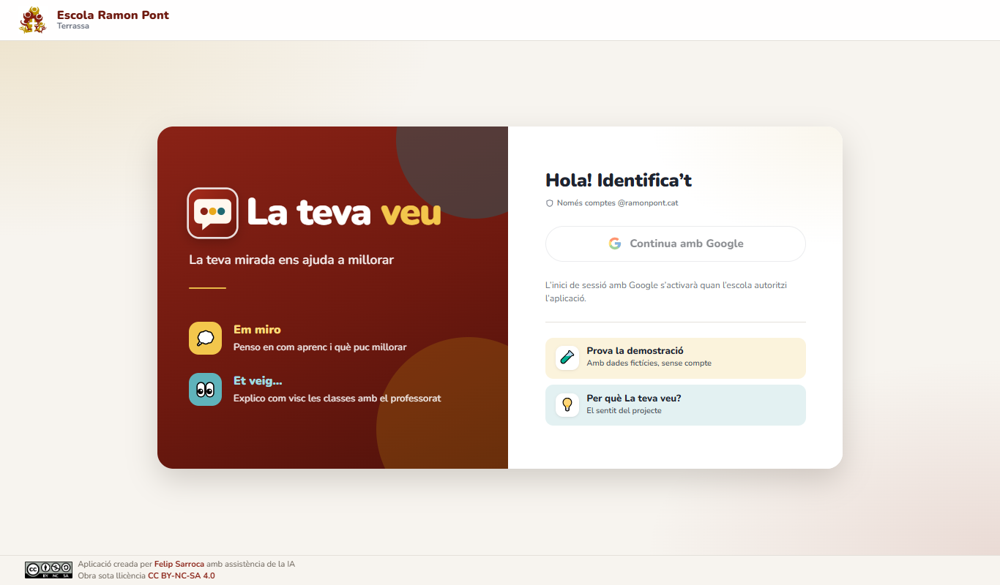

### Alumnat

La pantalla d'inici és diferent a primària i a l'ESO. A primària només hi ha el que l'infant necessita per començar; a l'ESO s'hi afegeixen les dates i una breu explicació de cada apartat.

| Primària (3r) | ESO (2n) |
| --- | --- |
| 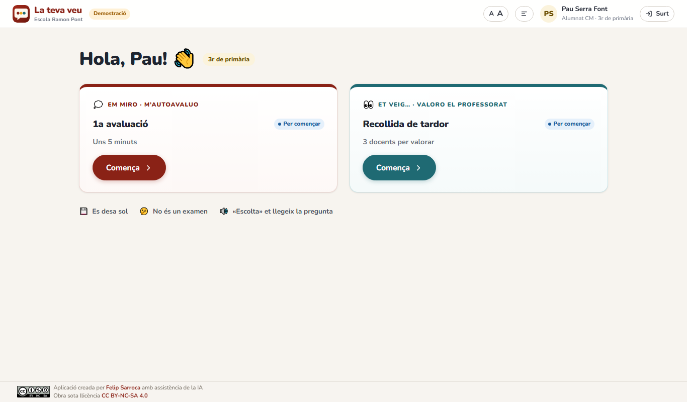 | 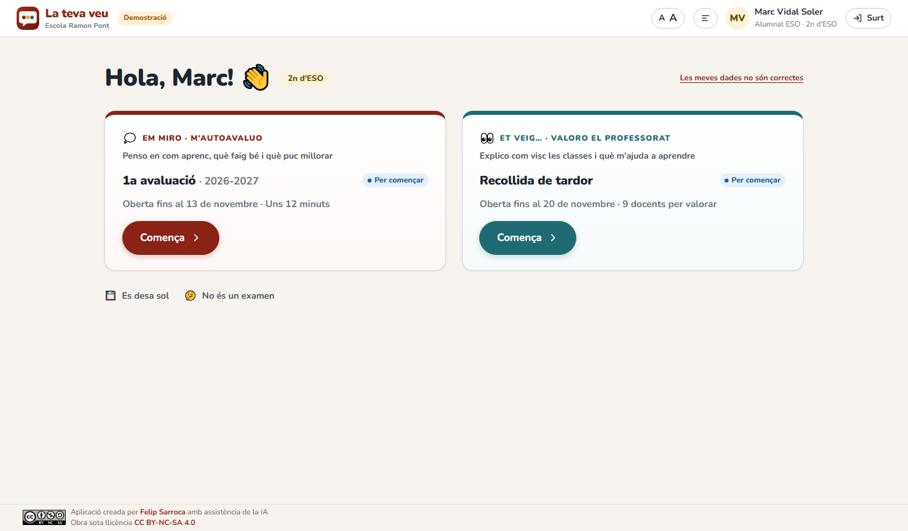 |

A 3r i 4t, una pregunta per pantalla amb targetes grans i lectura en veu alta:

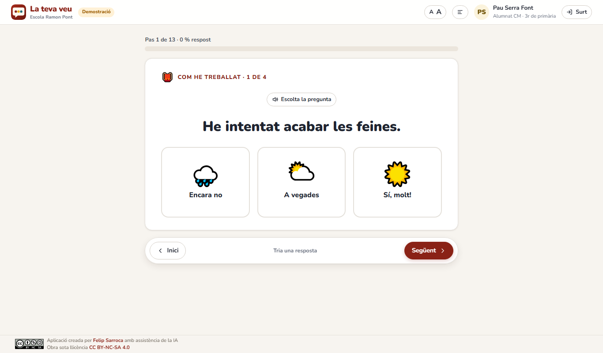

### Tutoria i professorat

El personal tria l'espai on vol treballar. Cada persona només veu el que li pertoca.

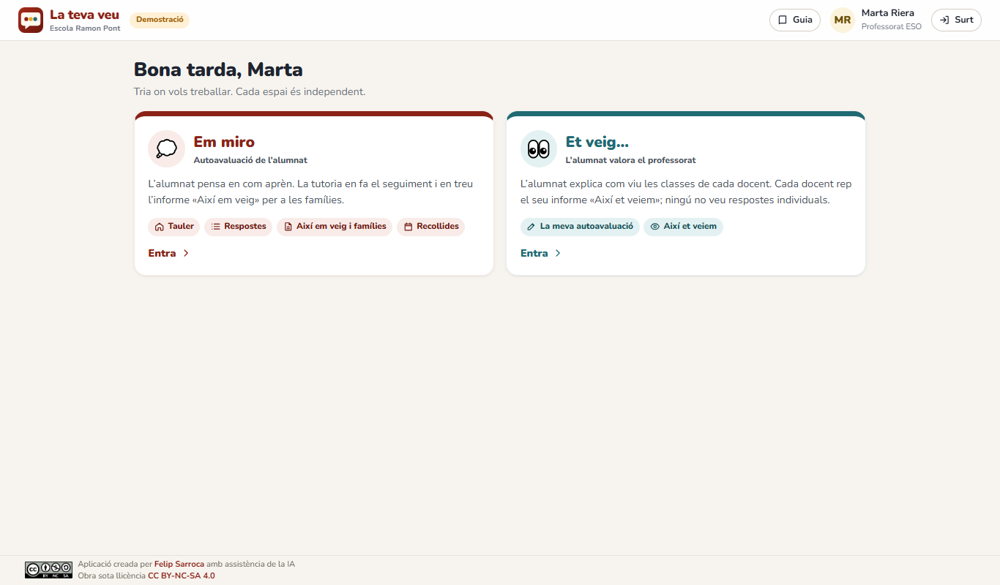

| Tauler de la tutoria | Informes i famílies |
| --- | --- |
| 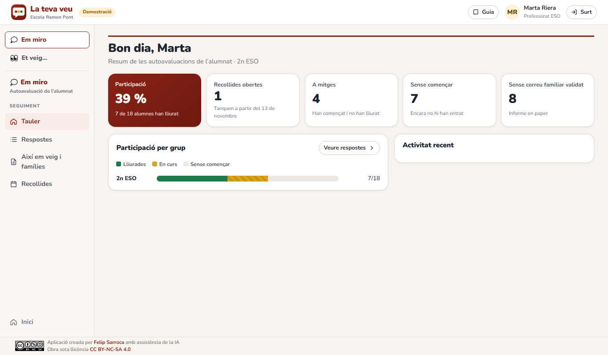 | 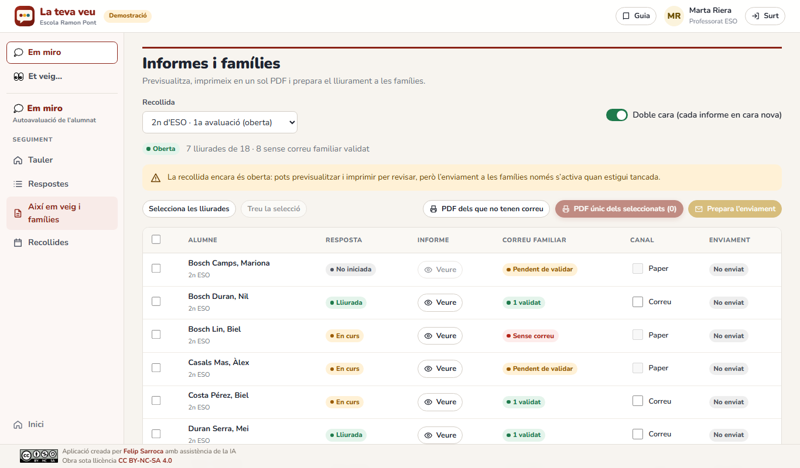 |

| Informe «Així em veig» | Informe «Així et veiem» |
| --- | --- |
| 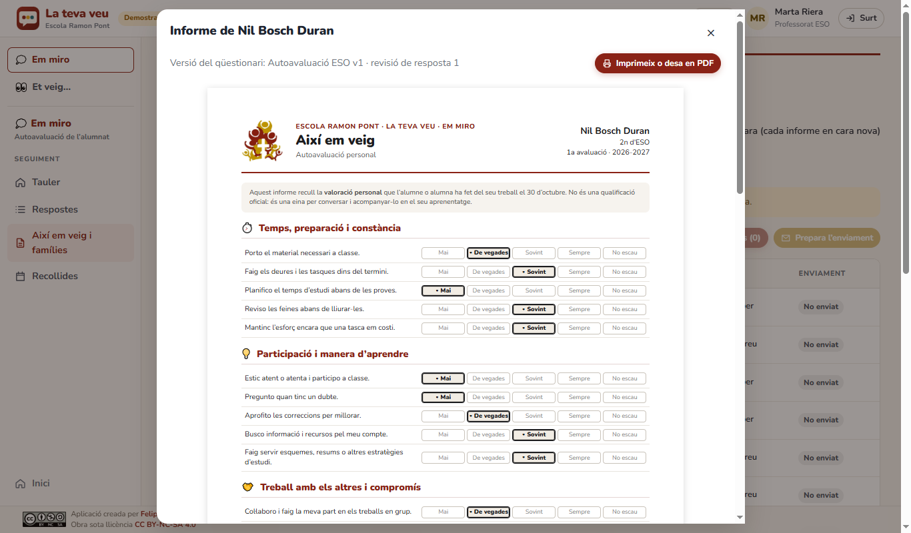 | 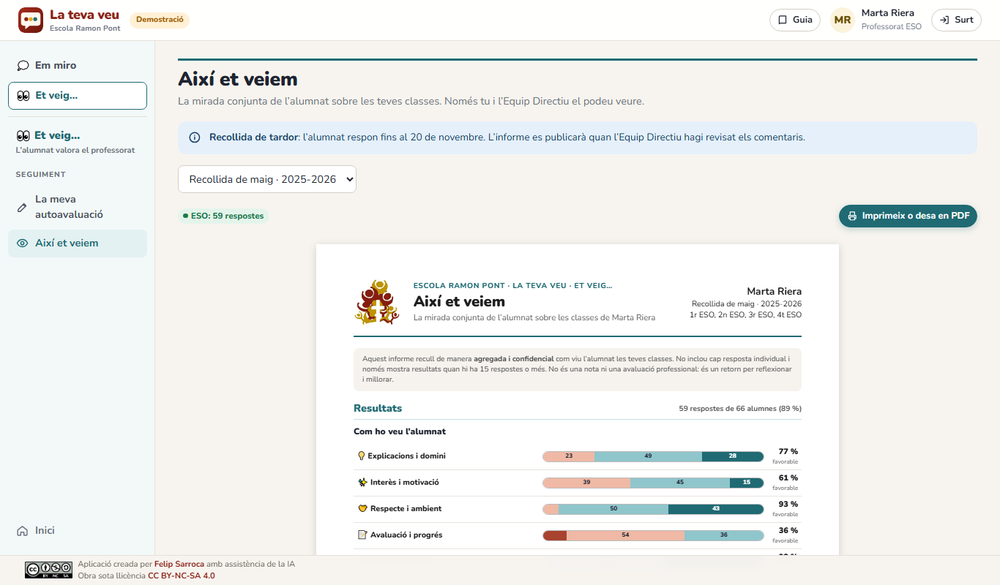 |

### Equip Directiu i administració

| Visió de centre (Equip Directiu) | Recollides (administració) |
| --- | --- |
| 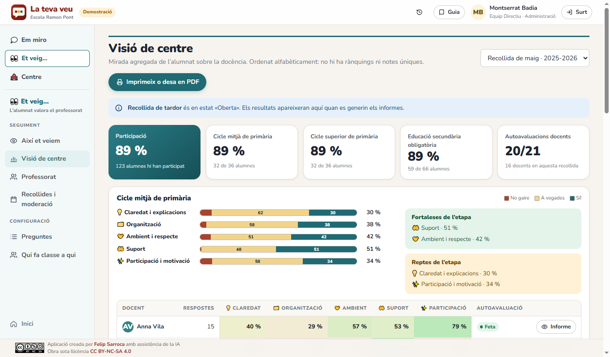 | 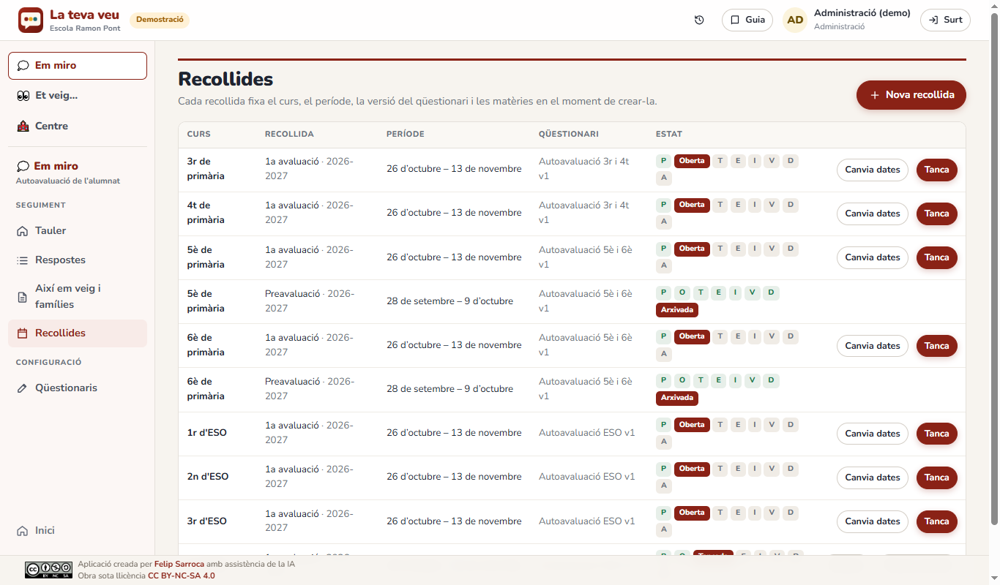 |

| Correu (administració) | Guia del personal |
| --- | --- |
| 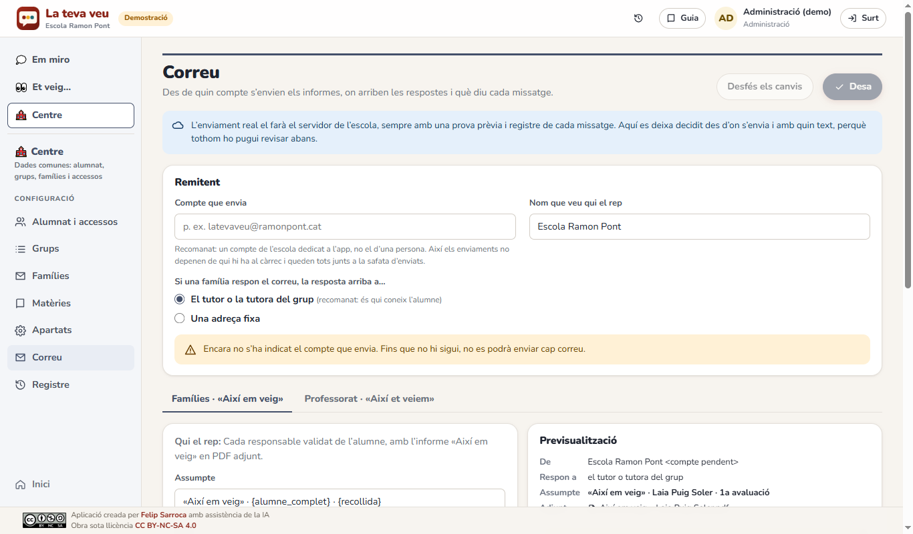 | 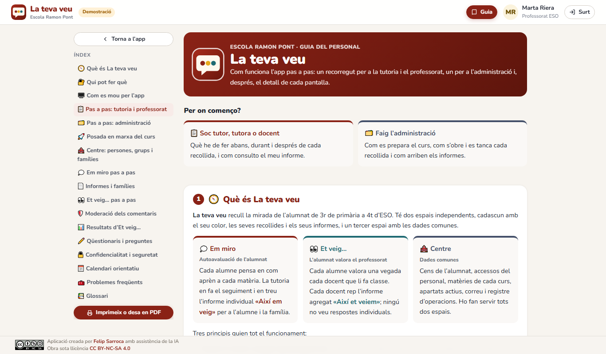 |

Totes les captures són de la demostració, amb dades fictícies. Es poden tornar a fer seguint [SEGUIMENT.md](SEGUIMENT.md#captures-del-readme).

## Tres espais

| Espai | Color | Què hi ha |
| --- | --- | --- |
| **Em miro** | Granat | Autoavaluació de l'alumnat, seguiment de la tutoria i informe «Així em veig» |
| **Et veig…** | Verd blavós | Valoració del professorat, autoavaluació docent, moderació i informe «Així et veiem» |
| **Centre** | Pissarra | Cens, accessos, grups, famílies, matèries, apartats, correu i registre |

Dins de cada espai, el menú separa **Seguiment** (l'ús diari) de **Configuració** (el que es prepara abans).

## Qui veu què

Només s'hi pot entrar amb un compte **@ramonpont.cat**, i tenir-ne un no dona accés a cap dada:

| Compte | Què veu |
| --- | --- |
| Alumne al cens | La seva autoavaluació i les valoracions dels seus docents |
| Professorat | A «Et veig…», la seva autoavaluació i el seu informe quan es publica |
| Tutoria | A més, a «Em miro», el seguiment i els informes dels seus grups |
| Equip Directiu | El seguiment de tot l'alumnat; a «Et veig…», el seguiment del professorat, tots els informes, la visió de centre i la moderació. Mai qui ha dit què. Gestiona els correus de les famílies i decideix qui forma part de l'Equip Directiu |
| Administració | La configuració, amb registre de cada acció. No veu cap resultat d'«Et veig…» |
| Compte de l'escola fora del cens | «Encara no tens accés», sense cap dada |
| Compte d'un altre domini | Rebutjat abans d'entrar |

Amb Google real, el botó demana el domini de l'escola (`hd=ramonpont.cat`). El servidor torna a verificar la signatura del testimoni, el domini i el correu verificat.

## Què fa

### Alumnat

- **Pantalles senzilles.** Sense requadres dins de requadres ni explicacions sobreres: el que cal per respondre i prou.
- **Pantalla d'inici adaptada a l'edat.** Salutació amb el curs com a etiqueta discreta, perquè el docent de l'aula comprovi que és el compte bo. A primària no hi ha descripcions, dates ni avisos que no entendria; a l'ESO hi ha les dates i un enllaç per avisar si les dades són incorrectes.
- **Tres experiències.** 3r-4t: una pregunta per pantalla, targetes grans, avanç automàtic i lectura en veu alta. 5è-6è: blocs curts i l'objectiu de l'avaluació anterior. ESO: blocs de 4-5 afirmacions i una pantalla per matèria.
- **Sense pressa.** Es desa sol, es pot continuar un altre dia i es pot modificar fins al tancament.
- **Accessibilitat.** Lectura en veu alta amb la millor veu catalana del navegador (sona millor amb Microsoft Edge), lletra gran, lletra de lectura fàcil (Atkinson Hyperlegible), navegació amb teclat i tancament de sessió després de 20 minuts d'inactivitat.
- **Et veig….** Cada docent es valora una sola vegada (no per matèria), en ordre aleatori estable. Preguntes per etapa (6 a cicle mitjà, 12 a cicle superior, 20 a l'ESO), sempre amb «No ho sé». Comentaris opcionals; un cop lliurat no es pot canviar.

### Tutoria (Em miro)

- **Tauler**: participació del grup, alumnes a mitges i sense començar, i alumnes sense correu familiar validat.
- **Respostes**: estat i progrés de cada alumne, amb filtres i cerca.
- **Així em veig i famílies**: informe A4 de cada alumne, un sol PDF dels seleccionats o dels que no tenen correu, doble cara, acusament de lectura retallable i preparació de l'enviament amb el remitent i l'assumpte real.

### Professorat i Equip Directiu (Et veig…)

- **Autoavaluació docent**, una per etapa, amb etiquetes opcionals de context per grup.
- **Informe «Així et veiem»**: blocs, mirall alumnat-docent amb quatre quadrants, detall per afirmació, classe per classe, evolució i comentaris moderats (els repetits, una vegada amb el nombre de persones). Imprimible en A4.
- **Seguiment del professorat** (Equip Directiu): autoavaluacions pendents, valoracions rebudes, adreces per a un recordatori i tots els informes en un PDF.
- **Visió de centre** (Equip Directiu): participació, blocs per etapa amb la variació respecte de la recollida anterior i taula de docents en ordre alfabètic, sense rànquings.
- **Confidencialitat**: respostes sense identificar l'alumne, cap resultat amb menys de 15 respostes i cap comentari sense moderar.

### Administració

- **Recollides d'Em miro** (`Programada → Oberta → Tancada → En revisió → Informes generats → Validada → Distribuïda → Arxivada`) i **d'Et veig…** (`Programada → Oberta → Tancada → Moderació → Informes generats → Publicada → Arxivada`). Canvis de dates i reobertures amb motiu registrat.
- **Qüestionaris** sense programar, amb previsualització, prova de l'informe i versions immutables.
- **Centre**: accessos del personal, cens amb optatives (CSV amb validació prèvia), grups, matèries per curs, correus de les famílies (CSV), incidències d'identitat, apartats actius i registre d'operacions inalterable.
- **Correu**: compte de l'escola que envia, on arriben les respostes (tutoria o adreça fixa) i text editable dels dos missatges, amb previsualització:
  - a les famílies, amb l'informe «Així em veig» adjunt (text basat en el de VeuAlumnat);
  - al professorat, un avís que «Així et veiem» és disponible, sense adjunt perquè és confidencial.

### Guia del personal

Botó **Guia** a la capçalera, per a tot el personal. Comença amb dos recorreguts pas a pas, un per a la tutoria i el professorat i un per a l'administració. Després detalla cada pantalla, la confidencialitat, un calendari orientatiu i els problemes freqüents. Es pot imprimir.

## Adreces directes

| Adreça | Obre |
| --- | --- |
| [`#/em-miro`](https://felipsarroca.github.io/util-apps/LaTevaVeu/#/em-miro) | Em miro |
| [`#/et-veig`](https://felipsarroca.github.io/util-apps/LaTevaVeu/#/et-veig) | Et veig… |
| `#/guia` | La guia del personal (cal haver entrat) |
| [`#/projecte`](https://felipsarroca.github.io/util-apps/LaTevaVeu/#/projecte) | La presentació del projecte, sense entrar |
| [`#/demo`](https://felipsarroca.github.io/util-apps/LaTevaVeu/#/demo) | La tria de perfil de la demostració |

## Comptes de la demostració

Es trien a «Prova la demostració». Amb el servidor real, aquest botó desapareix i només es pot entrar amb Google.

| Perfil | Per provar |
| --- | --- |
| Alumne de 3r, alumna de 5è, alumne de 2n d'ESO | L'experiència de cada etapa |
| Marta Riera | Tutora de 2n d'ESO i docent: seguiment, informes, autoavaluació i el seu informe |
| Sergi Prat | Especialista d'EF a les tres etapes |
| Equip Directiu | Visió de centre, seguiment del professorat, tots els informes i moderació |
| Administració | Configuració, sense accés als resultats |

Les dades es poden restaurar des de la mateixa finestra.

## Desenvolupament

> A Google Drive `npm install` falla o va molt lent. Treballa en una còpia local fora de la unitat (vegeu [SEGUIMENT.md](SEGUIMENT.md#com-continuar-des-dun-altre-ordinador)).

```bash
npm ci
npm run dev            # demostració a http://localhost:5173
npm test               # proves del prototip i del servidor (vitest, PGlite)
npx tsc -b && npm run lint
npm run build          # genera dist/
npm run docs           # regenera db/dades-prova.sql i els documents de revisió
```

Per activar Google real: copia `.env.example` a `.env.local` i posa-hi `VITE_GOOGLE_CLIENT_ID` (client OAuth «Aplicació web» del Google Cloud de l'escola, amb l'origen autoritzat de l'URL publicada).

### Estructura

| Carpeta | Contingut |
| --- | --- |
| `src/domain` | Model, catàleg de cursos i matèries, plantilles, motor de qüestionaris, CSV i format dels correus (`mail.ts`) |
| `src/data` | Identificació i capa de dades (`api.ts`: les regles de permisos, compartides amb el servidor) |
| `src/student` | Flux de l'alumnat i components de pregunta |
| `src/staff` | Pantalles del personal i guia (`Guide.tsx`) |
| `src/report` | Informes A4 «Així em veig» i «Així et veiem» |
| `server` | Servidor (Fastify): verificació de Google, permisos i API de tota l'app |
| `db` | Esquema de PostgreSQL, permisos del rol de l'app i dades de prova fictícies |
| `docs` | Dossier de privacitat, textos informatius, kit del claustre i de la prova pilot, i [captures](docs/captures) |
| `scripts` | Generació dels documents de revisió (`npm run docs`) |
| `tests`, `server/tests` | Proves dels criteris d'acceptació (prototip i servidor) |

## Servidor (sense desplegar)

La carpeta `server` conté el backend de tota l'app.

- **Identitat.** Cada petició porta el testimoni de Google (`Authorization: Bearer …`). Se'n comprova la signatura, l'emissor, l'audiència, el domini i el correu verificat. Cal ser al cens o tenir un rol.
- **Em miro i Centre.** `GET /api/state` torna només les dades que cada persona pot veure. `POST /api/ops` executa cada operació amb les mateixes regles que la demostració, dins d'una transacció exclusiva, i només escriu el que ha canviat. La configuració del correu es desa a `app_settings`.
- **Et veig….** Respostes sense identificador d'alumne, esborranys xifrats (AES-256-GCM) i esborrats en lliurar, ordre barrejat en tancar, llista de participació esborrada en publicar, llindar de 15 i moderació aplicats al servidor.
- **Mode connectat.** Amb `VITE_API_URL`, l'app treballa amb el servidor i no desa dades al navegador.

Per provar-ho tot en local amb dades fictícies:

```bash
npm run server:local                                               # servidor a 127.0.0.1:8787, base de dades en memòria
VITE_API_URL=http://127.0.0.1:8787 VITE_DEV_AUTH=1 npm run dev -- --port 5191
```

### Base de dades

- Projecte de Neon «La teva veu» (Frankfurt, PostgreSQL 17). Branca `proves` amb `db/schema.sql` i `db/dades-prova.sql` (tot fictici); branca `integracio` per a les proves.
- El registre d'operacions (`audit_log`) només creix: un activador impedeix modificar-ne o esborrar-ne files. El servidor s'hi connecta amb el rol `latevaveu_app` (`db/permisos.sql`).
- La cadena de connexió no s'escriu mai en cap fitxer.

## Pendent abans de fer-la servir amb dades reals

1. Revisió amb l'Equip Directiu i la persona delegada de protecció de dades.
2. Client OAuth de Google aprovat a la consola de Google Workspace (els comptes de menors poden tenir bloquejades les apps no configurades).
3. Allotjament del servidor a la UE i desplegament.
4. **Compte que envia els correus**: decidir-lo, crear-lo si cal i autoritzar el servidor a enviar en nom seu. Després, la cua d'enviament amb prova prèvia i sense duplicats.
5. Inventari real de les matèries d'ESO per curs.
6. Prova pilot amb alumnat de cada etapa per ajustar preguntes, durada i obligatorietat.
