# La teva veu

*La teva mirada ens ajuda a millorar.*

Aplicació web de l'Escola Ramon Pont perquè l'alumnat de 3r de primària a 4t d'ESO s'autoavaluï i valori el professorat. Té dos apartats, que es poden activar o desactivar per separat:

- **Em miro**: l'alumne s'autoavalua a cada avaluació. En surt l'informe individual **«Així em veig»**, que llegeix amb la família.
- **Et veig…**: l'alumne valora una vegada cada docent que li fa classe. Cada docent rep l'informe agregat **«Així et veiem»**, contrastat amb la seva autoavaluació.

| | |
| --- | --- |
| **App** | <https://felipsarroca.github.io/util-apps/LaTevaVeu/> · enllaç curt <https://ja.cat/tensveu> |
| **Demostració** | <https://felipsarroca.github.io/util-apps/LaTevaVeu/demo/>, amb dades fictícies |
| **Presentació del projecte** | [`#/projecte`](https://felipsarroca.github.io/util-apps/LaTevaVeu/#/projecte): sentit, marc normatiu, funcionament i beneficis |
| **Guia del personal** | Dins de l'app, botó **Guia** (o `#/guia`): recorregut pas a pas per a la tutoria i per a l'administració |
| **Estat de la feina** | [SEGUIMENT.md](SEGUIMENT.md) |
| **Pla** | [Pla mestre v2](La_teva_veu_pla_mestre_v2.md) (implementa les fases 1 i 2) |

> **Estat (31 d'octubre de 2026).** L'app és **en funcionament** a l'adreça principal, amb entrada amb Google, servidor a Neon Functions (Frankfurt) i base de dades a la UE. Hi ha carregat el curs 2026-2027: 218 alumnes de 3r de primària a 4t d'ESO, el professorat, l'Equip Directiu i l'administració, les tutories, qui fa classe a qui i els correus de les famílies (217 de 218 alumnes, importats de Clickedu). Encara no s'ha obert cap recollida. **Falta l'enviament real dels correus**: de moment els informes es lliuren en PDF o en paper. La [demostració](https://felipsarroca.github.io/util-apps/LaTevaVeu/demo/) permet provar-ho tot amb dades fictícies.

## Com es veu

### Entrada

Només s'hi entra amb el compte de l'escola. Des d'aquí es pot provar la demostració o llegir el sentit del projecte.

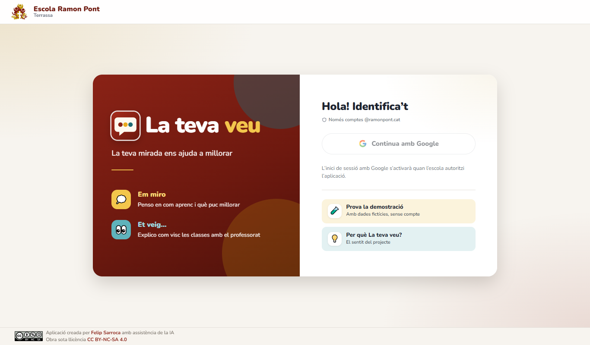

### Alumnat

La pantalla d'inici és diferent a primària i a l'ESO. A primària només hi ha el que l'infant necessita per començar; a l'ESO s'hi afegeixen les dates i una breu explicació de cada apartat.

| Primària (3r) | ESO (2n) |
| --- | --- |
| 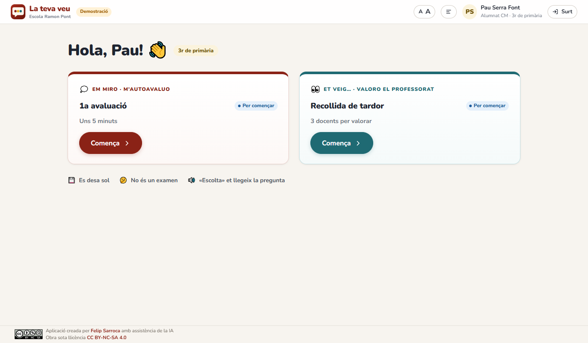 | 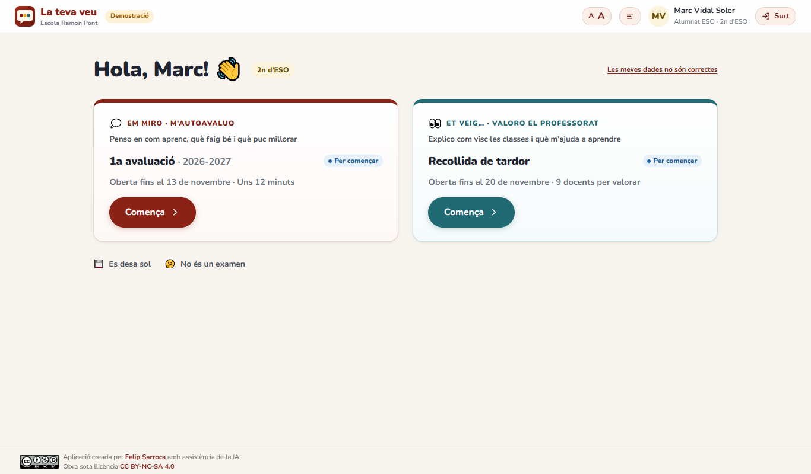 |

A 3r i 4t, una pregunta per pantalla amb targetes grans i lectura en veu alta:

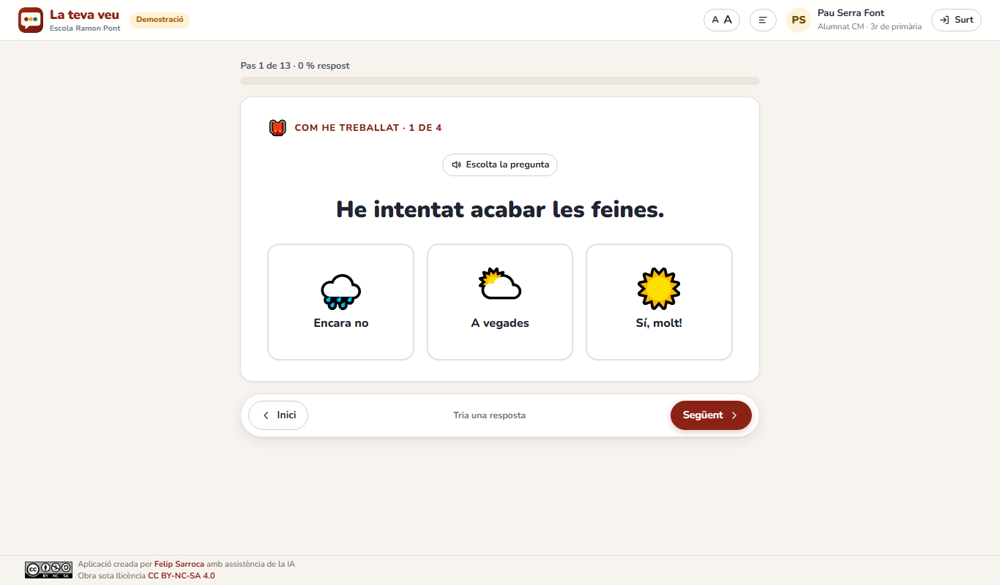

### Tutoria i professorat

El personal tria l'espai on vol treballar. Cada persona només veu el que li pertoca.

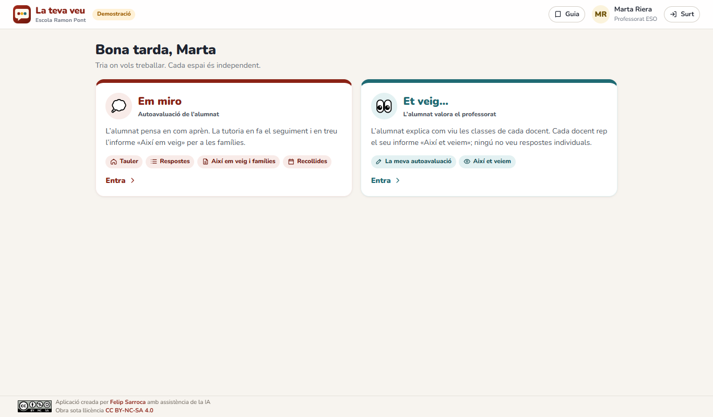

| Tauler de la tutoria | Informes i famílies |
| --- | --- |
| 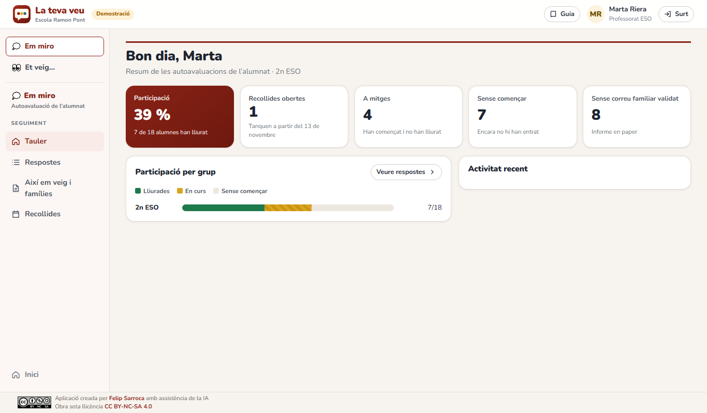 | 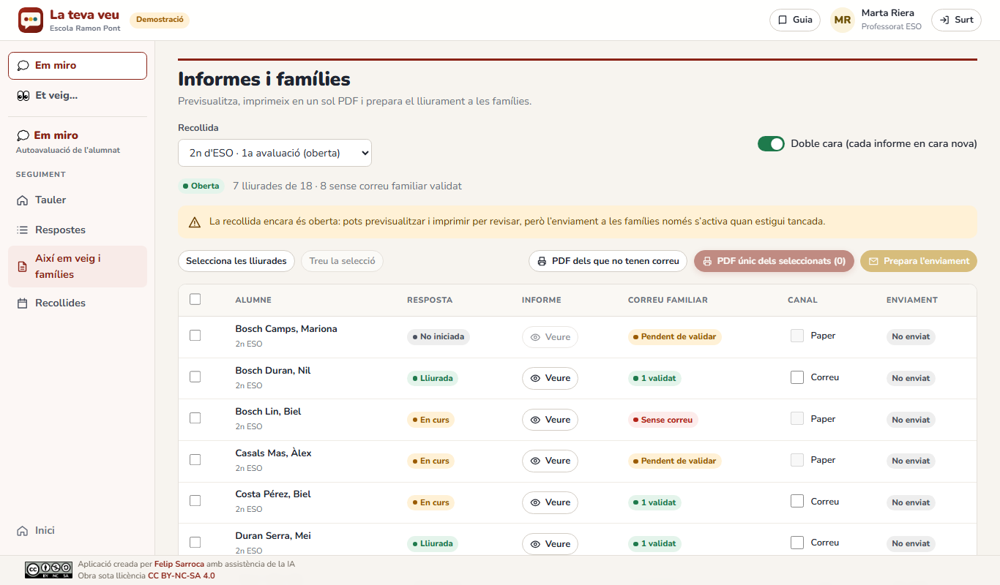 |

| Informe «Així em veig» | Informe «Així et veiem» |
| --- | --- |
| 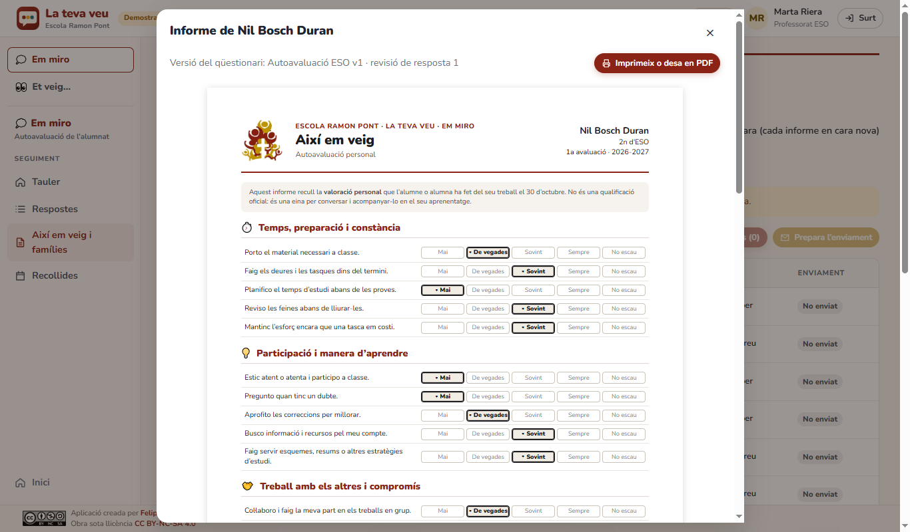 | 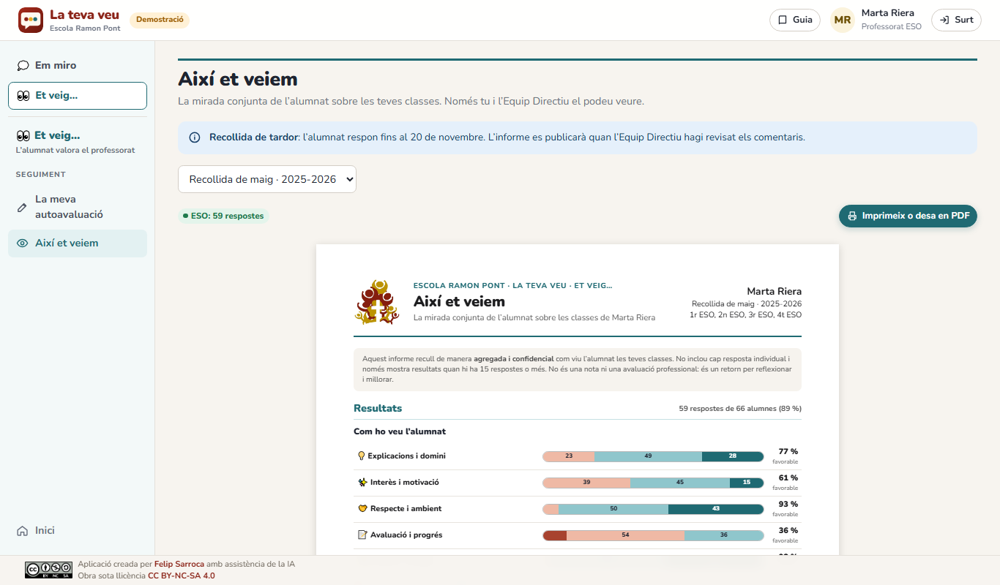 |

### Equip Directiu i administració

| Visió de centre (Equip Directiu) | Recollides (administració) |
| --- | --- |
| 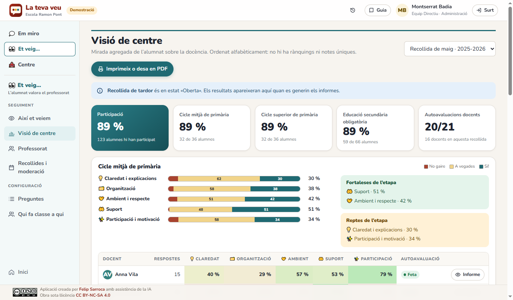 | 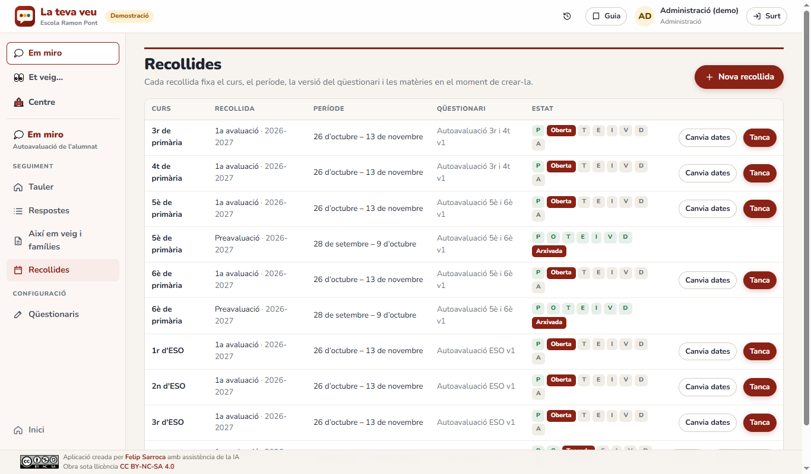 |

| Correu (administració) | Guia del personal |
| --- | --- |
| 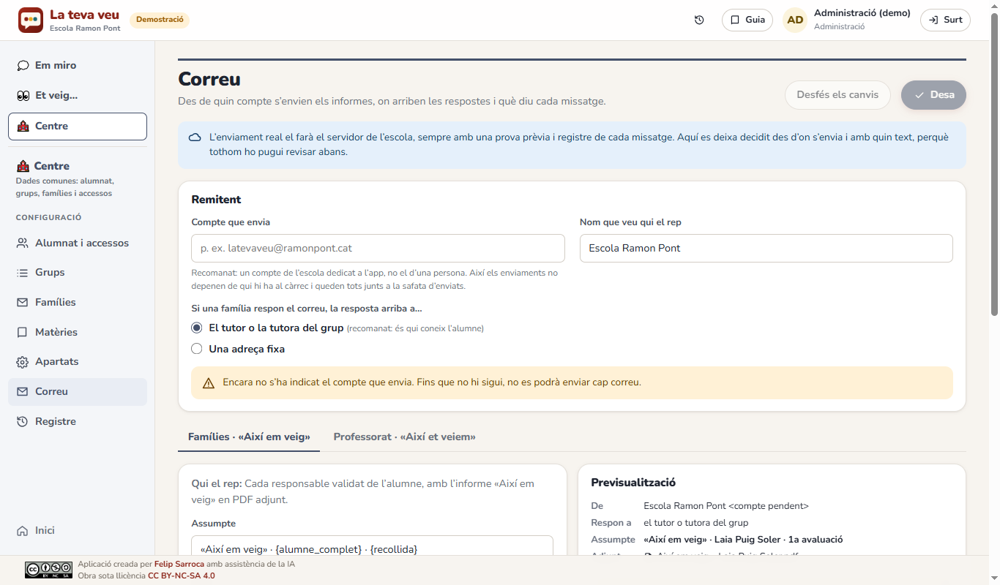 | 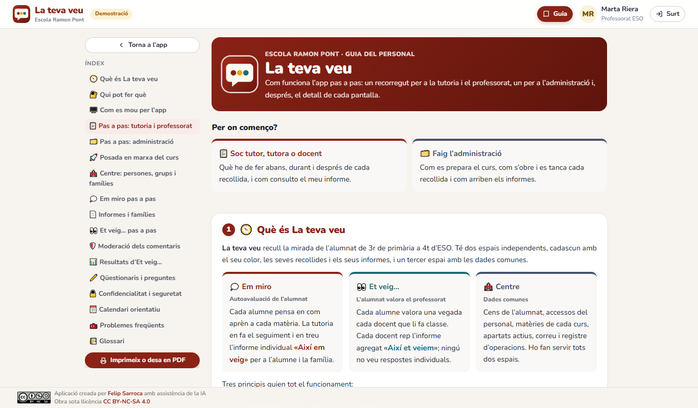 |

Totes les captures són de la demostració, amb dades fictícies. Es poden tornar a fer seguint [SEGUIMENT.md](SEGUIMENT.md#captures-del-readme).

## Tres espais

| Espai | Color | Què hi ha |
| --- | --- | --- |
| **Em miro** | Granat | Autoavaluació de l'alumnat, seguiment de la tutoria i informe «Així em veig» |
| **Et veig…** | Verd blavós | Valoració del professorat, autoavaluació docent, moderació i informe «Així et veiem» |
| **Centre** | Pissarra | Cens, accessos, grups, famílies, matèries, apartats, correu i registre |

Dins de cada espai, el menú separa **Seguiment** (l'ús diari) de **Configuració** (el que es prepara abans).

## Qui veu què

Només s'hi pot entrar amb un compte **@ramonpont.cat**, i tenir-ne un no dona accés a cap dada:

| Compte | Què veu |
| --- | --- |
| Alumne al cens | La seva autoavaluació i les valoracions dels seus docents |
| Professorat | A «Et veig…», la seva autoavaluació i el seu informe quan es publica |
| Tutoria | A més, a «Em miro», el seguiment i els informes dels seus grups |
| Equip Directiu | El seguiment de tot l'alumnat; a «Et veig…», el seguiment del professorat, tots els informes, la visió de centre i la moderació. Mai qui ha dit què. Gestiona els correus de les famílies i decideix qui forma part de l'Equip Directiu |
| Administració | La configuració, amb registre de cada acció. No veu cap resultat d'«Et veig…» |
| Compte de l'escola fora del cens | «Encara no tens accés», sense cap dada |
| Compte d'un altre domini | Rebutjat abans d'entrar |

Amb Google real, el botó demana el domini de l'escola (`hd=ramonpont.cat`). El servidor torna a verificar la signatura del testimoni, el domini i el correu verificat.

## Què fa

### Alumnat

- **Pantalles senzilles.** Sense requadres dins de requadres ni explicacions sobreres: el que cal per respondre i prou.
- **Pantalla d'inici adaptada a l'edat.** Salutació amb el curs com a etiqueta discreta, perquè el docent de l'aula comprovi que és el compte bo. A primària no hi ha descripcions, dates ni avisos que no entendria; a l'ESO hi ha les dates i un enllaç per avisar si les dades són incorrectes.
- **Tres experiències.** 3r-4t: una pregunta per pantalla, targetes grans, avanç automàtic i lectura en veu alta. 5è-6è: blocs curts i l'objectiu de l'avaluació anterior. ESO: blocs de 4-5 afirmacions i una pantalla per matèria.
- **Sense pressa.** Es desa sol, es pot continuar un altre dia i es pot modificar fins al tancament.
- **Accessibilitat.** Lectura en veu alta amb una veu neuronal catalana (àudios pregenerats; si un text s'ha editat, la millor veu del navegador), lletra gran, lletra de lectura fàcil (Atkinson Hyperlegible), navegació amb teclat i tancament de sessió després de 20 minuts d'inactivitat.
- **Et veig….** Cada docent es valora una sola vegada (no per matèria), en ordre aleatori estable. Preguntes per etapa (6 a cicle mitjà, 12 a cicle superior, 20 a l'ESO), sempre amb «No ho sé». Comentaris opcionals; un cop lliurat no es pot canviar.

### Tutoria (Em miro)

- **Tauler**: participació del grup, alumnes a mitges i sense començar, i alumnes sense correu familiar validat.
- **Respostes**: estat i progrés de cada alumne, amb filtres i cerca.
- **Així em veig i famílies**: informe A4 de cada alumne, un sol PDF dels seleccionats, doble cara i acusament de lectura retallable.
- **Lliurament**: «Prepara l'enviament» mostra el correu tal com el rebrà cada família. Els informes que no es poden enviar (sense correu, correu pendent de validar o no vàlid, marcats «Paper») surten sols en una llista per triar un per un o tots alhora i **desar en PDF** o **imprimir**. El botó «En paper» obre la mateixa llista.

### Professorat i Equip Directiu (Et veig…)

- **Autoavaluació docent**, una per etapa, amb etiquetes opcionals de context per grup.
- **Informe «Així et veiem»**: blocs, mirall alumnat-docent amb quatre quadrants, detall per afirmació, classe per classe, evolució i comentaris moderats (els repetits, una vegada amb el nombre de persones). Imprimible en A4.
- **Seguiment del professorat** (Equip Directiu): autoavaluacions pendents, valoracions rebudes, adreces per a un recordatori i tots els informes en un PDF.
- **Lliurament per correu** (Equip Directiu): es marquen els docents i cadascun rep el seu informe «Així et veiem» en PDF adjunt, amb un missatge personal i amable, des de **direccio@ramonpont.cat**. Els que no es poden enviar es desen o s'imprimeixen. Cal haver publicat la recollida.
- **Visió de centre** (Equip Directiu): participació, blocs per etapa amb la variació respecte de la recollida anterior, fortaleses i reptes de cada etapa, les tres afirmacions més ben valorades i les tres amb més marge de millora, i taula de docents en ordre alfabètic, sense rànquings.
- **Confidencialitat**: respostes sense identificar l'alumne, cap resultat amb menys de 15 respostes i cap comentari sense moderar.

### Administració

- **Recollides d'Em miro** (`Programada → Oberta → Tancada → En revisió → Informes generats → Validada → Distribuïda → Arxivada`) i **d'Et veig…** (`Programada → Oberta → Tancada → Moderació → Informes generats → Publicada → Arxivada`). Canvis de dates i reobertures amb motiu registrat.
- **Qüestionaris** sense programar, amb previsualització, prova de l'informe i versions immutables.
- **Centre**:
  - accessos del personal, amb la tutoria de cada docent;
  - cens amb optatives (CSV amb validació prèvia), accions en bloc (canviar de curs o de grup, donar de baixa) i **curs nou**, que copia grups, matèries i assignacions, passa l'alumnat de curs i respecta els repetidors;
  - grups amb el tutor o tutora de cada un;
  - matèries per curs, matèries noves i canvis de nom; la **Tutoria** és a tots els cursos i qui la fa veu l'«Em miro» del grup;
  - correus de les famílies: el **llistat de pares i mares de Clickedu** tal com surt (amb ajuda pas a pas a la mateixa pantalla) o un CSV propi; també es poden **corregir a mà** el nom i el correu de cada responsable i **afegir-ne** quan no n'hi ha cap o en falta un;
  - incidències d'identitat, apartats actius i registre d'operacions inalterable;
  - **còpies de seguretat**: una còpia completa cada dia i abans de cada canvi gran (curs nou, importació de correus, restauració), i restauració amb un clic i confirmació escrita.
- **Correu**: text editable dels dos missatges, amb previsualització:
  - a les famílies, amb l'informe «Així em veig» adjunt (text basat en el de VeuAlumnat), des del compte que triï l'escola; les respostes van a la tutoria o a una adreça fixa;
  - al professorat, amb el seu informe «Així et veiem» adjunt, sempre des de **direccio@ramonpont.cat**;
  - **recordatoris automàtics**, des de direccio@ramonpont.cat, uns dies abans que es tanqui una recollida (de 1 a 5, per defecte 2): a l'alumnat que no ha lliurat «Em miro» i al professorat que no ha lliurat l'autoavaluació d'«Et veig…». Un sol recordatori per persona i recollida. Botons «Envia'm una prova» i «Envia ara els pendents».

### Guia del personal

Botó **Guia** a la capçalera, per a tot el personal. Comença amb dos recorreguts pas a pas, un per a la tutoria i el professorat i un per a l'administració. Després detalla cada pantalla, la confidencialitat, un calendari orientatiu i els problemes freqüents. Es pot imprimir.

## Com es fa servir

### A l'inici de cada curs (administració)

1. **Curs nou.** *Centre › Grups › Curs nou*. Abans, marca els alumnes que repeteixen. Es copien grups, matèries, tutories i qui fa classe a qui; l'alumnat passa al curs següent i el de 4t d'ESO surt.
2. **Alumnat nou.** *Centre › Alumnat i accessos › Cens*: afegeix el nou 3r de primària i les altes, i dona de baixa les baixes (en bloc).
3. **Personal.** Altes i baixes, i la **tutoria** de cada docent (columna Tutoria).
4. **Matèries i docents.** *Centre › Matèries* i *Et veig… › Qui fa classe a qui*.
5. **Famílies.** *Centre › Famílies › Importa des de CSV*, amb el llistat de Clickedu. El botó **Com s'obté de Clickedu** ho explica pas a pas: *Administració › Gestió d'usuaris › Llistats › Llistat de pares i mares*, totes les classes de 3r de primària a 4t d'ESO, marcant *Nom alumne*, *Nom i cognoms* i *Correu electrònic*, i *Exportar a excel*. Revisa les propostes i les incidències, i **esborra el fitxer de Baixades** quan acabis. Els correus que falten o s'han de corregir s'afegeixen o s'editen a mà a la mateixa pantalla.

### A cada avaluació (Em miro)

1. L'administració crea la recollida de cada curs (*Em miro › Recollides*) i l'obre.
2. La tutoria segueix la participació al **Tauler** i a **Respostes**. Si els recordatoris estan activats, uns dies abans del tancament l'alumnat que no ha acabat en rep un per correu.
3. Quan es tanca, a *Així em veig i famílies*: **Prepara l'enviament** per als que tenen correu i **En paper** per als altres (desar en PDF o imprimir).

### Una o dues vegades l'any (Et veig…)

1. L'Equip Directiu o l'administració crea la recollida i l'obre; el professorat fa la seva autoavaluació (qui no l'ha lliurat rep un recordatori abans del tancament).
2. Es tanca, l'Equip Directiu modera els comentaris i es generen els informes.
3. L'Equip Directiu revisa la **Visió de centre** i els informes, i els **publica** als docents.
4. *Et veig… › Professorat › Lliura per correu*: cada docent rep el seu informe des de direccio@ramonpont.cat.

## Adreces directes

| Adreça | Obre |
| --- | --- |
| [`#/em-miro`](https://felipsarroca.github.io/util-apps/LaTevaVeu/#/em-miro) | Em miro |
| [`#/et-veig`](https://felipsarroca.github.io/util-apps/LaTevaVeu/#/et-veig) | Et veig… |
| `#/guia` | La guia del personal (cal haver entrat) |
| [`#/projecte`](https://felipsarroca.github.io/util-apps/LaTevaVeu/#/projecte) | La presentació del projecte, sense entrar |
| [`#/demo`](https://felipsarroca.github.io/util-apps/LaTevaVeu/#/demo) | La tria de perfil de la demostració |

## Comptes de la demostració

Es trien a «Prova la demostració». Amb el servidor real, aquest botó desapareix i només es pot entrar amb Google.

| Perfil | Per provar |
| --- | --- |
| Alumne de 3r, alumna de 5è, alumne de 2n d'ESO | L'experiència de cada etapa |
| Marta Riera | Tutora de 2n d'ESO i docent: seguiment, informes, autoavaluació i el seu informe |
| Sergi Prat | Especialista d'EF a les tres etapes |
| Equip Directiu | Visió de centre, seguiment del professorat, tots els informes i moderació |
| Administració | Configuració, sense accés als resultats |

Les dades es poden restaurar des de la mateixa finestra.

## Desenvolupament

> A Google Drive `npm install` falla o va molt lent. Treballa en una còpia local fora de la unitat (vegeu [SEGUIMENT.md](SEGUIMENT.md#com-continuar-des-dun-altre-ordinador)).

```bash
npm ci
npm run dev            # demostració a http://localhost:5173
npm test               # proves del prototip i del servidor (vitest, PGlite)
npx tsc -b && npm run lint
npm run build          # genera dist/
npm run docs           # regenera db/dades-prova.sql i els documents de revisió
npm run audios         # genera els àudios de les preguntes (cal edge-tts)
```

Per activar Google real: copia `.env.example` a `.env.local` i posa-hi `VITE_GOOGLE_CLIENT_ID` (client OAuth «Aplicació web» del Google Cloud de l'escola, amb l'origen autoritzat de l'URL publicada).

### Estructura

| Carpeta | Contingut |
| --- | --- |
| `src/domain` | Model, catàleg de cursos i matèries, plantilles, motor de qüestionaris, CSV i format dels correus (`mail.ts`) |
| `src/data` | Identificació i capa de dades (`api.ts`: les regles de permisos, compartides amb el servidor) |
| `src/student` | Flux de l'alumnat i components de pregunta |
| `src/staff` | Pantalles del personal i guia (`Guide.tsx`) |
| `src/report` | Informes A4 «Així em veig» i «Així et veiem» |
| `server` | Servidor (Fastify): verificació de Google, permisos i API de tota l'app |
| `db` | Esquema de PostgreSQL, permisos del rol de l'app i dades de prova fictícies |
| `docs` | Dossier de privacitat, textos informatius, kit del claustre i de la prova pilot, i [captures](docs/captures) |
| `scripts` | Generació dels documents de revisió (`npm run docs`) i dels àudios (`npm run audios`) |
| `tests`, `server/tests` | Proves dels criteris d'acceptació (prototip i servidor) |

## Servidor

La carpeta `server` conté el backend de tota l'app.

- **Identitat.** Cada petició porta el testimoni de Google (`Authorization: Bearer …`). Se'n comprova la signatura, l'emissor, l'audiència, el domini i el correu verificat. Cal ser al cens o tenir un rol.
- **Em miro i Centre.** `GET /api/state` torna només les dades que cada persona pot veure. `POST /api/ops` executa cada operació amb les mateixes regles que la demostració, dins d'una transacció exclusiva, i només escriu el que ha canviat. La configuració del correu es desa a `app_settings`.
- **Et veig….** Respostes sense identificador d'alumne, esborranys xifrats (AES-256-GCM) i esborrats en lliurar, ordre barrejat en tancar, llista de participació esborrada en publicar, llindar de 15 i moderació aplicats al servidor.
- **Mode connectat.** Amb `VITE_API_URL`, l'app treballa amb el servidor i no desa dades al navegador.
- **Còpies de seguretat** (`server/backups.ts`). Cada còpia és un JSON amb totes les taules de treball, desat a la taula `backups` de la mateixa base de dades. Es fa cada dia, abans del curs nou, abans d'importar correus de les famílies, abans de restaurar i a mà. Es conserven 30 dies (com a mínim, les 10 més recents). Restaurar ho fa tot en una transacció; no toca el registre d'operacions ni els recordatoris enviats. El pla gratuït de Neon només permet una instantània manual i cap de programada; per això les còpies són de l'app.
- **Recordatoris** (`server/reminders.ts`) i **enviament** (`server/gmail.ts`): API de Gmail amb un compte de servei amb delegació de domini, només amb l'abast `gmail.send`, en nom de direccio@ramonpont.cat. La taula `reminders_sent` evita duplicats; els que fallen es tornen a provar.
- **Tasca diària.** Un activador programat de Neon (`0 6 * * *`, 7 h o 8 h a Catalunya) crida `POST /api/tasques/diaries`: còpia diària i recordatoris, si estan activats. Només l'accepta amb la capçalera que hi posa Neon.
- **Desplegament.** Neon Functions (Frankfurt), funció `latevaveu` a la branca `produccio`. Es torna a desplegar amb `bash scripts/desplega-servidor.sh` (detalls a [SEGUIMENT.md](SEGUIMENT.md#producció)).

Per provar-ho tot en local amb dades fictícies:

```bash
npm run server:local                                               # servidor a 127.0.0.1:8787, base de dades en memòria
VITE_API_URL=http://127.0.0.1:8787 VITE_DEV_AUTH=1 npm run dev -- --port 5191
```

### Base de dades

- Projecte de Neon «La teva veu» (Frankfurt, PostgreSQL 17). Branca `produccio` amb les dades reals; branca `proves` amb `db/schema.sql` i `db/dades-prova.sql` (tot fictici); branca `integracio` per a les proves automàtiques.
- El registre d'operacions (`audit_log`) només creix: un activador impedeix modificar-ne o esborrar-ne files. El servidor s'hi connecta amb el rol `latevaveu_app` (`db/permisos.sql`).
- La cadena de connexió no s'escriu mai en cap fitxer.

### Autoritzar l'enviament des de direccio@ramonpont.cat

Ho fa una vegada una persona administradora de Google Workspace. La clau no es puja mai al repositori ni es copia en cap missatge.

1. **Gmail API.** [Google Cloud](https://console.cloud.google.com), projecte «La teva veu» (el del client de Google): *API i serveis › Biblioteca › Gmail API › Habilita*.
2. **Compte de servei.** *IAM i administració › Comptes de servei › Crea un compte de servei*: nom `latevaveu-correu`, sense cap rol. Obre'l i copia l'**ID únic** (un número llarg).
3. **Clau.** Al compte de servei, *Claus › Afegeix una clau › Crea una clau nova › JSON*. Desa el fitxer fora de Google Drive, per exemple a `C:\Users\<usuari>\claus\latevaveu-correu.json`. Si Google no deixa crear claus, a *IAM i administració › Polítiques de l'organització* desactiva temporalment `iam.disableServiceAccountKeyCreation` per a aquest projecte.
4. **Delegació.** [Consola d'administració](https://admin.google.com) › *Seguretat › Accés i control de dades › Controls de l'API › Delegació a tot el domini › Afegeix-ne un de nou*: l'ID únic del pas 2 i l'abast `https://www.googleapis.com/auth/gmail.send`. Pot trigar uns minuts a fer efecte.
5. **Servidor.** A l'ordinador que desplega, la variable d'usuari amb el camí del fitxer (PowerShell): `[Environment]::SetEnvironmentVariable('LATEVAVEU_GMAIL_SA_FILE', 'C:\Users\<usuari>\claus\latevaveu-correu.json', 'User')`. Obre un terminal nou i desplega (`bash scripts/desplega-servidor.sh`): la clau passa a la funció com a `GMAIL_SERVICE_ACCOUNT`.
6. **Prova.** *Centre › Correu › Recordatoris automàtics › Envia'm una prova*. Si arriba, activa «Envia'ls automàticament» i desa.

`direccio@ramonpont.cat` ha de ser un usuari amb bústia de Gmail (no un grup).

## Pendent

1. **Enviament real dels informes.** Els recordatoris ja surten per Gmail (un cop autoritzat). Falta fer servir el mateix camí per lliurar els informes amb el PDF adjunt: al professorat des de direccio@ramonpont.cat, i a les famílies des del compte que triï l'escola, amb «Envia'm una prova», «Aprova i envia», sense duplicats i amb registre de cada missatge.
2. Revisar amb l'Equip Directiu les matèries d'ESO de cada curs i qui fa classe a qui.
3. Prova pilot amb alumnat de cada etapa per ajustar preguntes, durada i obligatorietat.
4. Revisió final amb la persona delegada de protecció de dades.
5. PFI: necessitaria un curs i un qüestionari propis.
