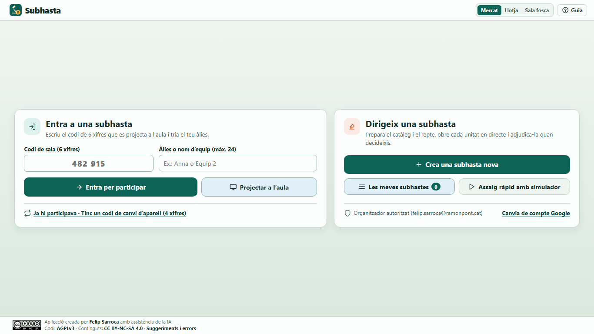
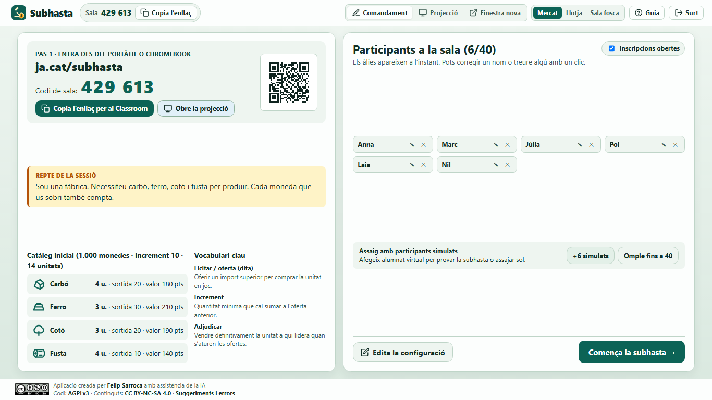
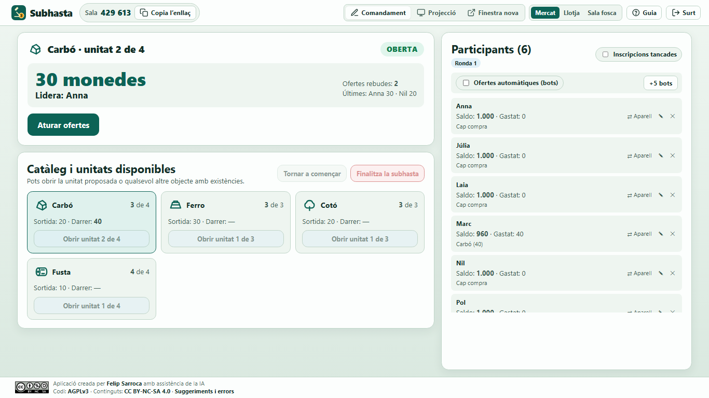
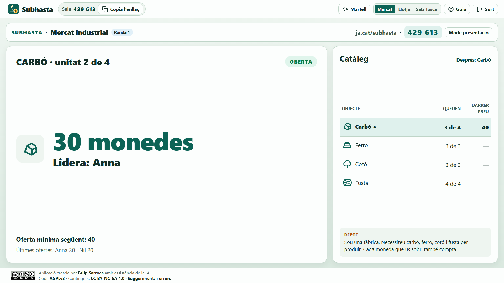
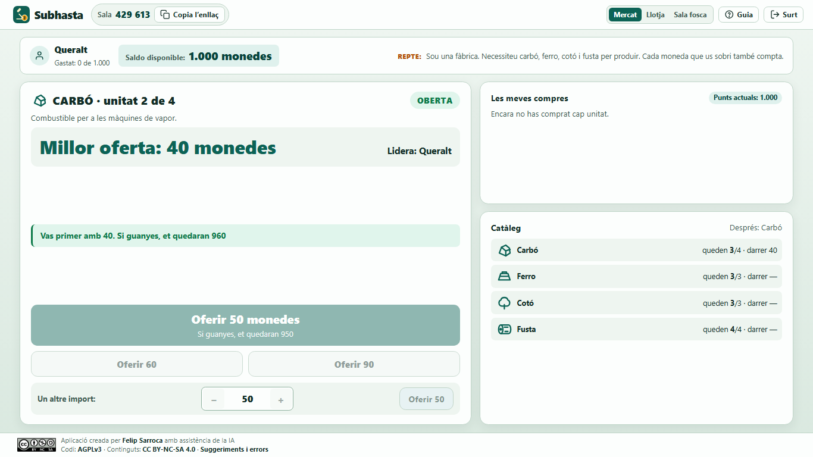
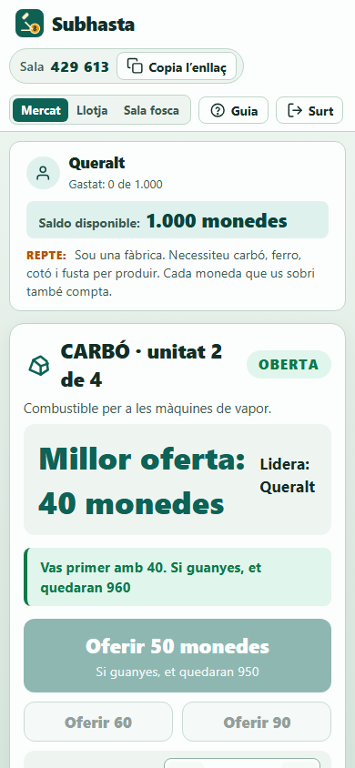
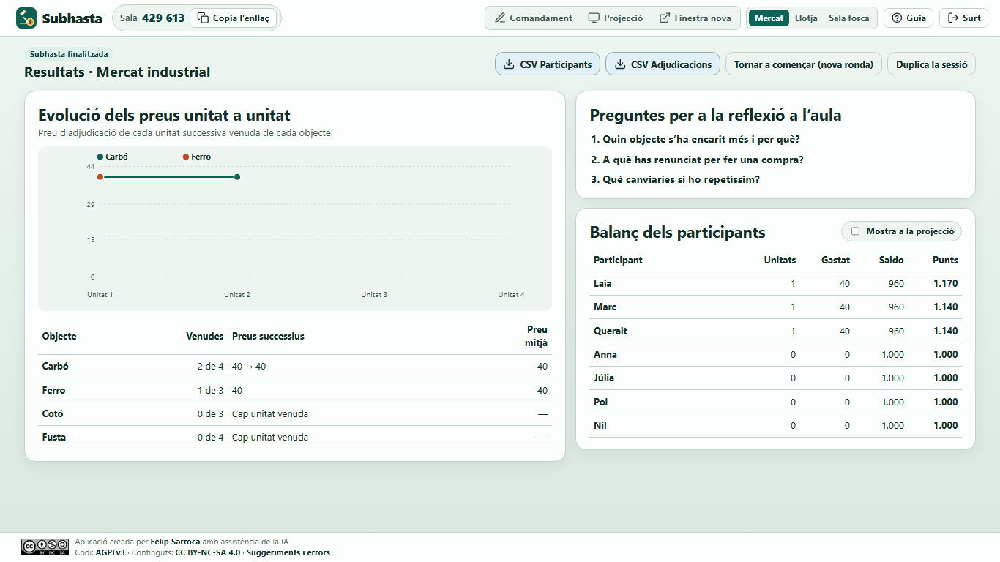

# Subhasta

Aplicació educativa de **subhastes angleses obertes en temps real** per treballar a l'aula com es formen els preus, l'escassetat, l'oferta i la demanda, el pressupost limitat, el cost d'oportunitat i la presa de decisions.

- **Accés directe:** [https://ja.cat/subhasta](https://ja.cat/subhasta)
- **Document de disseny:** [PLANIFICACIO.md](PLANIFICACIO.md)
- **Guia docent completa:** [docs/guia-docent.md](docs/guia-docent.md)
- **Llicència:** [LICENSE](LICENSE) (Codi: AGPLv3 · Continguts: CC BY-NC-SA 4.0)

---

## Captures de pantalla

### Portada i preparació (1366 × 768)

### Sala d'espera i comandament de l'organitzador (1366 × 768)

### Projecció d'aula (1920 × 1080 · Estils «Mercat» i «Sala fosca»)

### Terminal de l'alumnat en portàtil o Chromebook (1366 × 768) i mòbil (390 × 844)

  

### Resultats finals, gràfic d'evolució de preus i reflexió (1366 × 768)

---

## Com funciona

1. **Preparació:** l'organitzador defineix els objectes, les unitats de cadascun, el pressupost inicial, l'increment mínim, el repte didàctic i la puntuació opcional (o carrega amb un clic l'exemple *«Mercat industrial»*).
2. **Entrada ràpida:** l'alumnat entra a `ja.cat/subhasta` des del portàtil o Chromebook amb el codi de 6 xifres (o l'enllaç compartit al Classroom) i tria un àlies.
3. **Licitació en directe:** l'organitzador obre una unitat (per exemple, *«Carbó · unitat 2 de 4»*) i totes les pantalles mostren a l'instant l'objecte, la millor oferta i qui lidera.
4. **Autonomia al terminal:** l'alumnat licita amb tres botons d'import total i un selector `− / +` en múltiples de l'increment, veient sempre quants diners li quedaran si guanya.
5. **Adjudicació controlada:** l'organitzador atura les ofertes quan ho decideix (sense temporitzador automàtic) i adjudica la unitat sobre l'import i el líder congelats. Es pot desfer l'última adjudicació abans d'obrir la unitat següent.
6. **Tancament didàctic:** en finalitzar, es projecta el gràfic amb el preu de cada unitat successiva venuda i tres preguntes per al debat a l'aula, i es poden exportar dos fitxers CSV (`participants` i `adjudicacions`).

---

## Guia docent resumida

### Organització a l'aula (30–40 minuts)

- **Abans (5 min):** agrupeu l'alumnat en equips de **2 o 3 persones** per portàtil o Chromebook. Recomanem un catàleg d'entre **12 i 20 unitats totals** repartides en 3 o 4 objectes.
- **Durant (15–25 min):** utilitzeu la primera unitat com a **ronda de prova** perquè comprenguin la mecànica i a continuació premeu **«Tornar a començar»** per iniciar la partida real conservant tots els participants.
- **Després (10 min):** analitzeu el gràfic de preus unitat a unitat i debatgeu les tres preguntes finals sobre escassetat, cost d'oportunitat i estratègia.

### Vincle curricular (Decret 175/2022)

Activitat alineada amb el **Decret 175/2022, de 27 de setembre, d'ordenació dels ensenyaments de l'educació bàsica**:

- **Economia Bàsica (4t d'ESO) — Competència específica 1:** «Reconèixer els rols individuals i col·lectius de les persones dintre del sistema econòmic i constituir dinàmiques de participació ciutadana, prenent consciència de la interdependència dels factors econòmics, per valorar les desigualtats en l'accés als recursos i la distribució de la riquesa.»
- **Economia Bàsica (4t d'ESO) — Competència específica 5:** «Dissenyar un pla financer personal i/o familiar, aplicant estratègies de planificació i presa de decisions, avaluant-ne la coherència i consistència al llarg del temps, per donar resposta a les necessitats vitals presents i futures, i millorar la qualitat de vida.»
- **Emprenedoria (ESO) — Competència específica 5:** «Dissenyar solucions emprenedores, creatives i sostenibles, utilitzant metodologies àgils i actives d'innovació, per respondre a reptes o necessitats de l'entorn.»
- **Ciències Socials: Geografia i Història (ESO) — Competència específica 2:** «Indagar i argumentar a partir de problemes socials rellevants, locals i globals, per comprendre la complexitat del món actual i fomentar el pensament crític i el compromís cívic.»

---

## Arquitectura i verificació

- **Aplicació estàtica** allotjada a GitHub Pages amb sincronització en temps real a **Firebase Firestore** (`subhasta-aula-cat`, regió `eur3` de la Unió Europea) i sincronització instantània entre pestanyes (`BroadcastChannel`).
- **Proves automàtiques:** executeu `node tests/proves-domini.mjs` per verificar tots els casos de referència, les transicions d'estat, les 8 regles comptables invariants i la protecció de fórmules als CSV.
