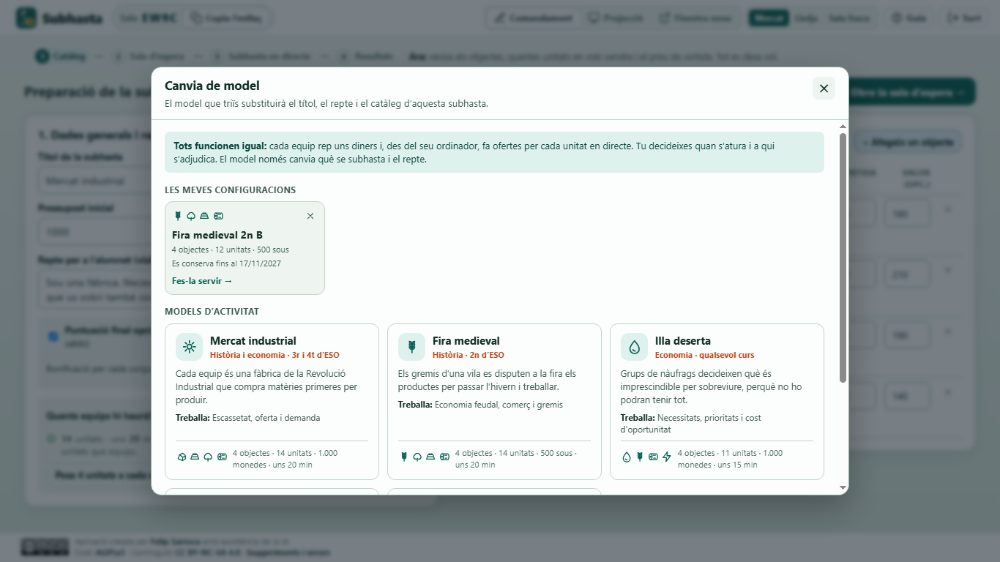
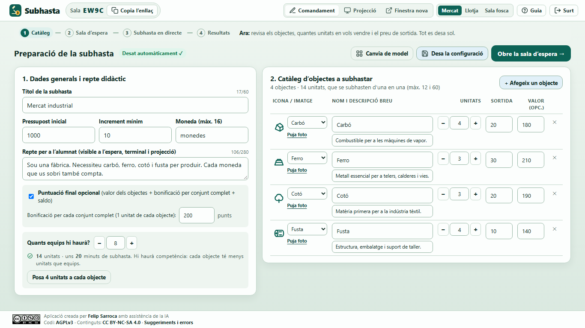
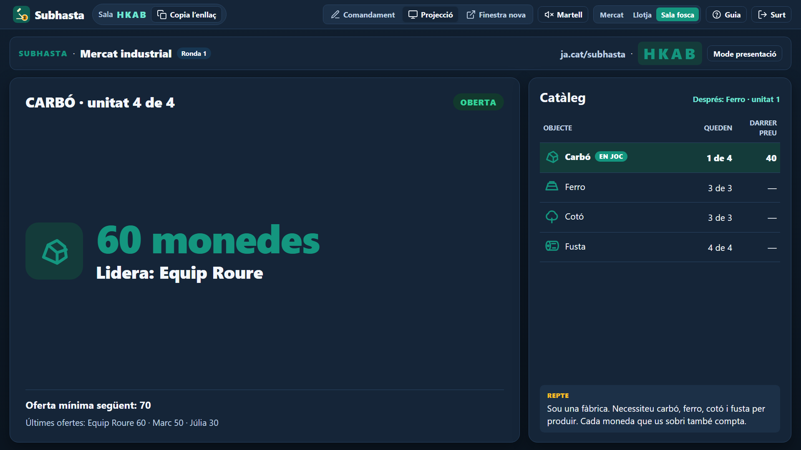

# Subhasta

Aplicació educativa de **subhastes angleses obertes en temps real** per treballar a l'aula com es formen els preus, l'escassetat, l'oferta i la demanda, el pressupost limitat, el cost d'oportunitat i la presa de decisions.

- **Accés directe:** [https://ja.cat/subhasta](https://ja.cat/subhasta)
- **Document de disseny:** [PLANIFICACIO.md](PLANIFICACIO.md)
- **Guia visual pas a pas (per a qui organitza per primer cop):** <https://felipsarroca.github.io/util-apps/Subhasta/guia.html> ([guia.html](guia.html))
- **Guia docent completa:** [docs/guia-docent.md](docs/guia-docent.md)
- **Llicència:** [LICENSE](LICENSE) (Codi: AGPLv3 · Continguts: CC BY-NC-SA 4.0)

---

## Captures de pantalla

### Portada, models i preparació (1366 × 768)

### Sala d'espera i comandament de l'organitzador (1366 × 768)

### Projecció d'aula (1920 × 1080 · Estils «Mercat» i «Sala fosca»)

### Terminal de l'alumnat en portàtil o Chromebook (1366 × 768) i mòbil (390 × 844)

  

### Resultats finals, gràfic d'evolució de preus i reflexió (1366 × 768)

---

## Com funciona

1. **Preparació:** l'organitzador defineix els objectes, les unitats de cadascun, el pressupost inicial, l'increment mínim, el repte didàctic i la puntuació opcional (o carrega amb un clic l'exemple *«Mercat industrial»*).
2. **Entrada ràpida:** l'alumnat entra a `ja.cat/subhasta` des del portàtil o Chromebook amb el codi de sala de 4 caràcters entre lletres i xifres (per exemple, `K7QM`; o l'enllaç compartit al Classroom) i tria un àlies. El codi no fa servir caràcters que es confonen (0/O, 1/I/L) i es pot escriure en minúscules.
3. **Licitació en directe:** l'organitzador obre una unitat (per exemple, *«Carbó · unitat 2 de 4»*) i totes les pantalles mostren a l'instant l'objecte, la millor oferta i qui lidera.
4. **Autonomia al terminal:** l'alumnat licita amb tres botons d'import total i un selector `− / +` en múltiples de l'increment, veient sempre quants diners li quedaran si guanya.
5. **Adjudicació controlada:** l'organitzador atura les ofertes quan ho decideix (sense temporitzador automàtic) i adjudica la unitat sobre l'import i el líder congelats. Es pot desfer l'última adjudicació abans d'obrir la unitat següent.
6. **Tancament didàctic:** en finalitzar, es projecta el gràfic amb el preu de cada unitat successiva venuda i tres preguntes per al debat a l'aula, i es poden exportar dos fitxers CSV (`participants` i `adjudicacions`).

---

## Guia docent resumida

### Organització a l'aula (30–40 minuts)

- **Abans (5 min):** agrupeu l'alumnat en equips de **2 o 3 persones** per portàtil o Chromebook. Recomanem un catàleg d'entre **12 i 20 unitats totals** repartides en 3 o 4 objectes.
- **Durant (15–25 min):** utilitzeu la primera unitat com a **ronda de prova** perquè comprenguin la mecànica i a continuació premeu **«Tornar a començar»** per iniciar la partida real conservant tots els participants.
- **Després (10 min):** analitzeu el gràfic de preus unitat a unitat i debatgeu les tres preguntes finals sobre escassetat, cost d'oportunitat i estratègia.

### Vincle curricular (Decret 175/2022)

Activitat alineada amb el **Decret 175/2022, de 27 de setembre, d'ordenació dels ensenyaments de l'educació bàsica**:

- **Economia Bàsica (4t d'ESO) — Competència específica 1:** «Reconèixer els rols individuals i col·lectius de les persones dintre del sistema econòmic i constituir dinàmiques de participació ciutadana, prenent consciència de la interdependència dels factors econòmics, per valorar les desigualtats en l'accés als recursos i la distribució de la riquesa.»
- **Economia Bàsica (4t d'ESO) — Competència específica 5:** «Dissenyar un pla financer personal i/o familiar, aplicant estratègies de planificació i presa de decisions, avaluant-ne la coherència i consistència al llarg del temps, per donar resposta a les necessitats vitals presents i futures, i millorar la qualitat de vida.»
- **Emprenedoria (ESO) — Competència específica 5:** «Dissenyar solucions emprenedores, creatives i sostenibles, utilitzant metodologies àgils i actives d'innovació, per respondre a reptes o necessitats de l'entorn.»
- **Ciències Socials: Geografia i Història (ESO) — Competència específica 2:** «Indagar i argumentar a partir de problemes socials rellevants, locals i globals, per comprendre la complexitat del món actual i fomentar el pensament crític i el compromís cívic.»

---

## Arquitectura i verificació

- **Aplicació estàtica** allotjada a GitHub Pages amb sincronització en temps real a **Firebase Firestore** (`subhasta-aula-cat`, regió `eur3` de la Unió Europea) i sincronització instantània entre pestanyes (`BroadcastChannel`).
- **Proves automàtiques:** executeu `node tests/proves-domini.mjs` per verificar tots els casos de referència, les transicions d'estat, les 8 regles comptables invariants, la protecció de fórmules als CSV i el format del codi de sala.
- **Regles de Firestore:** `firebase/firestore.rules`; es publiquen amb `firebase deploy --only firestore:rules --project subhasta-aula-cat` des de la carpeta `firebase`.

---

## Novetats de la versió 1.1 (17-11-2026)

- **Codi de sala de 4 caràcters** alfanumèrics (abans, 6 xifres). Les sales antigues de 6 xifres continuen funcionant.
- **Entre aparells de debò:** la sala es desa al núvol abans d'obrir-la, l'entrada i les ofertes de l'alumnat només es donen per bones quan Firestore les confirma, i les pantalles es reconnecten soles si perden la connexió.
- **Terminal més clar:** targeta central per a l'espera i per al rebut de compra, missatge d'estat just sota l'oferta i botons sempre a la mateixa posició.
- **Comandament:** icones de línia per a canvi d'aparell, canvi d'àlies i baixa; qui lidera queda destacat a la llista; el catàleg indica quina unitat és en joc.
- **Projecció:** codi més gran, catàleg alineat a dalt amb la marca «En joc», «Després» amb la unitat concreta i sense peu de pàgina per guanyar espai.
- **Sala d'espera:** codi gegant, QR més gran i estat buit explicatiu.
- **Resultats:** eix del gràfic amb valors rodons.
- **Privadesa:** la portada ja no mostra el correu de l'organitzador i «Les meves subhastes» només inclou les sales pròpies.

## Novetats de la versió 1.2 (17-11-2026)

- **Qualsevol persona pot organitzar una subhasta**, sense compte. Qui la crea n'és el propietari i és l'únic que la pot dirigir.
- **Seguretat real amb Firebase Authentication:** tothom entra amb un usuari anònim i les regles comproven qui és el propietari de cada sala. Un alumne no pot canviar el tauler, les carteres, les adjudicacions ni el codi de sala d'una subhasta aliena, ni llegir les carteres dels altres.
- **Vinculació opcional amb Google** («Vincula-les a Google» a la portada) per dirigir les subhastes des d'un altre ordinador.
- **Canvi d'aparell entre ordinadors diferents:** el traspàs de la cartera es fa al núvol i les regles comproven el codi.
- **Balanç projectat a tots els aparells** quan l'organitzador ho decideix.
- **Guia visual pas a pas** ([guia.html](guia.html)), enllaçada des de la portada i des del botó «Guia»: captures comentades de cada pantalla, com omplir el catàleg (unitats, preu de sortida, valor), quantitats recomanades segons el grup, puntuació, projecció, cicle d'adjudicació, resultats i preguntes freqüents.

## Novetats de la versió 1.3 (17-11-2026)

- **Començar amb pocs clics:** «Crea una subhasta nova» mostra cinc models d'activitat (Mercat industrial, Fira medieval, Illa deserta, Llança la teva empresa i Comença de zero) amb la matèria, en què consisteix, què es treballa i la durada orientativa. Un clic i la preparació ja és plena.
- **Configuracions desades amb nom:** «Desa la configuració» guarda títol, repte, diners i catàleg per fer-los servir amb altres grups. Es conserven un any des de l'últim ús (màxim 20 per persona) i després s'esborren soles, per no omplir el servidor.
- **Recorregut guiat per a qui organitza:** barra de quatre passos (Catàleg → Sala d'espera → Subhasta en directe → Resultats) i una línia «Ara:» que diu què toca fer en cada moment, també durant cada unitat.
- **Quantitats fàcils:** botons − i + a cada objecte i un bloc «Quants equips hi haurà?» que calcula les unitats, la durada i, amb un clic, posa a cada objecte les unitats recomanades perquè hi hagi competència.
- **Terminal de l'alumnat més clar:** l'estat propi («Pots oferir…», «Vas primer…», «T'han superat…») destaca amb icona, color i una explicació del que pot fer; s'hi veuen les últimes ofertes, les compres agrupades per objecte, el progrés cap al conjunt complet i l'objecte «En joc» al catàleg.
