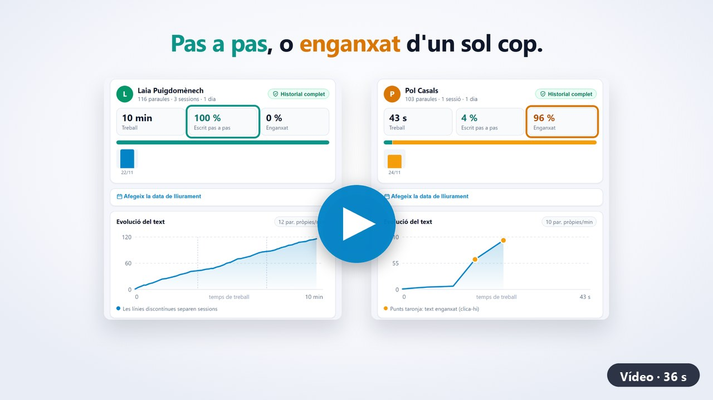
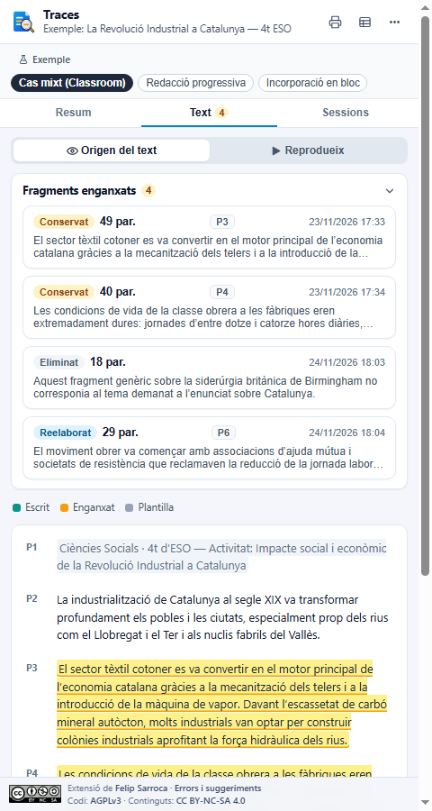
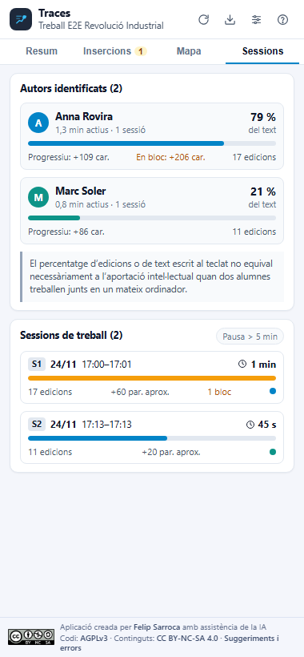

# Traces — Com s'ha elaborat un treball de Google

- **Instal·lació (Chrome Web Store):** [Traces a la botiga](https://chromewebstore.google.com/detail/traces-%E2%80%94-com-sha-elaborat/bhefekpdnechibijoigoomnjlgcbhilb?hl=ca)
- **Pàgina web i demostració:** <https://ja.cat/app-traces>
- **Vídeo de presentació (36 s):** <https://youtu.be/ScLl4G9Zstg>
- **Privadesa i full per a famílies:** <https://felipsarroca.github.io/util-apps/Traces/privadesa.html>
- **Errors i suggeriments:** [formulari](https://github.com/felipsarroca/util-apps/issues/new?template=traces.yml)

**Traces** és una extensió de Google Chrome en català, gratuïta i de codi obert, per al professorat. Mostra d'un cop d'ull com s'ha elaborat un treball de **Google Docs**, **Presentacions** o **Fulls de càlcul**, dins del mateix fitxer o des de **Google Classroom**. Tot es calcula al navegador: no s'envia res a cap servidor.

[](https://youtu.be/ScLl4G9Zstg)

---

## Què mostra

- **Fitxa de l'alumne:** temps de treball, percentatge escrit pas a pas i percentatge enganxat, amb una franja dels dies treballats.
- **Senyals breus:** poques correccions, tot fet l'últim dia, ritme d'escriptura molt alt, fragments moguts (text propi retallat i enganxat, que no compta com a enganxat) i nombre d'autors.
- **Data de lliurament:** la llegeix de Classroom (o l'escriviu vosaltres) i indica quan es va començar, quina part es va fer les últimes 24 h i si hi ha feina fora de termini.
- **Evolució sobre el temps real de treball:** les pauses no ocupen espai, de manera que un salt vertical vol dir molt text en poc temps.
- **Pestanya Text:** fragments enganxats (conservats, reelaborats o eliminats), mapa acolorit del text final i reproducció pas a pas amb el botó «Següent enganxat».
- **Presentacions:** diapositives amb paraules, imatges, enganxats i qui hi ha participat.
- **Fulls de càlcul:** cel·les escrites a mà, enganxades i fórmules, per autor, i llista de dades enganxades.
- **Documents amb pestanyes:** analitza totes les pestanyes.
- **Classroom:** botó **Analitza la classe** a la pàgina de la tasca, etiquetes al costat de cada treball i taula comparativa ordenable (exportable en CSV). Al qualificador, botó **Al comentari privat**, que escriu el resum sense enviar-lo.
- **Informe d'una pàgina** per imprimir o desar en PDF.
- **Segell de fiabilitat** sempre visible i avís clar si Google canvia el format intern.

| Resum | Text | Sessions |
|---|---|---|
|  |  |  |

---

## Com instal·lar-la (pas a pas)

1. Obriu la fitxa de [Traces a Chrome Web Store](https://chromewebstore.google.com/detail/traces-%E2%80%94-com-sha-elaborat/bhefekpdnechibijoigoomnjlgcbhilb?hl=ca) i premeu **Afegeix a Chrome**.
2. A la icona de la peça de trencaclosques, fixeu la icona de Traces.

Amb un compte de centre, si la botiga diu que està bloquejada, l'administrador del Google Workspace l'ha de permetre (o forçar-ne la instal·lació al claustre) amb l'identificador `bhefekpdnechibijoigoomnjlgcbhilb`: vegeu [PUBLICACIO.md](./PUBLICACIO.md).

Per provar-la des del codi: `chrome://extensions` › **Mode de desenvolupador** › **Carrega descomprimida** › carpeta `Traces/extension`.

## Com fer-la servir

- **Un treball:** obriu el fitxer (cal permís d'edició) i premeu el botó **Traces** de dalt a la dreta. Si la finestra és prou ampla, el fitxer s'estreny per fer lloc al panell.
- **Al qualificador de Classroom:** el botó apareix a baix a la dreta del treball. En passar a l'alumne següent, Traces l'analitza sol.
- **Tota la classe:** obriu la tasca a Classroom (pestanya *Treball de l'alumnat*) i premeu **Analitza la classe**. La taula es consulta amb la icona de taula del panell.

## Com actualitzar-la

Des de la botiga, Chrome l'actualitza sol. Si la teníeu instal·lada amb el `.zip`, elimineu-la a `chrome://extensions` i instal·leu-la des de la botiga.

> **Criteri pedagògic:** Traces no és un detector d'IA ni prova res per si sol. «Enganxat» vol dir que un fragment va entrar d'un sol cop: pot ser copiat, però també un esborrany propi, un dictat o una traducció. És un punt de partida per parlar amb l'alumne.

---

## Desenvolupament

```bash
npm install
npm test          # proves amb Vitest
npm run build     # compila l'extensió a extension/
```

Estructura:

- `src/extractor/` lectura de l'historial (Docs, Presentacions i Sheets).
- `src/core/` intèrprets dels formats interns, reconstrucció del text i mètriques.
- `src/content/` botó dins dels fitxers (`docsToolbarButton.ts`) i integració amb Classroom (`classroom.ts`).
- `src/ui/` panell (React).
- `video/` vídeo de presentació: animació, renderitzador i banda sonora sintetitzada (vegeu `video/README.md`). El resultat és `store/traces-promocional.mp4`.

Si Google canvia el format intern, el segell de fiabilitat passa a vermell i les proves de `tests/` ajuden a localitzar el canvi.

---

## Autoria i llicència

Extensió de [Felip Sarroca](https://ja.cat/felipsarroca).

- **Codi font:** [GNU AGPLv3 o posterior](./LICENSE)
- **Continguts, textos i disseny gràfic:** [Creative Commons BY-NC-SA 4.0](https://creativecommons.org/licenses/by-nc-sa/4.0/deed.ca)
