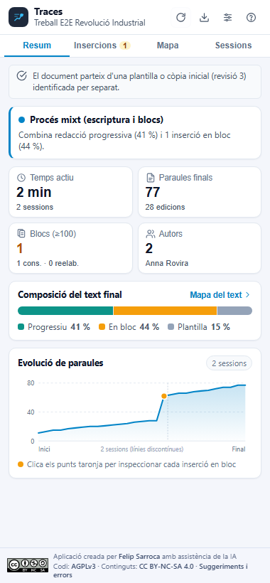
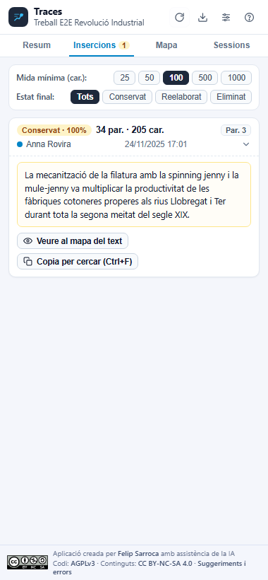
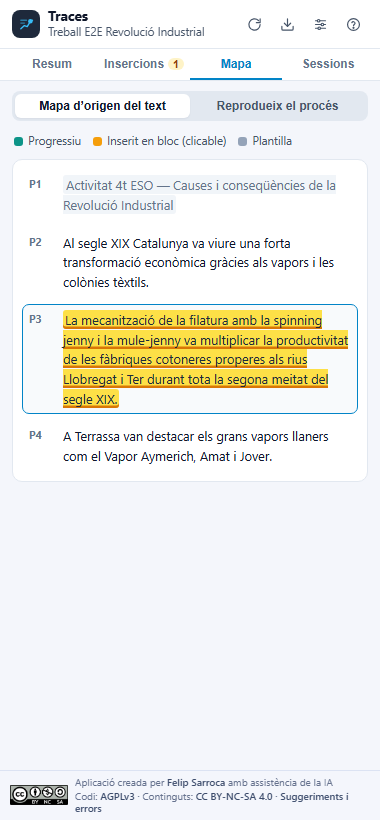

# Traces — Procés d'elaboració a Google Docs

- **Pàgina web, descàrrega directa (.zip) i demostració interactiva:** <https://ja.cat/app-traces>

**Traces** és una extensió de Google Chrome en català, gratuïta i de codi obert pensada per al professorat. Permet analitzar amb un sol clic com s'ha elaborat un document de Google Docs (també directament des del qualificador de Google Classroom), sense que l'alumnat hagi d'instal·lar res prèviament i processant totes les dades **100 % en local al navegador**.

---

## Què permet veure d'un cop d'ull

- **Resum visual immediat:** temps actiu estimat, nombre de sessions, paraules finals, autors i proporció exacta del text final escrita **progressivament**, **inserida en bloc** o provinent d'una **plantilla inicial** (com ara un enunciat de Google Classroom).
- **Gràfic d'evolució de paraules:** línia temporal interactiva amb separació de sessions i punts taronja clicables allà on s'han produït insercions massives.
- **Inspecció d'insercions en bloc:** filtres instantanis (`25 · 50 · 100 · 500 · 1000` caràcters) i classificació automàtica de cada fragment segons si al document final s'ha **conservat**, **reelaborat** o **eliminat**.
- **Mapa d'origen del text i reproductor:** vista completa del treball amb els fragments inserits en bloc ressaltats en context paràgraf a paràgraf, més un reproductor pas a pas (`1× · 4× · 12×`) per observar com s'ha construït el document.
- **Sessions i autors:** cronologia d'estones de treball i participació de cada editor sense duplicar intervals simultanis.
- **Exportació docent:** informe llest per imprimir o desar en PDF, taula CSV i exportació/importació d'historials JSON.

### Vista del panell lateral (380 px)

| Resum i evolució | Insercions en bloc | Mapa d'origen | Sessions i autors |
|---|---|---|---|
|  |  |  |  |

---

## Com instal·lar-la a Google Chrome (pas a pas)

La carpeta [`extension/`](./extension) ja conté l'extensió compilada i llesta per carregar a qualsevol ordinador sense necessitat d'instal·lar res més:

1. Obriu Google Chrome i escriviu a la barra d'adreces:
   ```text
   chrome://extensions
   ```
2. A la cantonada superior dreta, activeu l'interruptor **Mode de desenvolupador** (*Developer mode*).
3. Feu clic al botó **Carrega descomprimida** (*Load unpacked*) que apareix a dalt a l'esquerra.
4. Seleccioneu la carpeta **`extension`** de dins d'aquest projecte:
   ```text
   W:\La meva unitat\Github\util-apps\Traces\extension
   ```
5. Feu clic a la icona de la peça de trencaclosques (Extensions) de la barra superior de Chrome i **fixeu la icona de Traces** (la xinxeta) perquè quedi sempre a la vista.

---

## Com fer-la servir

1. Obriu qualsevol treball de **Google Docs** (en què tingueu permís d'edició, com els treballs lliurats a **Google Classroom**) o bé obriu-lo directament dins la pantalla de correcció de Classroom.
2. Feu **un clic a la icona de Traces** a dalt a la dreta de Chrome.
3. S'obrirà el panell lateral a la dreta amb el diagnòstic visual del document.
4. Si passeu al document del següent alumne amb el panell obert, Traces ho detectarà i l'analitzarà automàticament.

> **Nota pedagògica i de privadesa:** Traces mostra evidències objectives sobre el procés temporal d'escriptura i no és un detector d'IA. Una inserció en bloc pot correspondre a copiar i enganxar, però també a un esborrany previ fet en un altre document, dictat per veu, traducció o sincronització fora de línia. Cap dada ni cap fragment de text surt mai del vostre navegador.

---

## Desenvolupament i proves (opcional)

Si modifiqueu el codi font TypeScript/React de [`src/`](./src):

```bash
npm install
npm test          # Executa les proves automatitzades amb Vitest
npm run build     # Compila l'extensió actualitzada dins d'extension/
```

Després de compilar, premeu el botó de recarregar (`↻`) a la targeta de **Traces** dins de `chrome://extensions`.

---

## Autoria i llicència

Aplicació creada per [Felip Sarroca](https://ja.cat/felipsarroca) amb assistència de la IA.

- **Codi font:** [GNU AGPLv3 o posterior](./LICENSE)
- **Continguts, textos i disseny gràfic:** [Creative Commons BY-NC-SA 4.0](https://creativecommons.org/licenses/by-nc-sa/4.0/deed.ca)
- **Suggeriments i errors:** [Formulari d'incidències de Traces](https://github.com/felipsarroca/util-apps/issues/new?template=traces.yml)
