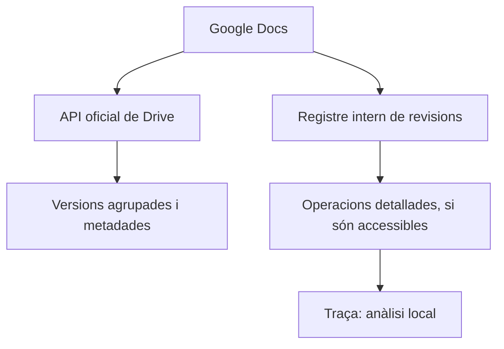
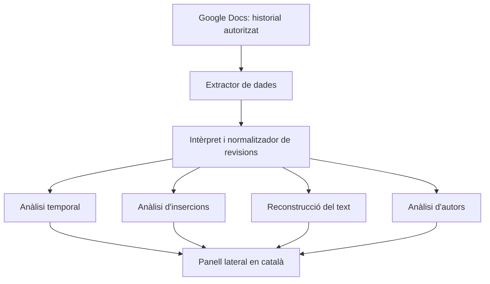

# Traça — Estudi de viabilitat d'una extensió de Chrome per analitzar l'historial de Google Docs

**Data de la recerca inicial:** 25 de novembre de 2026  
**Estat:** proposta preliminar, pendent de prova de concepte i validació experimental.

## 1. Origen i objectius del projecte

La proposta neix de la necessitat docent de conèixer com s'ha elaborat un treball en Google Docs. Es vol crear una extensió de Chrome que, en obrir un document, permeti analitzar-ne retrospectivament l'historial amb un sol clic, estimar el temps d'edició i detectar quan i on s'han produït possibles accions de copiar i enganxar.

Ja existeixen extensions amb aquestes funcionalitats, però algunes són de pagament, tenen quotes d'ús o no ofereixen tota la informació desitjada. Abans de desenvolupar una alternativa pròpia, cal determinar si és viable, si aporta valor diferencial i si l'esforç de creació i manteniment compensa el benefici.

### Requisits inicials

- Interfície íntegrament en català.
- Ús gratuït, sense quotes comercials ni límits artificials de documents.
- Anàlisi retrospectiva: l'alumnat no ha d'haver instal·lat l'extensió abans de redactar.
- Activació amb un únic clic des de Google Docs.
- Informació clara, precisa dins dels límits de les dades i útil per al professorat.
- Identificació temporal i textual de les insercions en bloc.
- Respecte per la privacitat de l'alumnat, sense enviar documents a servidors externs.
- Sense compte propi, subscripcions ni dependència d'un servei comercial extern.
- No utilitzar detectors d'IA com a prova d'autoria: analitzar el procés d'elaboració, no atribuir-ne automàticament l'origen.

## 2. Alternatives existents

Les característiques i preus següents recullen la recerca inicial de la conversa; no s'han verificat mitjançant proves pràctiques ni s'han tornat a consultar en preparar aquest document. Poden canviar.

### 2.1. Revision History

- Web: <https://www.revisionhistory.com/>
- Chrome Web Store: <https://chromewebstore.google.com/detail/dlepebghjlnddgihakmnpoiifjjpmomh>
- Condicions identificades: fins a 150 documents mensuals gratuïts; pla il·limitat de 32 USD anuals.
- Avantatges: temps estimat d'edició, sessions, possibles enganxades, reproducció de l'escriptura, diversos autors i integració amb Classroom. Segons els desenvolupadors, processament local del contingut.
- Inconvenients: quota mensual, subscripció per a ús il·limitat i dependència externa.
- És l'alternativa més semblant a la proposta inicial.

### 2.2. Draftback

- Web: <https://draftback.com/>
- Chrome Web Store: <https://chromewebstore.google.com/detail/nnajoiemfpldioamchanognpjmocgkbg>
- Model de subscripció amb període de prova.
- Avantatges: reconstrucció detallada de les revisions, reproducció de modificacions, estadístiques i processament local. Prioritza mostrar evidències en lloc d'acusar l'alumnat.
- Inconvenients: de pagament i més orientada a la reproducció que al diagnòstic immediat. El manteniment és exigent, segons el seu creador.

### 2.3. Process Feedback for Google Docs

- Web: <https://processfeedback.org/gdocs/>
- Chrome Web Store: <https://chromewebstore.google.com/detail/chcbikmmlhbbdkfiaaaljabpefdfajnb>
- Ús individual gratuït per a professors i estudiants; algunes prestacions institucionals de pagament. No s'ha confirmat experimentalment si hi ha quotes d'ús.
- Avantatges: anàlisi retrospectiva, temps d'escriptura, pauses, aportacions per autor, possibles enganxades, gràfics, reproducció i exportació ZIP de l'historial. L'alumnat no necessita un compte al servei.
- Inconvenients: pot oferir més informació de la necessària per a una correcció ordinària; les opcions de compartició externa requereixen precaució.
- És la primera alternativa que convé provar abans de decidir si es desenvolupa Traça.

### 2.4. Brisk Teaching — Inspect Writing

- Web: <https://www.briskteaching.com/inspect-writing>
- Model freemium; quota gratuïta concreta no confirmada.
- Avantatges: interfície docent, reproducció visual del procés d'escriptura i integració amb altres eines educatives.
- Inconvenients: forma part d'una plataforma comercial amb funcionalitats d'IA que no necessàriament interessen al projecte. Processament local no verificat.

### 2.5. Comparativa

| Característica | Revision History | Draftback | Process Feedback | Brisk |
|---|---|---|---|---|
| Anàlisi retrospectiva | Sí | Sí | Sí | Sí |
| Temps estimat d'edició | Sí | Sí | Sí | No verificat |
| Sessions | Sí | Sí | Sí | No verificat |
| Insercions massives | Sí | Visual | Sí | Visual |
| Reproducció | Sí | Sí | Sí | Sí |
| Diversos autors | Sí | Sí | Sí | No verificat |
| Gratuïtat continuada | Limitada | No | Individual | Condicions no confirmades |
| Processament local | Sí | Sí | Per defecte | No verificat |
| Català | No confirmat | No confirmat | No confirmat | No confirmat |

## 3. Viabilitat tècnica i accés a les revisions

### 3.1. API oficial de Google Drive

L'API oficial permet enumerar revisions, consultar metadades com dates i autors i, quan sigui possible, exportar versions. Google adverteix que els historials retornats poden ser incomplets i que les revisions poden agrupar-se. Per tant, aquesta via no garanteix una reconstrucció detallada de cada operació d'escriptura.

Referències oficials:

- <https://developers.google.com/workspace/drive/api/guides/manage-revisions>
- <https://developers.google.com/workspace/drive/api/reference/rest/v3/revisions/list>

### 3.2. Registre intern de Google Docs

Google Docs necessita gestionar operacions granulars per permetre l'edició simultània. Diverses eines i investigacions han aprofitat registres interns, inclòs un punt d'accés conegut com `revisions/load`, per reconstruir el procés.

Aquesta és la via prometedora, però no constitueix una API pública estable. Google pot canviar els formats, l'autenticació, la disponibilitat o els permisos. Cal validar l'accés actual amb una sessió legítimament autoritzada, sense eludir restriccions, i revisar les condicions aplicables abans de distribuir l'extensió.



La dependència d'un mecanisme intern és el principal risc del projecte. Encara no s'ha comprovat experimentalment que funcioni en l'entorn actual.

## 4. Què es pot mesurar i què no

| Informació | Viabilitat preliminar |
|---|---|
| Dates de modificacions | Alta |
| Identificació dels editors | Alta |
| Text afegit o eliminat per operació | Alta |
| Posició de les insercions | Alta |
| Nombre de sessions | Alta, segons criteri |
| Insercions massives | Alta |
| Temps d'edició activa | Estimació |
| Percentatge de text final introduït en bloc | Alta si l'historial és suficient |
| Localització de text inserit que es conserva | Mitjana-alta |
| Nombre exacte de copiar i enganxar | No garantit |
| Procedència externa del text | Generalment desconeguda |
| Ús d'IA | No demostrable |
| Temps dedicat a pensar, llegir o investigar | No detectable |

Totes aquestes estimacions estan condicionades a la disponibilitat i qualitat del registre real.

### 4.1. Temps d'edició

Exemple: tres sessions d'11, 14 i 6 minuts separades per pauses. Entre la primera i la darrera modificació transcorren 1 h 53 min, però les sessions sumen 31 minuts.

Una possible metodologia és agrupar modificacions consecutives i separar sessions quan hi ha més de cinc minuts d'inactivitat. El llindar ha de ser configurable. Cal definir com es tracten les sessions amb una sola operació i evitar sumar dues vegades els intervals simultanis de diversos autors.

Indicadors: temps transcorregut, temps estimat d'edició, nombre i durada de sessions, pauses i activitat per autor. El temps entre modificacions no és una mesura exacta del temps de dedicació.

### 4.2. Copiar i enganxar

Una inserció de 1.500 caràcters en una sola operació és compatible amb una enganxada, però també amb text redactat en un altre document, dictat, traducció, substitució automàtica o agrupació de modificacions per Google.

Process Feedback, segons la recerca inicial, utilitza per defecte un llindar de 25 caràcters configurable. Draftback també adverteix sobre l'agrupació de pulsacions.

Cal distingir:

- **Escriptura progressiva:** petites insercions consecutives.
- **Inserció en bloc:** incorporació de molts caràcters en una operació.
- **Possible enganxada:** inserció compatible amb copiar i enganxar, sense certesa sobre la seva procedència.

No s'ha de confondre una inserció en bloc amb plagi o ús d'IA. Convé mostrar el text concret, la data, l'autor i la posició, així com si s'ha conservat, modificat o eliminat.

## 5. Referents tècnics i codi obert

| Recurs | Utilitat |
|---|---|
| [Harvard VPAL — gdocrevisions](https://github.com/harvard-vpal/gdocrevisions) | Biblioteca Python per recuperar i interpretar historials. |
| [Draftback — GitHub](https://github.com/jsomers/draftback) | Referent històric; cal verificar la disponibilitat i vigència del codi. |
| [Deciphering Google Doc Revision Data](https://gist.github.com/syntaxi/b28ff43c4aa1f18c0b9c0714f516d2fb) | Documentació independent del format intern. |
| [Humanshipd — investigació tècnica](https://github.com/Flagrare/humanshipd/blob/main/docs/research/2026-06-06-google-docs-writing-capture.md) | Investigació sobre vies d'obtenció de modificacions. |
| [Process Feedback — Advanced Edit History Explorer](https://gdocs-explorer.processfeedback.org/) | Exploració de dades exportades. |

Cal comprovar que els enllaços, repositoris, llicències i formats continuen vigents abans de reutilitzar codi. No s'ha auditat cap repositori en aquesta fase.

## 6. Proposta funcional: Traça

**Traça** és el nom provisional, no una decisió definitiva. L'objectiu és una eina ràpida, clara i específicament docent, no una còpia de totes les funcions de les alternatives.

### 6.1. Experiència d'ús

1. El professor obre un document de Google Docs, per exemple des de Classroom.
2. Pitja la icona de Traça.
3. S'obre un panell lateral de Chrome i comença l'anàlisi.
4. Apareix un resum amb indicadors i gràfics.
5. El professor pot inspeccionar insercions, sessions i autors.
6. Si l'historial és inaccessible o incomplet, es mostra un advertiment explícit.

### 6.2. Maqueta conceptual del panell

Exemple fictici: treball de socials de 4t ESO sobre la Revolució Industrial. No correspon a cap alumne ni document real.

| Indicador | Valor fictici |
|---|---:|
| Temps actiu estimat | 24 min |
| Sessions | 3 |
| Paraules finals | 682 |
| Modificacions | 1.284 |
| Text final introduït progressivament | 40 % |
| Text final introduït en bloc | 60 % |

Pestanyes:

- **Resum:** indicadors, distribució del text i gràfic d'evolució de paraules.
- **Insercions:** filtre de 25, 50, 100, 500 o 1.000 caràcters; desplegament del text, data, autor, paràgraf i estat de conservació.
- **Sessions:** data, hora d'inici i final, durada i aportació neta.
- **Autors:** activitat individual, amb l'advertiment que el percentatge de modificacions no equival a contribució intel·lectual.

Exemples d'insercions de la maqueta original:

| Data i hora | Paraules | Caràcters | Posició | Estat |
|---|---:|---:|---|---|
| 23/11/2026 17:42 | 186 | 1.124 | Paràgraf 4 | Conservat |
| 23/11/2026 17:43 | 134 | 815 | Paràgraf 5 | Conservat |
| 24/11/2026 18:12 | 14 | 86 | Paràgraf 7 | Eliminat |
| 24/11/2026 18:21 | 92 | 563 | Paràgraf 9 | Conservat |

Sessions fictícies: 23/11 17:30–17:44 (14 min); 24/11 18:09–18:15 (6 min); 24/11 18:21–18:25 (4 min). Autors ficticis: alumne A, 1.053 modificacions (82 %); alumne B, 231 (18 %).

Els valors de la maqueta són merament il·lustratius, no una reconstrucció validada d'un historial coherent.

### 6.3. Prioritats funcionals

| Funcionalitat | Prioritat |
|---|---|
| Anàlisi amb un clic | Imprescindible |
| Temps estimat d'edició | Imprescindible |
| Nombre i durada de sessions | Imprescindible |
| Detecció d'insercions en bloc | Imprescindible |
| Visualització del text inserit | Imprescindible |
| Llindar configurable | Imprescindible |
| Identificació d'autors | Alta |
| Gràfic d'evolució del document | Alta |
| Localització de text al document actual | Alta |
| Distinció entre text conservat i eliminat | Alta |
| Exportació d'informe PDF | Mitjana |
| Reproducció del procés | Mitjana |
| Exportació CSV o JSON | Mitjana |
| Anàlisi conjunta de tota una classe | Futura |

Especialment valuós: calcular quina part del text final prové d'insercions en bloc i quina s'ha reelaborat. No és equivalent enganxar fragments i treballar-los profundament que incorporar un treball gairebé complet de cop.

## 7. Arquitectura tècnica proposada



| Tecnologia | Funció |
|---|---|
| Chrome Manifest V3 | Estructura de l'extensió |
| TypeScript | Programació i interpretació |
| React | Interfície |
| Vite | Desenvolupament i compilació |
| SVG | Gràfics |
| Vitest | Proves automatitzades |
| Chrome Storage | Preferències locals |
| GitHub | Control de versions i codi font |

Documentació del panell lateral: <https://developer.chrome.com/docs/extensions/reference/api/sidePanel>.

No es preveu necessitar Supabase, Neon, Firebase, serveis d'IA, servidor propi ni autenticació pròpia. El processament es faria al navegador i es conservarien només les preferències necessàries.

L'extractor ha d'estar separat del motor d'anàlisi i de la interfície, per facilitar el manteniment quan Google canviï els seus formats. El motor ha de poder provar-se amb dades sintètiques o historials de prova anonimitzats sense connexió a Google.

## 8. Riscos i privacitat

| Risc | Importància |
|---|---|
| Canvis de Google en formats o punts d'accés interns | Molt alta |
| Agrupació o pèrdua de revisions | Alta |
| Interpretació incorrecta d'insercions | Alta |
| Edició sense connexió i sincronització posterior | Alta |
| Falsos positius de copiar i enganxar | Alta |
| Diversos comptes i editors | Mitjana |
| Documents amb diverses pestanyes | Mitjana |
| Taules, imatges i formats complexos | Mitjana |
| Permisos de documents de Classroom | Mitjana |
| Publicació a Chrome Web Store | Baixa-mitjana |
| Cost d'infraestructura | Molt baix |

L'accés a l'historial normalment requereix permisos d'edició; no s'ha de pressuposar que qualsevol document visible pugui analitzar-se. A més, una seqüència d'operacions semblant a l'escriptura humana no demostra necessàriament l'autoria.

L'extensió ha d'indicar la qualitat i cobertura de l'historial, distingir errors d'accés de manca de dades i evitar presentar resultats amb falsa precisió.

### Protecció de dades

- Anàlisi només quan el professor la sol·licita.
- Permisos mínims i accés exclusivament als documents autoritzats.
- Sense seguiment en segon pla de l'alumnat.
- Sense telemetria ni enviament de continguts a tercers.
- Sense emmagatzematge persistent innecessari d'historials.
- Exportacions voluntàries i tractades com a dades potencialment personals.
- Validació amb el responsable de protecció de dades del centre i informació a l'alumnat abans de l'ús institucional.
- Els resultats han de servir com a evidències per a una valoració contextualitzada, no com a sancions automàtiques.

El processament local redueix riscos, però no elimina les obligacions legals ni garanteix per si sol la conformitat del projecte.

## 9. Esforç estimat

| Fase | Hores orientatives |
|---|---:|
| Investigació i prova d'accés | 2–5 |
| Interpretació d'operacions | 5–12 |
| Càlcul de temps, sessions i insercions | 3–6 |
| Interfície i gràfics | 4–8 |
| Reconstrucció i localització del text | 5–12 |
| Proves i correccions | 6–15 |
| Documentació i distribució | 2–4 |
| **Total** | **27–62** |

Estimacions preliminars, no compromisos. No inclouen el manteniment futur ni eventuals dificultats extraordinàries de l'extractor. L'assistència d'IA pot agilitzar el codi, però no substitueix les proves experimentals.

## 10. Pla de validació

Cal construir documents de prova amb accions conegudes i comparar els resultats amb Revision History, Draftback, Process Feedback i Traça.

| Document | Acció controlada |
|---|---|
| A | Escriure manualment 300 paraules |
| B | Enganxar 300 paraules de cop |
| C | Escriure 150 paraules i enganxar-ne 150 |
| D | Enganxar text i eliminar-lo |
| E | Enganxar text i reelaborar-lo |
| F | Copiar text dins del mateix document |
| G | Escriure en tres sessions separades |
| H | Editar simultàniament amb dos usuaris |
| I | Utilitzar dictat per veu |
| J | Treballar sense connexió i sincronitzar |
| K | Crear una còpia d'un document anterior |
| L | Editar diverses pestanyes |
| M | Treballar amb taules, imatges i llistes |

Registrar les accions i els temps de referència, la cobertura de l'historial recuperat, errors de reconstrucció, falsos positius i falsos negatius. Cal comprovar també documents sense permisos d'edició i documents amb historials incomplets.

## 11. Rendibilitat i valor diferencial

Si només es vol estalviar diners, probablement no compensa desenvolupar una extensió completa: la subscripció de Revision History identificada inicialment és econòmica i Process Feedback ofereix una alternativa individual gratuïta.

Tanmateix, Traça pot aportar autonomia, català, privacitat, simplicitat, adaptació a la pràctica docent i possibilitat de compartir-la amb altres centres.

### Model d'estalvi de temps

Variables:

- `A`: nombre d'alumnes.
- `D`: documents per alumne i mes.
- `S`: segons estalviats per document respecte de l'alternativa existent.
- `M`: mesos lectius (supòsit inicial: 10).
- `H`: hores de desenvolupament.

```text
Documents mensuals = A × D
Estalvi anual (hores) = A × D × S × M / 3600
Amortització (mesos lectius) = H / (A × D × S / 3600)
Estalvi net inicial = estalvi anual − H
```

Exemple de la calculadora original: 100 alumnes, 4 documents mensuals per alumne, 30 segons estalviats per document i 30 hores de desenvolupament. Resultat: 400 documents mensuals, 33,3 hores estalviades per curs, amortització en 9 mesos lectius i estalvi net de 3,3 hores abans del manteniment. Són supòsits, no dades mesurades del centre.

## 12. Valoració qualitativa preliminar

| Dimensió | Valoració sobre 10 |
|---|---:|
| Viabilitat tècnica | 8 |
| Utilitat docent | 9 |
| Viabilitat econòmica | 10 |
| Facilitat de desenvolupament | 6 |
| Estabilitat a llarg termini | 5 |
| Valor diferencial | 6 |
| Potencial per compartir amb altres centres | 9 |

Aquestes puntuacions expressen una valoració qualitativa inicial, no mesures experimentals ni probabilitats d'èxit.

## 13. Full de ruta i criteris de decisió

### Fase 1. Provar Process Feedback

Instal·lar l'extensió, comprovar les condicions d'ús i comparar-la amb Revision History. Valorar rapidesa, claredat, català, quotes, qualitat dels historials i privacitat. Començar amb documents de prova, no amb dades personals d'alumnes.

### Fase 2. Prova de concepte tècnica

Construir una extensió elemental que, en un document autoritzat, recuperi les operacions accessibles i les mostri en JSON. No invertir encara en estètica, gràfics o informes. Comprovar si s'obtenen dates, autors, text inserit i eliminat i posicions.

### Fase 3. Verificació

Executar la bateria de proves i comparar les dades amb les accions conegudes. Determinar quines mesures són fiables, quines són inferències i quins casos no es poden analitzar.

### Fase 4. Decisió de continuïtat

Continuar només si l'accés és prou fiable, compatible amb les condicions aplicables i les alternatives no satisfan adequadament les necessitats. Si no, adoptar l'eina existent més adequada o reconsiderar l'abast.

### Fase 5. Desenvolupament i publicació

Implementar les funcionalitats prioritàries, validar-les, documentar-les i valorar la publicació com a projecte de codi obert, gratuït i en català, amb internacionalització futura. Caldrà escollir una llicència compatible amb el codi reutilitzat.

## 14. Decisions provisionals i qüestions pendents

- Nom provisional: Traça.
- Arquitectura local i panell lateral: propostes, no decisions irrevocables.
- Llindar temporal inicial de cinc minuts i llindars d'inserció configurables: pendents de calibratge.
- No s'ha verificat experimentalment l'accés actual al registre intern.
- No s'han provat les extensions competidores ni confirmat totes les seves quotes, idiomes i polítiques actuals.
- No s'han auditat les llicències dels repositoris ni les condicions aplicables a l'accés intern.
- Cal definir les unitats exactes de recompte, la reconstrucció de posicions i el tractament de documents complexos.
- Cal mesurar l'estalvi real respecte de les alternatives abans de justificar la inversió.

## 15. Conclusió

El projecte és prometedor i pot tenir una utilitat docent elevada. No obstant això, la fiabilitat de l'extracció de revisions i la dependència d'un mecanisme intern de Google són els factors determinants.

La recomanació és provar primer Process Feedback i, en paral·lel o posteriorment, crear una prova de concepte mínima. El primer objectiu de programació ha de ser exclusivament demostrar que es pot recuperar i interpretar l'historial autoritzat amb prou detall. Només després convé invertir en la interfície i en les funcionalitats avançades.

La finalitat no és demostrar que un alumne ha copiat o ha fet servir IA, sinó proporcionar evidències objectives i contextualitzades sobre com s'ha elaborat el document.
