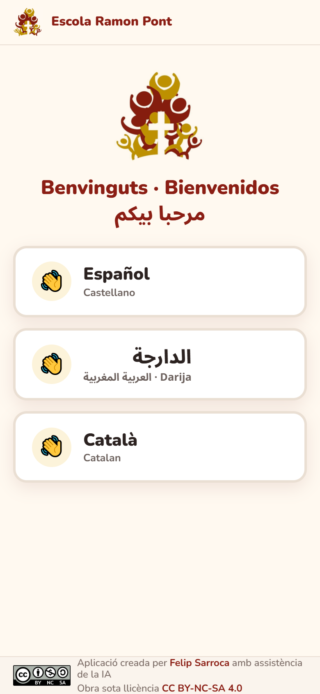
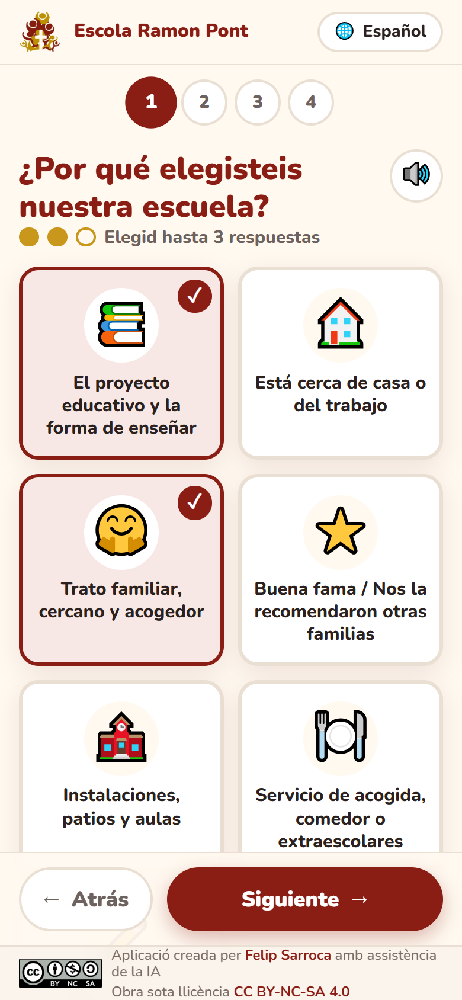
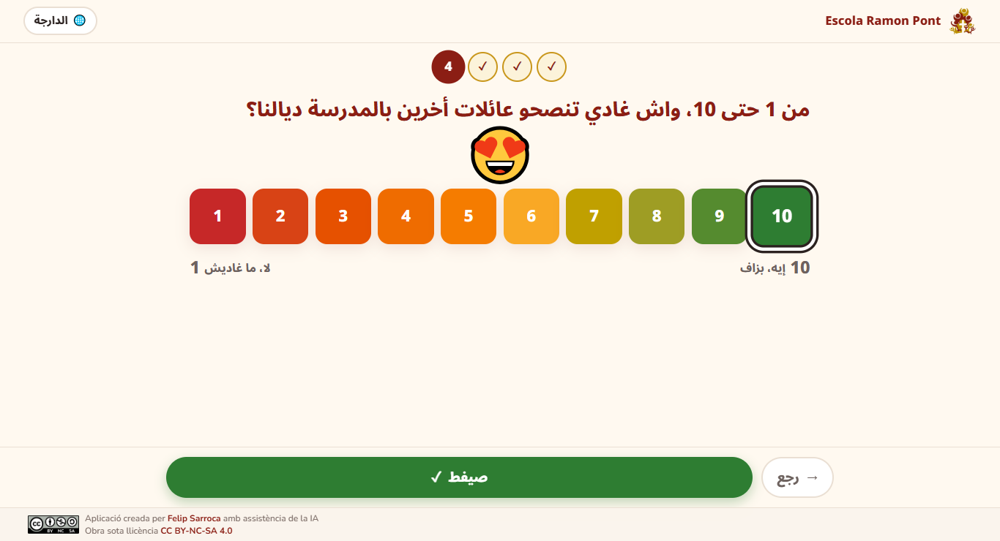

# La vostra opinió

Qüestionari web per conèixer la valoració de les famílies de l'Escola Ramon Pont. L'han pensat per a famílies amb pocs coneixements de català i poca experiència digital, i es fa servir sobretot amb el mòbil. Està en **castellà**, **darija** (de dreta a esquerra) i **català**. Les respostes es desen en un full de càlcul de Google amb un resum visual per curs escolar.

**Enllaç per a les famílies:** [ja.cat/valorans](https://ja.cat/valorans)

| Tria d'idioma (mòbil) | Pregunta 1 (mòbil) | Pregunta 4 en darija (ordinador) |
|---|---|---|
|  |  |  |

## Què demana

1. Per quins motius van triar l'escola (fins a 3 respostes, més «Una altra raó»).
2. Què és el que més valoren després dels primers mesos (diverses respostes).
3. Com recomanarien l'escola en una sola frase (opcional i en qualsevol llengua).
4. De l'1 al 10, amb quina probabilitat recomanarien l'escola.

Característiques:

- Una pregunta per pantalla, amb icones grans i botons fàcils de tocar.
- Botó 🔊 per escoltar la pregunta quan el dispositiu té veu en aquell idioma.
- És anònim. El mòbil recorda que ja s'ha respost, però permet tornar a respondre.
- La interfície s'adapta al mòbil, al portàtil (1366×740) i a les pantalles grans.

## Full de càlcul

El full és a la unitat de Drive del compte de l'escola: *Valoració de les famílies · Escola Ramon Pont*.

| Pestanya | Contingut |
|---|---|
| 📊 Resum | Desplegable del curs escolar, xifres clau (respostes, nota mitjana, % que recomanen molt i idiomes), barres per a cada opció i distribució de les notes amb colors de semàfor |
| 💬 Frases | Frases del curs triat, amb traducció automàtica al català |
| 🗂️ Respostes | Una fila per resposta (no cal tocar-la) |

El curs escolar es calcula automàticament: de setembre a juny és un mateix curs (per exemple, 2026-2027).

## Cartell per imprimir

La carpeta `cartell/` conté el cartell A4 amb el codi QR i l'enllaç en els tres idiomes:

- `Cartell QR valoració famílies.pdf`: per imprimir.
- `cartell.html`: font editable. Es converteix a PDF amb Chrome.

## Instal·lació i manteniment

Projecte de Google Apps Script gestionat amb `clasp` amb el compte de l'escola (`clasp --user ramonpont`). El fitxer `.clasp.json` és local i no es versiona.

| Fitxer | Funció |
|---|---|
| `Codi.gs` | Web (`doGet`), desament validat (`desaResposta`), curs escolar i creació del full (`configura`) |
| `Index.html` | Interfície en tres idiomes |
| `Logo.html`, `Llicencia.html` | Imatges incrustades en base64 |
| `appsscript.json` | Aplicació web anònima executada com a propietari |

1. `clasp --user ramonpont push --force`
2. Primera vegada: a l'editor d'Apps Script, executeu **`configura`**. Crea el full i en desa l'identificador. Es pot tornar a executar per refer el format sense perdre les respostes.
3. Per publicar canvis sense canviar l'URL: `clasp --user ramonpont update-deployment AKfycbzERbkL1jKSQA3ub5PvpKTkCC0Kmbe2wHWCOV-1XyQ5as3n-oBDnsMO0ARd49kX-kwqgw`

Seguretat: el servidor valida les opcions amb una llista tancada, limita la llargada dels textos, neutralitza els textos que comencen amb `=`, `+`, `-` o `@` i no permet executar `configura` des de la web pública.

---

Aplicació creada per [Felip Sarroca](https://ja.cat/felipsarroca) amb assistència de la IA · Obra sota llicència [CC BY-NC-SA 4.0](https://creativecommons.org/licenses/by-nc-sa/4.0/deed.ca)
