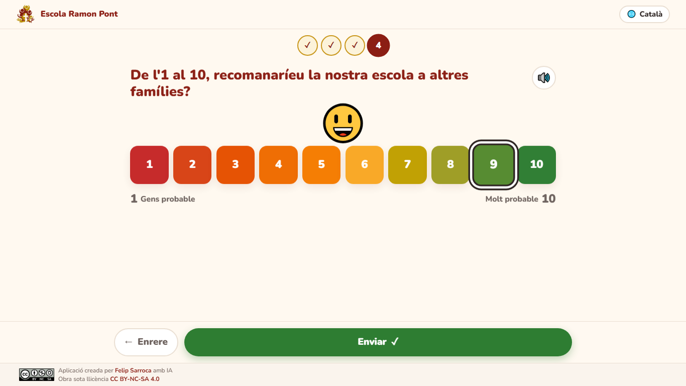
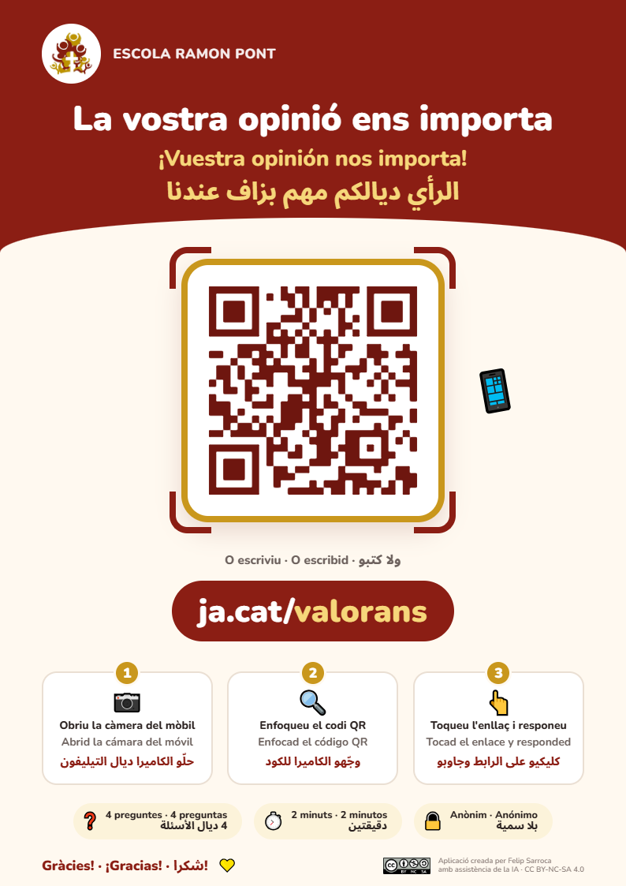
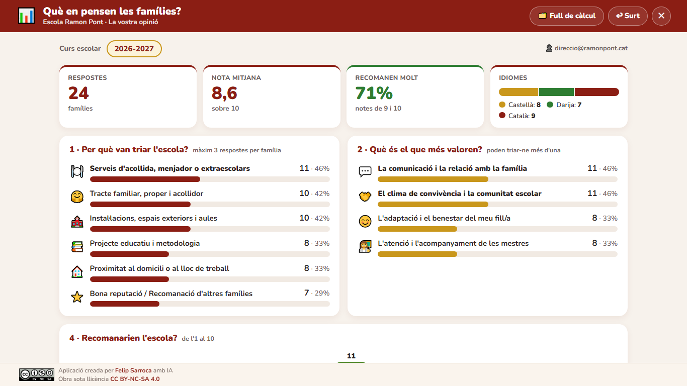

# La vostra opinió

Qüestionari web per conèixer la valoració de les famílies de l'Escola Ramon Pont. Està pensat per a famílies amb pocs coneixements de català i poca experiència digital, i es fa servir sobretot amb el mòbil. Està en **castellà**, **darija** (de dreta a esquerra) i **català**.

Les respostes es desen en un full de càlcul de Google que només pot consultar l'equip directiu.

**Enllaç per a les famílies:** [ja.cat/valorans](https://ja.cat/valorans)

| Tria d'idioma (mòbil) | Pregunta 1 en darija (mòbil) | Pregunta 4 (ordinador) |
|---|---|---|
|  |  |  |

## Cartell amb el codi QR

**[⬇️ Descarregueu el cartell en PDF (A4) per imprimir-lo](https://felipsarroca.github.io/util-apps/ValoracioEscola/cartell/Cartell%20QR%20valoraci%C3%B3%20fam%C3%ADlies.pdf)**

El codi QR porta a `https://ja.cat/valorans` i les instruccions són en els tres idiomes. A la carpeta `cartell/` hi ha:

- `Cartell QR valoració famílies.pdf`: el cartell per imprimir.
- `cartell.html`: la font editable, que es converteix a PDF amb Chrome.
- `previsualitzacio.png`: la imatge que es mostra en aquest README.

## Què demana

1. Per quins motius van triar l'escola (fins a 3 respostes, «Una altra raó» inclosa).
2. Què és el que més valoren després dels primers mesos (diverses respostes).
3. Com recomanarien l'escola en una sola frase (opcional i en qualsevol llengua).
4. De l'1 al 10, amb quina probabilitat recomanarien l'escola.

Característiques:

- Una pregunta per pantalla, amb icones grans i botons fàcils de tocar.
- Botó 🔊 per escoltar cada pantalla. En darija hi ha àudios gravats (`audio/ar-*.mp3`, veu generada amb ElevenLabs) que sonen a tots els dispositius. En castellà i català s'usa la veu del dispositiu, si en té.
- És anònim. El mòbil recorda que ja s'ha respost, però permet tornar a respondre.
- És una pàgina web estàtica: s'obre sempre, sense iniciar sessió i amb qualsevol compte.
- La interfície s'adapta a les pantalles grans, als portàtils (1366×768) i al mòbil, on és més compacta perquè hi càpiga més contingut.

## Estadístiques per a l'equip directiu

*Tauler amb dades de prova.*

A la pantalla d'inici hi ha un botó discret, **📊 Estadístiques**. En clicar-hi, cal entrar amb un compte de Google de l'escola:

- Si el compte té accés al full de càlcul (propietari, editor o lector), es mostra el tauler. Inclou les xifres clau, els motius de tria, el que més valoren, la distribució de notes, les frases (amb traducció), les altres respostes escrites i l'evolució per cursos.
- Si no hi té accés, es torna a l'app amb un avís breu i no es mostra res.

**Per donar accés a algú, només cal compartir-li el full de càlcul. Per treure-l'hi, se li treu l'accés al full.** Els accessos per grup de Google o per domini sencer no es detecten: cal compartir-lo amb cada persona.

## Full de càlcul

El full és a la unitat de Drive del compte de l'escola: *Valoració de les famílies · Escola Ramon Pont*.

| Pestanya | Contingut |
|---|---|
| 📊 Resum | Desplegable del curs escolar, xifres clau (respostes, nota mitjana, % que recomanen molt i idiomes), barres per a cada opció i distribució de les notes amb colors de semàfor |
| 💬 Frases | Frases del curs triat, amb traducció automàtica al català |
| 🗂️ Respostes | Una fila per resposta (no cal tocar-la) |

El curs escolar es calcula automàticament: de setembre a juny és un mateix curs (per exemple, 2026-2027).

La configuració regional del full és l'anglesa perquè les fórmules funcionin sempre. Les dates es mostren com a dia/mes/any i la nota mitjana, amb coma decimal. La interfície de Google Sheets continua en l'idioma de cada persona.

## Arquitectura

| Part | On és | Funció |
|---|---|---|
| App de les famílies | GitHub Pages (`util-apps/ValoracioEscola/`) | Web estàtica en tres idiomes |
| Servidor | Apps Script (`Codi.gs`), compte de l'escola | Rep les respostes (`doPost`), les desa al full i serveix les estadístiques als comptes autoritzats |
| Dades i resum | Full de càlcul de l'escola | Respostes, resum visual i frases, només per a qui hi tingui accés |

| Fitxer o carpeta | Funció |
|---|---|
| `index.html`, `estils.css`, `app.js` | Qüestionari en tres idiomes |
| `estadistiques.js` | Inici de sessió amb Google i tauler d'estadístiques |
| `config.js` | URL del servidor i identificador de client OAuth (públic) |
| `audio/` | Àudios en darija de la benvinguda i de les quatre preguntes |
| `Codi.gs`, `appsscript.json` | Servidor d'Apps Script |
| `logo.png`, `llicencia.png`, `favicon.svg` | Imatges |
| `cartell/` | Cartell amb el codi QR |
| `captures/` | Captures d'aquest README |

Si algú obre l'URL antic de l'script (per exemple, perquè el navegador recorda la destinació antiga de ja.cat), veu un botó gran que porta a l'app nova.

## Instal·lació i manteniment

Projecte d'Apps Script gestionat amb `clasp` amb el compte de l'escola (`clasp --user ramonpont`). Només es pugen `Codi.gs` i `appsscript.json` (vegeu `.claspignore`).

1. `clasp --user ramonpont push --force`
2. Primera vegada: a l'editor d'Apps Script, executeu **`configura`** (crea el full o en refà el format sense perdre les respostes) i **`autoritza`** (accepta el permís per comprovar l'inici de sessió).
3. Per publicar canvis sense canviar l'URL: `clasp --user ramonpont update-deployment AKfycbzERbkL1jKSQA3ub5PvpKTkCC0Kmbe2wHWCOV-1XyQ5as3n-oBDnsMO0ARd49kX-kwqgw`
4. L'app web es publica en fer push a `main` del repositori `util-apps`.

Si el full mostra errors, executeu **`diagnostica`** a l'editor: escriu al registre les cel·les amb error i les seves fórmules.

### Client OAuth per a les estadístiques

Es crea una sola vegada a [Google Cloud Console](https://console.cloud.google.com/) amb el compte de l'escola (projecte *Valoracio escola*). La pantalla de consentiment ha de ser de tipus **Intern**, i el client, de tipus **Aplicació web** amb l'origen `https://felipsarroca.github.io`. L'identificador es posa a `config.js` (`clientId`) i a `Codi.gs` (`CLIENT_ID`). Si és buit, el botó d'estadístiques no apareix.

### Seguretat

- El servidor valida les opcions amb una llista tancada, limita la llargada dels textos i neutralitza els textos que comencen amb `=`, `+`, `-` o `@`.
- `configura` no es pot executar des de la web.
- Les estadístiques només es retornen si Google confirma la identitat (credencial verificada, adreçada a aquest client i no caducada) i el compte té el full compartit.

---

Aplicació creada per [Felip Sarroca](https://ja.cat/felipsarroca) amb IA · Obra sota llicència [CC BY-NC-SA 4.0](https://creativecommons.org/licenses/by-nc-sa/4.0/deed.ca)
